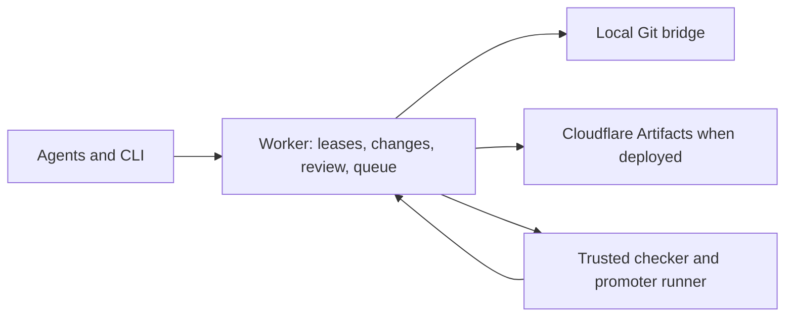

# Concord

Git conflicts on lines. Agents collide on meaning. Concord is a Git platform for agents working concurrently on one repository: an owner-defined unit policy lets them reserve semantic work, publish real commits to isolated forks, and earn a checked place in canonical history. The local demo uses a Cloudflare Worker with a fake Git bridge and an original retry-policy fixture.

## What is novel

- **Semantic leases** refuse overlapping intents before agents edit, while independent rows of one file can proceed together.
- **A checker-arbitrated speculative queue** composes candidates, checks their actual content, and bisects a failed stack to keep safe survivors moving.
- **Content-bound verdicts** can carry across a mechanical base move only after a trusted delta check; changed dependencies invalidate them.
- **A findings ledger** keeps review objections and repair dispositions tied to change revisions rather than transient comments.

The [architecture](docs/ARCHITECTURE.md) explains the Worker, Git storage, runner, trust boundaries, and limits. The [nine-minute demo](docs/DEMO.md) shows each local scene; the [judging map](docs/JUDGING.md) maps evidence to the competition criteria.



## Five-minute local start

Prerequisites: Node 22+, npm, and native Git. In a clean clone, install the pinned dependencies first. Start from the clone's directory:

Run `cd "$(pwd -P)"` because macOS `/tmp` is a symlink and Wrangler rejects `..` paths through symlinked checkouts.

<!-- verified-by: 12c -->
```sh
cd "$(pwd -P)"
npm ci
```

Use four terminals for the remaining commands. The bridge and demo share one temporary run directory. Wrangler stores its local state in `.wrangler/state/` inside the clone; `.wrangler/` is gitignored. Its directory name is derived from the absolute run path, so a fresh run directory gets separate Worker state. No Cloudflare account or paid model is needed for this local path.

Terminal 1, preflight:

<!-- verified-by: 12c -->
```sh
cd "$(pwd -P)"
export CONCORD_RUN_DIR="$(node -p 'require("node:path").resolve(process.env.TMPDIR || "/tmp")')/concord-demo-01"
npm run demo -- preflight --local --state-dir "$CONCORD_RUN_DIR"
```

Terminal 2, local Git bridge (leave running):

<!-- verified-by: 12c -->
```sh
cd "$(pwd -P)"
export CONCORD_RUN_DIR="$(node -p 'require("node:path").resolve(process.env.TMPDIR || "/tmp")')/concord-demo-01"
export CONCORD_BRIDGE_DATA_DIR="$CONCORD_RUN_DIR/bridge"
export CONCORD_BRIDGE_TOKEN=local-bridge-fixture-2026
export CONCORD_BRIDGE_PORT=8788
npm run git-bridge
```

Terminal 3, local API Worker (leave running):

<!-- verified-by: 12c -->
```sh
cd "$(pwd -P)"
export CONCORD_RUN_DIR="$(node -p 'require("node:path").resolve(process.env.TMPDIR || "/tmp")')/concord-demo-01"
export CONCORD_BRIDGE_TOKEN=local-bridge-fixture-2026
export CONCORD_WRANGLER_STATE=".wrangler/state/$(node -p 'require("node:crypto").createHash("sha256").update(process.env.CONCORD_RUN_DIR).digest("hex").slice(0,12)')"
export WRANGLER_SEND_METRICS=false
npm run dev -- --persist-to "$CONCORD_WRANGLER_STATE" --var STORAGE_BACKEND:bridge --var "BRIDGE_URL:http://127.0.0.1:8788/?token=$CONCORD_BRIDGE_TOKEN" --var "TRUSTED_CONFIG:$(cat "$CONCORD_RUN_DIR/trusted-config.json")"
```

Terminal 4, seed and the first three scenes:

<!-- verified-by: 12c -->
```sh
cd "$(pwd -P)"
export CONCORD_RUN_DIR="$(node -p 'require("node:path").resolve(process.env.TMPDIR || "/tmp")')/concord-demo-01"
export CONCORD_URL=http://127.0.0.1:8787
export CONCORD_TOKEN=local-owner
export CONCORD_SHOW_DECOMPILED_C=0
npm run demo -- seed --run demo-01 --state-dir "$CONCORD_RUN_DIR"
npm run demo -- scene context --run demo-01 --state-dir "$CONCORD_RUN_DIR" --pump-local
npm run demo -- scene leases --run demo-01 --state-dir "$CONCORD_RUN_DIR" --pump-local
npm run demo -- scene stack --run demo-01 --state-dir "$CONCORD_RUN_DIR" --pump-local
npm run demo -- inspect --run demo-01 --state-dir "$CONCORD_RUN_DIR" --json
```

`seed` creates a real Git commit through the bridge. The context scene labels owner-reported aggregates; leases shows one overlapping claim refused while distinct rows remain active; stack publishes and checks actual candidate commits. `--pump-local` runs bounded checker and promoter jobs. Stop the foreground servers when finished. The rows scene in the demo guide captures plain Git append conflict and Concord checked composition. The docs-command test executes these exact blocks and checks their state barriers.

## Status and safety

The local Worker, bridge, fixture checker, runner, scenario driver, CLI, and browser UI run without an account. Cloudflare Artifacts hosting, a public deployment, and any mirror require the owner's account, credentials, authorization, and the live evidence in the [deployment runbook](docs/deploy.md); a local bridge run is not that evidence. The AW scene uses a public mock adapter, not the private launcher. Historical improvement claims require an approved sanitized timeline and are not inferred from the supplied aggregates.

The default is `CONCORD_SHOW_DECOMPILED_C=0`. The public fixture contains no ROM bytes, proprietary compiler inputs, or decompiled C. Licensed under [MIT](LICENSE).
