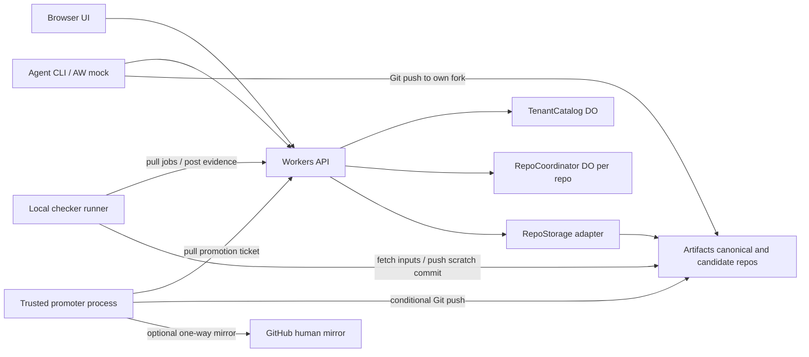

# Concord architecture

Design contract v1, checked against live Cloudflare documentation on 2026-10-11 UTC. This repository currently contains a design, not an implemented service. Commands in the other documents are acceptance contracts for the implementation slices.

**Git conflicts on lines. Agents collide on meaning.** Concord gives an agent a unit of work, exclusive semantic claims, preserved intent, content-bound review, and a checker-backed route to canonical history. Git remains the transport and immutable object format. A change, rather than a pull request, is the collaboration record.

## Product boundary

The prototype supports one owner, several repositories, a small fleet, one canonical branch per repository, candidate branches, independent reviewers, and trusted local checker runners. Artifacts hosts Git repositories; Workers serves the API and UI; Durable Objects coordinate the fleet. A demo-only AW adapter exercises the same API as the CLI. No existing project switches hosting, and no real launcher is modified.

The owner-provided motivation is evidence, not a Concord benchmark: 111/122 decomp batch PRs touched `callees.h`; 726 functions were `land_blocked`; 44 declaration conflicts were recorded; one nine-batch streak lasted over three hours without a commit. Three of nine PRs on 10-10 were approved before becoming conflicted; each required another worker and a 7–8 minute serialized check. These aggregate reports do not establish a replay baseline without underlying timelines.

Build the leases, bounded speculative queue, and usable UI first. General semantic parsing, public multi-tenancy, a full GitHub feature set, and live migration are outside the prototype. [The slice index](specs/README.md) defines cuts and integration order.

## What runs where



| Component | Responsibility | Execution / persistence |
| --- | --- | --- |
| API Worker | Authenticate, validate v1 requests, dispatch by tenant/repo, serve static UI | Cloudflare Workers; stateless |
| TenantCatalog | Reserve repo names, record provisioning status, list owned repos | SQLite Durable Object named `tenant:<tenantId>` |
| RepoCoordinator | Atomic transitions across changes, leases, queue, findings, verdicts, jobs, events | SQLite Durable Object named `repo:<tenantId>:<repoId>` |
| RepoStorage | Small provider boundary for immutable Git reads, repo/fork creation, token issuance | Artifacts binding in deployment; local fake in development |
| Agent | Claim units, edit in a local worktree, push to its candidate fork, publish a revision | Owner's machine / existing worker infrastructure |
| Reviewer | Submit content-scoped verdicts and finding evidence under a different principal | Human or separately launched reviewer; Concord does not invoke a model |
| Checker runner | Fetch exact inputs, compose a stack with native Git, run a pinned checker, post evidence | Owner's Mac/PC; disposable work directory; no canonical write credential |
| Promoter | Advance canonical branch to an authorized, already checked commit | Separate trusted local process; never executes candidate code |
| Replay tool | Validate sanitized historical events and simulate scheduling against recorded durations | Local Node process; no private-store connector in this build |

Workers hosts request handling rather than a native compiler or a long-running validation process. CPU and memory are bounded; large logs and Git pack processing stay off the request path. [Workers overview](https://developers.cloudflare.com/workers/) and [runtime limits](https://developers.cloudflare.com/workers/platform/limits/) support this placement.

## Verified Artifacts capability boundary

These are observed documentation capabilities, not claims that deployment has been tested. There is no Cloudflare account yet.

| Need | Verified surface | Concord choice |
| --- | --- | --- |
| Host versioned projects | Git-compatible versioned repositories via Workers, REST, and Git | One namespace `concord-demo`; one canonical repo and isolated candidate/scratch forks per logical repo. [Overview](https://developers.cloudflare.com/artifacts/) |
| Create and fork | Binding `create`, `get`, and repository `fork`; `get` returns a disposable handle | Release handles within each request; reconcile provisioning by stable name. [Workers binding](https://developers.cloudflare.com/artifacts/api/workers-binding/) |
| Inspect content | `info`, `log`, `readCommit`, `readTree`, `readBlob`, `readFile` | Pin object IDs; use `log({ref,limit:1})` to resolve a known registered ref. [Workers binding](https://developers.cloudflare.com/artifacts/api/workers-binding/) |
| Author commits and refs | Standard smart HTTP clone/fetch/push; push uses receive-pack v1 | Native Git on agents/runners authors branches, merge commits, and ref updates. No invented `ARTIFACTS.merge()` or ref-CAS binding method. [Git protocol](https://developers.cloudflare.com/artifacts/api/git-protocol/) |
| Credentials | Binding auth differs from REST API tokens and repo Git tokens; Git scopes are read/write | Agent write token only for its fork; canonical write credential only in promoter. [Authentication](https://developers.cloudflare.com/artifacts/guides/authentication/) |
| Token result | `createToken` yields `plaintext` and `expiresAt`; repo creation yields an initial token | Immediately revoke unused initial write tokens; mint short-lived operation tokens. [Workers binding](https://developers.cloudflare.com/artifacts/api/workers-binding/) |
| Capacity | Documented 1 GB/repo and 32 MB/blob | Keep synthetic demo below 10 MB/repo and 256 KB/file; never upload toolchains or ROMs. [Artifacts limits](https://developers.cloudflare.com/artifacts/platform/limits/) |
| Optional filesystem mount | ArtifactFS is a local FUSE-based lazy working tree | Not required; small demo uses ordinary clones. [ArtifactFS](https://developers.cloudflare.com/artifacts/guides/artifact-fs/) |

The binding reference calls for Wrangler 4.145.0 or newer for current types. Slice 01 pins an available compatible version and lockfile; it does not install floating `latest`. Remote local-development examples require account access. We make no claim that Artifacts emulation covers our full contract; the explicit fake remains the offline default. [Workers setup](https://developers.cloudflare.com/artifacts/get-started/workers/).

`RepoStorage` is a Concord interface, not a Cloudflare API:

```text
ensureRepo(storageName) -> {name, remote, status}
fork(sourceName, targetName) -> {name, remote, status}
info(storageName) -> {name, remote, status}
resolveRef(storageName, ref) -> commitOid | null
readCommit(storageName, oid) -> {oid, treeOid, parents[]} | null
readFile(storageName, oid, path) -> bytes | null
mintToken(storageName, read|write, ttlSeconds) -> {secret, expiresAt}
revokeToken(storageName, tokenIdOrSecret) -> boolean
```

Only slice 02 implements the Artifacts adapter. `ensureRepo` is a create-or-reconcile operation, not blind retry. Forks can be pending; return `202 provisioning` until ready. DO metadata and Artifacts are not one transaction: persist an operation intent, call the provider, then reconcile its result by deterministic storage name. Never report success on an unobserved external write.

Slice 01 supplies an in-process fake with explicit immutable commits for unit tests. Slice 02 adds a loopback Node Git bridge implementing this interface over local bare repositories for full local demonstrations. Its Git remotes are `file://` URLs; it uses native Git to inspect objects and create forks. A Worker-side bridge adapter uses HTTP, never `fs` or `child_process`. This is labelled **local fake**, not Artifacts. The production configuration refuses local bridge URLs. Both implementations run the same contract cases. The early live provider bootstrap gate below runs when the owner's account exists; slice 12 later repeats and expands remote smoke for deployment evidence.

## Durable Object layout and consistency

All decisions that gate a repository's landing occur in one `RepoCoordinator`. We deliberately do not split leases, findings, and queue into different DOs: that would require a distributed transaction for admission. Five logical repositories produce five independent coordinators. TenantCatalog is a discoverability index; it cannot authorize a landing.

Use SQLite-backed DOs and `transactionSync` for read/check/write transitions without external awaits. Keep SQL cursors within that synchronous scope. External calls use an outbox intent plus a version check when their result returns. [SQLite storage](https://developers.cloudflare.com/durable-objects/api/sqlite-storage-api/) documents transactional storage and the risks of cursors crossing awaits. DO routing gives a unique stateful coordinator with strongly consistent attached storage. [Durable Objects overview](https://developers.cloudflare.com/durable-objects/).

One DO alarm services the earliest lease expiry, job timeout, or reconciliation deadline. Every handler is idempotent, scans a bounded page, and schedules the next deadline. Requests also check expiry against server time; alarm delays never prolong exclusivity. Alarms can run more than once and expose only one scheduled alarm per object. [Alarms API](https://developers.cloudflare.com/durable-objects/api/alarms/).

Cap a demo repository at 32 active changes, 128 live leases, 8 queued candidates, and stack width 4. GET events polls every second using a monotonic repo sequence and a page size of 100. Backpressure returns `429` with `Retry-After`; no WebSocket or Cloudflare Queues dependency is needed for the prototype.

## Data model

Opaque IDs are server-generated except deterministic fixture aliases. Git OIDs identify commits/trees; SHA-256 identifies Concord content manifests. Never treat them as interchangeable. Timestamps are UTC milliseconds. Every mutable row has a version; every event carries the resulting version.

| Record / key | Required fields and invariants |
| --- | --- |
| Repo / `repoId` | tenant, displayName, canonicalStorageName, defaultBranch=`main`, observedCanonicalOid, policyDigest, status |
| Branch / `(storageName, ref)` | logicalRepoId, ownerId, observedHead; registered refs only; resolve provider before publish |
| Change / `changeId` | authorId, intentKey, intentText, candidateStorageName, branch, baseOid, headOid, revision, unitKeys, dependencyChangeIds, status |
| Intent / `(repoId, intentKey)` | Stable task identity independent of base SHA; repeated request returns same active change; explicit new attempt required after terminal state |
| Lease / `(unitKey)` | leaseId, holderId, changeId, intentText, fence, expiresAt; history survives release |
| Finding / `findingId` | changeId, originRevision, unitKey, evidenceDigest, text, status, repairRound, resolvedAtRevision, resolvingReviewerId |
| Verdict / `verdictId` | changeId, reviewerId, reviewManifestDigest, policyDigest, checkerDigest, findingSetVersion, approve/reject, evidence references |
| QueueEntry / `entryId` | changeId, admittedRevision, baseOid, sequence, generation, dependency IDs, state, blockedReason |
| Stack / `stackId` | canonicalBaseOid, ordered `(changeId, revision, headOid)` list, generation, composedOid, treeOid, resultId |
| Job / `jobId` | kind, repoId, inputDigest, generation, profileDigest, expected refs, state, attempt, runnerId, fence, expiresAt |
| Result / `(jobId, attempt)` | inputDigest, fence, source tree, toolchain/oracle/environment digests, outcome, score, durationMs, bounded log, resultDigest |
| Promotion / `promotionId` | expectedOldOid, checkedNewOid, queueGeneration, frozen admission snapshot, pending/applied/reconcile/failed |
| Event / `sequence` | kind, actorId, server timestamp, related IDs, redacted payload; append-only |
| Request / `(principalId, route, idempotencyKey)` | requestDigest, response/status; same key with different body returns `409` |

Changes transition `draft -> ready -> queued -> checking -> merged`, with side states `blocked`, `superseded`, and `closed`. A new head increments revision and invalidates queue jobs and any verdict whose manifest no longer matches. Only the queue can set `merged`, after canonical readback. Old revisions, findings, and intent history remain readable.

An empty repo needs one explicit bootstrap path. Owner-only `POST /repos/:r/bootstrap` accepts a registered seed fork/ref and immutable head plus trusted policy/profile IDs. It schedules `validate-stack` with `canonicalBaseOid=null` and one seed input; the checker validates that root tree. The owner authorizes initialization, and the normal promoter then receives a ticket with `expectedOldOid=null` (the branch must not exist). No unchecked direct push or public initial write token is exposed. Ref absence is checked conditionally at push and read back afterward. Bootstrap is rejected forever after canonical main exists; a concurrent initializer loses the absent-ref check. This is the only initialization exception to change/reviewer admission, and it is visible in the event history.

**Early Artifacts bootstrap gate:** as soon as the owner's account and a disposable namespace exist, the authorized operator uses the live binding/API to create an empty repo and attempts to fork it. If the empty fork succeeds, push its first seed commit to the fork's returned Git remote and read back its SHA. If empty-source fork fails, use the documented fallback: create a *separate* disposable seed repo, push its first commit to its returned remote, read back the SHA, then fork that seeded repo and verify the fork contains the seed. In either path use the seeded fork as the source for owner-only bootstrap and prove checked absent-ref promotion initializes canonical `main` once the implementation is integrated. Record API responses, remote URLs, Git OIDs, and fork status; run the provider operation gate before waiting for slice 12. If creating, first pushing, or forking a seeded repo fails, stop Artifacts-dependent integration and escalate with the observed response. The [Workers binding](https://developers.cloudflare.com/artifacts/api/workers-binding/) documents create/fork and returned remotes; the [Git protocol](https://developers.cloudflare.com/artifacts/api/git-protocol/) documents normal push. Those pages do not themselves prove this empty-repo sequence, so the live gate is required.

## Semantic leases

A semantic unit is an exact registered key: `symbol:sub_02000100`, `declaration:callee_alpha`, `row:families:alpha`, or conservative `file:src/unknown.ts`. The demo uses explicit unit metadata and a tiny TSV row extractor; there is no general C/TypeScript semantic parser. A trusted policy maps aliases to canonical keys and declares resource footprints. A file claim overlaps every row/symbol footprint in that file. Distinct rows can coexist. Declaration aliases share one resource identity.

Claim is all-or-nothing over a sorted, deduplicated set of at most 16 keys. The DO checks active overlaps in one transaction and either grants every key with increasing fencing tokens or returns `409 LEASE_CONFLICT` containing holder, intent, expiry, and conflicting keys. Unknown units return `422`; they cannot bypass the registry. TTL defaults to 120 seconds, renew every 40 seconds, maximum 300 seconds. Renew/release require holder and current fence. Expiry/reacquisition invalidates the old fence even if an old agent wakes up later.

The runner derives the actual changed-unit set from base/head, including coarse file units for unparsed content. Publishing records the claimed fences; admission requires current leases covering all writes and their verified footprint. Extra or undeclared writes block admission. Admission atomically converts the claims to queue reservations. Those reservations survive agent heartbeat loss until merge, withdrawal, or a bounded 30-minute queue timeout. No agent can release a queue reservation.

The ordinary overlap response refuses immediately; automatic wait queues are cut. Context is preserved in the refusal and lease history. Deliberate competing candidates use one owner-created contest ID: they are children of one reserved intent, not separate overlapping exclusive leases. Only the selected child enters the landing stack; the winner inherits that reservation. No generic override switch bypasses lease enforcement.

## Checker-arbitrated speculative queue

1. Admission verifies active revision, complete findings resolution, an independent valid approval, semantic coverage, and dependencies. Allocate a repo sequence. Coalesce waiting entries for up to two seconds or until four are available. Snapshot exact input OIDs, policy, and queue generation.
2. A `validate-stack` job starts at the observed canonical base and composes candidates in queue order with native Git. For the demo's shared table only, a trusted row adapter performs a three-way merge by row key: distinct row edits combine, conflicting edits to the same row stop. Unknown textual conflicts become `MERGE_CONFLICT`; never silently choose ours/theirs. Push the composed commit to a coordinator-owned scratch fork and report its OID and tree.
3. The pinned checker validates the exact composed tree. Do not infer stack success from individual greens. Verify the result's job fence, inputs, environment profile, and scratch object identity before consuming it.
4. A deterministic failure triggers bounded bisection. Check each half from the same base, preserving prerequisite closure. If one half fails independently, split it again and eventually attribute a failing singleton. Recompose and recheck the remaining independent candidates before landing anything.
5. If both halves pass but the whole fails, classify `INTERACTION`, retain the minimal observed failing set, and block that set for review. If prerequisite closure prevents isolation, report `DEPENDENCY_GROUP`, not individual blame. If the baseline itself fails, classify `BASE_RED` and pause. Maximum eight diagnostic jobs per generation; exhaustion means `INCONCLUSIVE`, never a fabricated culprit. All original results remain in the event log.
6. After a green stack, freeze its revisions, verdict/finding versions, and reservation fences into a promotion ticket. While promotion is pending, edits, new findings, and revocations on those revisions receive `409 PROMOTION_IN_PROGRESS`; retry after reconciliation. This short freeze prevents a check-to-push race. A new main tip invalidates the ticket and forces recomposition/checking.
7. A trusted promoter fetches the checked commit from scratch, verifies ancestry to expected old main, and pushes only that OID to canonical `main`, with an explicit expected-old lease. It refuses non-descendant updates even though Git's lease flag can permit force. On timeout, read canonical: new OID means success; old means safe retry; any third OID means stop/reconcile. DO and Git have no atomic cross-system commit. Never issue a new promotion until the prior ambiguous one is resolved, then read back through RepoStorage before marking merged.

Use native Git's `--force-with-lease=refs/heads/main:<expectedOldOid>` only after the ancestry check; test concurrent stale pushes during the account smoke test. The Artifacts docs establish standard Git push support, not a separate transactional binding method. No canonical credential is issued to agents. This design relies on standard receive-pack old-OID rejection and makes deployed verification a release gate.

Competition between candidates is explicit and bounded to two children per intent. Run both against the same base, checker/toolchain/oracle pins, unit, and environment profile. All hard acceptance gates must pass first. A policy may then maximize matchedBytes/totalBytes (fixed denominator) or another versioned score. Default decomp policy accepts only `MATCH`; `MISMATCH +0xNN`, `COMPILE-ERROR`, and `UNVERIFIED-TARGET` never land. Partial compiler progress requires a separately configured no-regression policy, not an implicit exception. Pass/fail policies choose the first valid green by server result sequence; exact score ties break by creation sequence. Never compare scores from different oracle pins. Losing children are `superseded` with an explanation.

Environment failure is distinct from product failure. Permit one same-input retry; discordant results become `SUSPECTED_FLAKE` and block automatic landing. Full statistical flake classification is an extra, not required for the demo.

## Local checker-runner protocol

Runners poll outbound HTTPS; no public inbound service on the Mac/PC is required. One runner handles one job at a time by default, preserving serialized project checkers. The same runner executable has separate `checker` and `promoter` roles with separate credentials and work directories. A promoter never runs a checker. The prototype executes only owner-controlled synthetic input; arbitrary untrusted repository code requires an OS/container sandbox before wider rollout.

| Request | Required request fields | Response / behavior |
| --- | --- | --- |
| `POST /v1/repos/:r/runner/poll` | runnerId, role, supportedProfileDigests, maxJobs=1 | `200 {job}` with fresh attempt/fence and 60-second claim, or `204` |
| `POST /v1/repos/:r/jobs/:j/heartbeat` | attempt, fence, inputDigest | Renew claim; every 20 seconds; stale token returns `409` |
| `POST /v1/repos/:r/jobs/:j/result` | attempt, fence, inputDigest, resultDigest, result | Idempotent same result; conflicting duplicate `409`; stale/expired result rejected |
| `POST /v1/repos/:r/jobs/:j/credentials` | attempt, fence, operation | Short-lived, role-scoped repo token only for the claimed operation; never logged |

Job kinds are `inspect-candidate`, `validate-stack`, `delta-check`, and `promote`. The first three are checker-role jobs. Inspection produces the trusted unit/manifest evidence used by leases and reviews. A job contains server-selected remotes and exact commit OIDs, ordered candidate base/head pairs, trusted unit policy, checker ID plus digest, oracle/toolchain/profile digests, timeout, and maximum output bytes. It never contains a shell command supplied by an agent.

The local allowlist maps checker ID to an executable and argv; invoke without a shell. Read credentials in the supervisor, strip them from the checker subprocess environment, disable Git hooks and repository configuration overrides in isolated work directories, and kill the child on timeout. Default job timeout is 120 seconds for the synthetic repo; a pinned compiler profile may allow 35 minutes with heartbeats. On runner death, the DO expires the claim and retries with a higher fence, maximum three attempts, then blocks for operator action. The exact same result can be safely retransmitted after a lost HTTP response.

Example result shape (metavariables below are schema values, not prerecorded performance):

```json
{
  "attempt": 1,
  "fence": 7,
  "inputDigest": "sha256:<canonical-job-input>",
  "resultDigest": "sha256:<canonical-result>",
  "result": {
    "outcome": "PASS",
    "commitOid": "<checked-git-oid>",
    "treeOid": "<checked-tree-oid>",
    "checkerDigest": "sha256:<pinned-checker>",
    "oracleDigest": "sha256:<public-golden-cases>",
    "environmentDigest": "sha256:<runner-profile>",
    "score": {"matched": 4, "total": 4},
    "durationMs": 0,
    "log": "<bounded-and-redacted>",
    "unitEvidence": []
  }
}
```

`durationMs` is measured by the runner, not set to this example's placeholder zero. Outcomes include `PASS`, `FAIL`, `MATCH`, `MISMATCH`, `COMPILE_ERROR`, `UNVERIFIED_TARGET`, `MERGE_CONFLICT`, `ENV_ERROR`, and `TIMEOUT`. Store only capped text (16 KB), summary hashes, and evidence references in the DO; local raw logs are opt-in and are not published automatically. Human-readable decomp status names can retain their original hyphenated spelling in the UI.

The same result envelope supports the owner's five definitions of done. This table describes adapters to configure later, not integrations performed by the prototype; only dispatch-lab runs publicly.

| Project | Pinned acceptance / progress policy | Runner placement and public evidence |
| --- | --- | --- |
| gen-v-decomp | Original compiler, target revision, bytes and relocation oracle; MATCH requires both bytes and relocations equal. Mismatch offset is diagnostic, not a green. | Owner machine, about 1 second/function as supplied; publish only status/counts/anonymized unit IDs, never oracle bytes or compiler. |
| mwcc-rs | Compiler/oracle pins and scoreboard version; byte equality for completed targets. Any partial-score/no-regression acceptance must be explicit policy. | Owner machine, supplied full validation 15–30 minutes; compare candidates only on identical target census and oracle. |
| agent-workflows | Pinned pass/fail validation command and environment; first valid green when alternatives have no quality score. | Owner machine; public demo uses an original AW-like fixture, not this project's private source. |
| azeron-macos | Required pass/fail gates plus explicit portability scoreboard out of 29; a larger score alone cannot waive a regression gate. | Compatible owner host; public view can show X/29 and pinned test identity. |
| mother-base | Pinned validation and golden acceptance cases; all required cases must pass. | Owner machine; no investment data or private golden inputs are uploaded. |

Pins identify private inputs by digest only. A digest is not permission to disclose the underlying data. The runner rejects a requested profile if its local toolchain/oracle digests differ and reports ENV_ERROR rather than evaluating a different target.

## Findings and content-bound review

Findings have stable IDs across revisions; line numbers are display hints. Their identity includes reviewer-issued ID, unit key, and evidence hash, not the current head SHA. A repair request captures `findingSetVersion` and every open finding. The author supplies a disposition and evidence for every one in one repair submission. Missing IDs, a concurrent new finding, or a stale revision returns `409` and leaves the entire round unresolved. The reviewer performs one delta review of the whole repair; only that independent reviewer resolves findings. No finding disappears when a file is renamed or a line moves. Unknown anchors remain open.

Review manifests are canonical sorted JSON of changed-unit before/after byte digests, file modes/paths, reviewed dependency-unit digests, checker/oracle/toolchain pins, and policy version. Whitespace is content. The owner-controlled unit policy supplies the dependency closure; a candidate cannot shrink it. When coverage is unknown, the entire relevant tree is the dependency scope and automatic carry is disabled.

An approval binds the manifest, independent reviewer identity, and finding-set version. The commit SHA remains audit metadata. A rebase or mechanical merge may change commit identity without changing that manifest. A `delta-check` independently recomputes the manifest against new main, verifies unchanged reviewed writes and dependency closure, checks no unresolved/new findings, and runs the pinned affected-unit checker. Only then mint a derived verdict with a link to the old verdict and delta evidence. A new dependency, changed bytes/modes, changed checker pin, conflict resolution, or missing evidence requires fresh review. Even a carried approval cannot replace the full composed-stack check.

For the demo, TSV rows are independent by trusted policy, with a small explicit dependency set. This permits a real carry case when another row changes and a real invalidation case when a dependent row changes. This is not a claim that equal patches imply equal semantics in arbitrary code.

## HTTP and agent interface

All routes use JSON under `/v1`. Mutations require `Idempotency-Key` and, for existing objects, `expectedVersion`. Success returns `{data, version, eventSeq}` (except `204`); errors return `{error:{code,message,details},requestId}`. Use `400` malformed, `401` missing/invalid identity, `403` wrong role/repo, `404` missing, `409` stale/conflict, `422` invalid semantic input, `429` capacity. List routes have opaque cursors and a maximum 100 results. Never return credentials from ordinary GET routes.

| API group | Minimum endpoints | Owning slice |
| --- | --- | --- |
| Discovery | `GET /health`; `GET/POST /repos`; `GET /repos/:r` | 01 shell, 02 behavior |
| Initialization | `POST /repos/:r/bootstrap` validates a seed then requests absent-ref promotion | 02 request, 04 ticket, 05 execution |
| Git access | `GET /repos/:r/branches`; `POST /repos/:r/branches` registers an existing candidate ref; `POST /repos/:r/git-token` | 02 |
| Changes | `GET/POST /repos/:r/changes`; `GET /repos/:r/changes/:c`; `POST .../:c/publish`; `POST .../:c/close` | 02 |
| Leases | `GET/POST /repos/:r/leases`; `POST /repos/:r/leases/:l/renew`; `POST .../:l/release` | 03 |
| Landing | `GET /repos/:r/queue`; `POST /repos/:r/queue/enqueue`; `POST /repos/:r/queue/withdraw`; `POST /repos/:r/contests` | 04 |
| Jobs | Poll, heartbeat, result, credentials routes above | 05 |
| Findings | `GET/POST /repos/:r/changes/:c/findings`; `POST .../:c/repairs`; `POST .../:c/repairs/:round/review` | 06 |
| Review | `GET/POST /repos/:r/changes/:c/verdicts`; `POST .../:c/carry` | 07 |
| Context | `GET /repos/:r/events?after=:seq`; `GET /repos/:r/snapshot` | 01 storage, modules contribute projections |

`POST changes` reserves intent and allocates a candidate fork (draft has no head yet). `publish` supplies candidate ref, base/head OIDs, unit keys, and lease fences; it schedules inspection. A verified inspection makes the change ready for review. Queue admission still checks leases and verdicts atomically. Git tokens are minted only for the authorized fork or runner job; only the promoter can obtain canonical write scope. Native branches are created by pushing to the fork, then registered through the API.

The minimum mutation bodies below freeze naming for parallel workers. IDs/OIDs shown as angle-bracket values are runtime inputs, not literal demo identifiers. Actors always come from authentication. The common idempotency header and expectedVersion rule apply in addition to these fields.

| Operation | Required body fields |
| --- | --- |
| Create repo | `name`, `policyId`, `profileId`; policies/profiles must be owner-installed and content-pinned |
| Create change | `intentKey`, `intentText`, `baseOid` (null only for a seed draft), `branch`, `unitKeys`, `dependencyChangeIds`, `attempt` (default 1) |
| Claim | `changeId`, `unitKeys`, `intentText`, `ttlSeconds` |
| Publish | `expectedVersion`, `baseOid`, `headOid`, `branch`, `unitKeys`, `leaseFences` as unit-to-fence map; seed publication is restricted to bootstrap |
| Enqueue | `changeId`, `expectedVersion`, `verdictId`, `leaseFences`; server reads findings version itself |
| Add finding | `expectedVersion`, `revision`, `unitKey`, `text`, `evidenceDigest` |
| Submit repair | `expectedVersion`, `revision`, `findingSetVersion`, `dispositions` array of findingId, explanation, evidenceDigest |
| Review repair | `expectedVersion`, `revision`, `findingSetVersion`, `decision` accept/reject, `evidenceDigest` |
| Add verdict | `expectedVersion`, `revision`, `reviewManifestDigest`, `findingSetVersion`, `decision` approve/reject, `evidenceDigest` |
| Carry | `expectedVersion`, `parentVerdictId`, `revision`, `newBaseOid`; server retrieves pinned manifest and dependencies |
| Create contest | `intentKey`, `intentText`, `unitKey`, `baseOid`, `profileId`; owner reserves the unit and receives parent intent plus two child change IDs |

Repo creation may allocate a seed draft fork before bootstrap, but it cannot grant canonical write access. Owner-installed policy/profile definitions are supplied by deployment configuration or a local fixture loader; candidates can reference them but cannot edit their bytes through the API. Hook contracts carry a discriminated `eligible`/`blocked` result with versions and evidence IDs, rather than a bare boolean that could lose the reason or snapshot identity.

The CLI command contract is `npm run concord -- <noun> <verb> ... --json`; the shipped binary can later be named `concord`. Required nouns: `repo`, `change`, `lease`, `queue`, `finding`, `repair`, `verdict`, `events`. `change publish --worktree PATH` reads the local HEAD/base, pushes only to the assigned fork, then publishes the immutable revision. `change checkout` materializes a fork; `repo clone` clones canonical read-only. Generic `api METHOD PATH --body-file PATH` supports advanced protocol operations without hiding state transitions. Tokens come from environment or stdin, not command arguments. JSON stdout stays machine-readable; diagnostics use stderr. Exit codes: 0 success, 2 usage, 3 conflict/stale, 4 auth, 5 network/server. Retry only idempotent calls with bounded backoff and the same key/body.

The UI shows a repo switcher, agents with lease intents/countdowns, change details, persistent findings, approval provenance, queue stack and bisection tree, runner status, and event history. Every blocked badge gives a reason and next action. Use real API projections, keyboard-accessible controls, and text alongside colors. Poll updates must preserve focus and scroll. A local/fake or replay banner is always visible when appropriate.

## Auth and trust

Prototype identity is an owner-provisioned bearer token mapping to tenant, principal, repo allowlist, roles, and expiry. Store token digests/server mappings in Worker secrets; local dev has explicitly named fixture identities. Reject fixture credentials in deployed mode. Roles are `owner`, `agent`, `reviewer`, `checker`, `promoter`, and `viewer`. A principal cannot approve its own change or resolve its own repair merely by also holding reviewer scope. All DO names are constructed from the authenticated tenant; never trust a tenant supplied in JSON.

Delegated principals are minted at run time in the tenant catalog. Their bearer tokens have 256 random bits, and only SHA-256 digests are persisted in the catalog's SQLite. The catalog enforces role and repository subsets, bounded expiry, a 100-ID repository scope bound, active and lifetime tenant caps, and descendant revocation. History is retained in SQLite and listed in bounded 25-item cursor pages. `checker` and `promoter` remain trusted `AUTH_TOKENS` identities. A token carries its tenant ID so authentication can make one tenant-catalog lookup after the secret map misses; the catalog verifies its own tenant identity before returning a principal. Mint and revoke write secret-free catalog events.

Workers secrets hold service configuration, not repository content. [Secrets documentation](https://developers.cloudflare.com/workers/configuration/secrets/) describes secret bindings; Concord's role rules are our application policy. Artifacts binding access is server-side and Git tokens are repo-scoped; neither replaces Concord authentication. [Artifacts auth](https://developers.cloudflare.com/artifacts/guides/authentication/).

The browser keeps a session token in memory, not URL/localStorage; a read-only viewer can inspect the public synthetic demo. Mutations require bearer headers and same-origin requests; no permissive credentialed CORS. Redact credentials from errors/events and cap user text. Project code, filenames, and intent are untrusted text in the UI. Public signup, OAuth, and production runner sandboxing are deferred.

## Local development and integration seams

Slice 01 freezes shared TypeScript contracts in `src/contracts.ts`, a typed `Module` interface, and prewired placeholder modules for repos, leases, queue, runners, findings, and verdicts. Each module exports route handlers, migrations, timer handling, and internal hooks. A context exposes authenticated principal, a synchronous transaction wrapper, namespaced state access, event append, RepoStorage, and typed service dispatch. Internal hooks are not public URLs.

Required hooks are `repos.inspectRevision`, `leases.reserve/releaseReservation`, `findings.gate`, `verdicts.gate/evaluateCarry`, `queue.onResult`, and `runners.schedule`. Inspection and delta job results are routed by stored job kind to their owning module. Placeholders return `501` or an explicit unavailable gate, never a permissive success. All modules are imported by the skeleton so later workers do not edit a central registry. Shared contract changes require a serialized integration task, not unilateral widening of a slice allowlist.

Use `wrangler dev --config wrangler.local.jsonc` without remote bindings and the fake/loopback bridge. Worker tests run in the Workers runtime with isolated DO storage; Node tests cover Git, runner, CLI, and replay. Current Cloudflare docs recommend `@cloudflare/vitest-plugin` and describe migration from `vitest-pool-workers`; select and pin one compatible setup in slice 01. [Vitest integration](https://developers.cloudflare.com/workers/testing/vitest-integration/). All later slices use the same `npm run test:target -- <literal test path>` dispatcher and `npm run typecheck`; the final `sh scripts/validate.sh` executes typecheck plus all implemented local tests, never a cloud deployment.

## Open risks

| Risk / decision owner | Evidence and closest alternative | Release condition |
| --- | --- | --- |
| Account and Artifacts access — owner | Docs require access; none has been provisioned. Offline fake allows development but cannot satisfy the competition's deployed Artifacts evidence. | Owner creates account and grants narrowly scoped access for slice 12; otherwise label deployment blocked. |
| Branch-scoped write protection — architecture | Documented Git tokens are repo-scoped, so candidate forks and a trusted sole canonical promoter are the chosen alternative. | Never distribute canonical write tokens to agents; test cross-repo token rejection. |
| Git conditional update semantics — slice 12 integrator | Git protocol docs support standard pushes; no explicit binding CAS API was found. Use expected-old Git push and readback, with ancestry enforcement. | Race two stale updates against a disposable deployed repo. If old-OID rejection fails, stop: closest alternative is immutable release refs plus a DO-owned canonical pointer, requiring owner approval of changed Git UX. |
| General semantic dependency accuracy — owner | Explicit metadata covers only the synthetic row domain. Unknown dependencies force fresh review/coarse file claims. | Do not advertise automatic C dependency extraction or broad semantic correctness. |
| Native execution trust — owner | Compilers and arbitrary source do not run in Workers. Trusted local runner required. | Synthetic owner-authored inputs only; production adoption needs OS isolation and credential separation. |
| Historical evidence — owner | Only supplied aggregates are available to this design run. No private databases/chats were accessed. | Export sanitized event timelines with provenance; omit before/after claims if missing. |
| Public code rights — owner | No ROM, proprietary compiler, or proprietary inputs. Whether decompiled C can appear is unresolved. | Default `CONCORD_SHOW_DECOMPILED_C=0`; a flag alone is not permission. Owner must approve any separately supplied C before use. |
| Scale and scope — integrator | One coordinator/repo is intentional; full GitHub parity is not a 12-slice project. | Preserve leases + queue + UI; apply the explicit cut list before adding features. |

No documented Artifacts limitation currently defeats this bounded design. If implementation disproves a required capability, record the failed operation and evidence here and escalate; do not silently substitute GitHub hosting and claim the Artifacts requirement is met.
