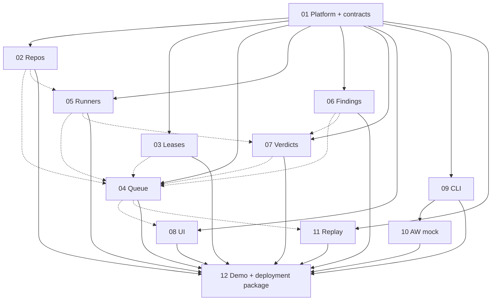

# Concord implementation slices

The twelve specs implement a small agent-native git platform, not production GitHub parity. Each has one user-observable behavior, a 45–90 minute implementation budget, literal file ownership, acceptance cases, and a commit message. Read [architecture contract v1](../ARCHITECTURE.md), [the demo](../DEMO.md), and [the judging map](../JUDGING.md) before dispatch. This documentation run implements none of the slices.

## Scope and deadline interpretation

The brief says “Tue 10-14 6 pm CT.” In 2026, October 14 is Wednesday. Use the more conservative **Tuesday, October 13, 2026 at 6:00 pm America/Chicago (23:00 UTC)** as the internal finish. Wednesday October 14 at 6 pm CT is contingency, not scheduled feature work. The supplied submission deadline is Wednesday October 14 at 11:59 pm PDT, equivalent to Thursday October 15 at 1:59 am CT (06:59 UTC). The owner should verify competition submission mechanics separately before uploading. The finalist date is October 21.

With six implementation workers plus one independent reviewer and one integrator/owner slot, the scoped build is approximately 15 worker-hours plus integration, review, repair, and filming across three days. Budgets are estimates, not a promise about agent throughput. Keep leases + queue + UI even when applying cuts. Missing Cloudflare access blocks deployed evidence, not local development; begin owner provisioning alongside 01.

## Slice index

| Slice | One behavior / acceptance result | Worker | Budget | Code dependencies | Integrated acceptance dependencies |
| --- | --- | --- | --- | --- | --- |
| [01 Platform](01-platform-skeleton.md) | Authenticated local request reaches durable state; real typecheck/test gate | Codex gpt-6-sol | 90m | None | None |
| [02 Repos and changes](02-repos-and-changes.md) | Publish an immutable candidate in an owned fork | Codex gpt-6-sol | 90m | 01 | 05 inspection hook |
| [03 Semantic leases](03-semantic-leases.md) | Atomic overlap refusal with fenced lifetime | Codex gpt-6-sol | 75m | 01 | 02, 04 |
| [04 Merge queue](04-merge-queue.md) | Checked stack becomes canonical, with bounded isolation | Codex gpt-6-sol | 90m | 01 | 02, 03, 05, 06, 07 |
| [05 Checker runners](05-checker-runners.md) | Fenced local job returns exact-input evidence | Codex gpt-6-sol | 90m | 01 | 02, 04, 07 |
| [06 Findings ledger](06-findings-ledger.md) | One reviewed repair clears the entire findings round | Codex gpt-6-luna | 60m | 01 | 02, 07 |
| [07 Verdict carry](07-verdict-carry.md) | Carry only an unchanged, delta-checked review scope | Codex gpt-6-sol | 75m | 01 | 02, 05, 06 |
| [08 Web UI](08-web-ui.md) | Show fleet state, blockers, and next actions | Codex gpt-6-luna or Muse | 90m | 01 | 02–07 |
| [09 Agent CLI](09-agent-cli.md) | Drive the lifecycle with stable machine-readable output | Codex gpt-6-luna | 75m | 01 | 02–07 |
| [10 AW mock](10-aw-mock-adapter.md) | One launcher task maps to one change across retries | Codex gpt-6-luna or Muse | 45m | 01, 09 | 02–07 |
| [11 Replay](11-replay-harness.md) | Produce only provenance-supported comparisons | Codex gpt-6-luna | 60m | 01 | 04 when reusing pure planning logic; owner export for real baseline |
| [12 Demo/deploy](12-demo-and-deploy.md) | Reproduce the submission through one scenario driver | Codex gpt-6-sol | 90m | 01–11 | Owner account for cloud; owner remote/grant for mirror |

Worker names are caller-requested placement preferences. They are not claims about model availability or authority to spend. Use only a launcher-authorized worker/profile; if unavailable, report it rather than silently switching models or providers. Muse is optional for the two bounded presentation/adapter tasks, not for policy, review, or acceptance.

## Dependency graph and parallel dispatch

Solid arrows below mean code must land before the dependent worker starts. Dashed edges mean final integration needs the real behavior, but unit work proceeds against 01's frozen typed hooks. Cycles in the dashed subgraph are service interactions, not an impossible launch order.

At most six implementation runs execute together. First run 01 alone and accept its contracts/gate. Then launch 02/03/04/05/06/11 together. Launch 07/08/09 when those slots free; 07 may use the finished findings helper while its runner seam is tested independently. Launch 10 after 09. Launch 12 only on the integrated, independently reviewed local candidate. “Unit tests pass against fakes” is not the same as integrated acceptance.

## File ownership and integration rules

Each slice's Allowed files is authoritative and literal: no globs, whole-directory grants, or implicit permission to change package/config files. The future implementation allowlists do not expand this documentation run's permissions. Feature workers may read any public contract/dependency but only write their own listed paths. Shared-file exceptions are deliberately ordered:

| Shared path(s) | Writers / order | Reason |
| --- | --- | --- |
| `src/features/repos.ts`, `src/storage/artifacts.ts`, `src/storage/bridge.ts` | 01 placeholders, then 02 | Provider/repo behavior replaces a prewired shell |
| `src/features/leases.ts` | 01, then 03 | Lease module replaces unavailable shell |
| `src/features/queue.ts` | 01, then 04 | Queue module replaces unavailable shell |
| `src/features/runners.ts` | 01, then 05 | Runner module replaces unavailable shell |
| `src/features/findings.ts` | 01, then 06 | Ledger module replaces unavailable shell |
| `src/features/verdicts.ts` | 01, then 07 | Verdict module replaces unavailable shell |
| `web/index.html`, `web/app.js`, `web/styles.css` | 01 placeholders, then 08 | Existing assets binding needs a local initial directory |
| `wrangler.jsonc` | 01, then 12 | Final deployment configuration after local integration |
| `docs/DEMO.md`, `README.md` | This design run, then 12 | Reconcile proposed commands with implemented behavior |

Everything else in the twelve implementation allowlists is single-owner. Only 01 owns package.json, package-lock.json, test config, shared types, main worker/DO shell, and scripts/validate.sh. Predeclare runtime commands, dependencies, import registration, all tests/node and tests/workers globs, and feature migrations there. Later modules must not modify those shared files merely to register themselves.

Contract freeze includes errors, role identities, revision/idempotency semantics, promotion freeze, module migrations/timers/projections, RepoStorage, job/result kinds, and these internal hooks: repos.inspectRevision; leases.reserve/releaseReservation; findings.gate; verdicts.gate/evaluateCarry; queue.onResult; runners.schedule. Placeholders fail closed. Reusable pure helpers cannot import cloudflare:workers into the CLI/runner. Slice 05 and 07 share manifest semantics through the frozen contract and compare canonical-digest golden fixtures in their own tests; if they need to share implementation, 05 may read 07's pure helper after integration without editing it.

If an interface repair requires a file outside a slice's allowlist, stop that worker and give the integrator the exact proposed change. The owner/launcher must issue a separate bounded repair spec with literal files; this index does not grant ad hoc shared edits. Serialize those repairs before dependent launch or acceptance. An implementing worker never accepts its own slice. Independent review examines exact candidate changes; owner/integrator handles integration and final acceptance.

## Hour-by-hour plan (America/Chicago)

All times are in CDT (UTC−05:00). Work starts Sunday October 11; no overnight owner availability is assumed. Each implementation run gets its listed 45–90 minute budget; follow-up repairs use explicit bounded scopes, not indefinite extensions. Reviewer and integrator work beside the six worker slots.

| Date / hour | Six-worker lane / integrator | Owner/reviewer evidence or gate |
| --- | --- | --- |
| Sun 10-11 09:00–10:00 | Start 01; freeze data/API/job contracts | Owner begins account/Artifacts access request and identifies optional human mirror repo |
| Sun 10-11 10:00–11:00 | Finish 01 by 10:30; launch 02/03/04/05/06/11 | Independently check offline startup, fail-closed seams, real gate; do not dispatch if contracts fail |
| Sun 10-11 11:00–12:00 | Six parallel slices continue; 06/11 finish first | Reviewer checks lease atomicity and protocol/security boundaries as candidates arrive |
| Sun 10-11 12:00–13:00 | Launch 07/08/09; integrate first wave through frozen hooks | Exercise fake-backed admission and real local Git bridge; register concrete repairs |
| Sun 10-11 13:00–14:00 | Finish 07/08/09 by 13:30; launch 10 | Review manifest equality vs dependency change; UI/CLI walkthrough against actual API |
| Sun 10-11 14:00–15:00 | Finish 10 by 14:15; start 12 on accepted local integration | Check seven-retry dedupe and provenance rejection; no real history required yet |
| Sun 10-11 15:00–16:00 | Finish 12 local packaging by 15:45 | Run full local gate plus fixture through actual processes; confirm no fabricated results |
| Sun 10-11 16:00–17:00 | Bounded seam repairs in owning files | Fresh review of repaired candidate; account/provisioning checkpoint |
| Sun 10-11 17:00–18:00 | First complete local rehearsal, record failure list | Must demonstrate lease refusal, checker queue, UI; cut extras if any core behavior is still missing |
| Mon 10-12 09:00–10:00 | Apply highest-priority local repairs | Owner supplies cloud grant if ready; reviewer verifies no out-of-scope migration |
| Mon 10-12 10:00–11:00 | Authorized operator runs Artifacts disposable smoke; otherwise continue local resilience checks | Verify actual token scopes, push/read, expected-old stale rejection; failed essential capability escalates immediately |
| Mon 10-12 11:00–12:00 | Deploy accepted candidate if authorized; otherwise freeze local package | Noon account cutoff: missing access is a submission risk, not a fake-backend substitution |
| Mon 10-12 12:00–13:00 | Real-API UI/CLI rehearsal; finite restart/retry cases | Confirm no self-approval, stale carry, or unresolved-finding landing |
| Mon 10-12 13:00–14:00 | Owner exports sanitized timeline if available; run replay validator | Missing provenance yields unavailable panel; do not reconstruct events from aggregates |
| Mon 10-12 14:00–15:00 | Optional mirror dry run and authorized execution | Verify one-way source SHA equality and divergence refusal; cut mirror if grant is absent |
| Mon 10-12 15:00–16:00 | Full nine-minute local/cloud rehearsal with exact commands | First timing pass; reduce narration/extras if over ten minutes |
| Mon 10-12 16:00–17:00 | Repair only demonstrated failures; rerun affected checks | Independent review of repair diff and final full local gate |
| Mon 10-12 17:00–18:00 | Feature freeze; capture backup run and redacted manifest | Preserve evidence with immutable candidate SHA; list known limitations |
| Tue 10-13 09:00–10:00 | Reconfirm frozen deployment and clean-clone instructions | Final timeline decision: approved export or explicit unavailable panel |
| Tue 10-13 10:00–11:00 | Capture scenes 0–4, including real failures and survivor landing | Keep backend mode, job input hashes, and canonical SHA visible |
| Tue 10-13 11:00–12:00 | Capture scenes 5–9 and deployed Artifacts proof | No account: cloud/submission gate remains visibly blocked for owner decision |
| Tue 10-13 12:00–13:00 | Assemble nine-minute video; trim pauses | Rights/redaction check; default decomp-only numbers and anonymized names |
| Tue 10-13 13:00–14:00 | Validate clean clone in a fresh directory; final commands/doc links | Run scripts/validate.sh on exact candidate; verify MIT LICENSE and runbook |
| Tue 10-13 14:00–15:00 | Independent end-to-end reviewer follows runbook | Record actual results and risks; no unsupported performance claims |
| Tue 10-13 15:00–16:00 | Reserved bounded repair/re-record slot | Re-review changed candidate; no new features |
| Tue 10-13 16:00–17:00 | Owner prepares video/repo/run-instruction submission bundle | Match video evidence, deployment, and reviewed commit; confirm actual contest form |
| Tue 10-13 17:00–18:00 | Finish and hand off; owner publishes/submits when authorized | Internal deadline 18:00 CT; preserve Wednesday as contingency |

## Cut list

These are already scoped cuts, not hidden acceptance exceptions. If the build slips, apply the optional cuts in order and state them in the UI/video. Do not weaken safety invariants to preserve a feature count.

| Order / status | Cut | Keep |
| --- | --- | --- |
| Already cut | Full GitHub parity: issues/projects/search/notifications, public signup, OAuth, organizations, multiple protected canonical branches | Repo/branch Git hosting, changes, independent review, merge, basic web UI, CLI |
| Already cut | General C/TypeScript semantic extraction and arbitrary shared-header rewriting | Explicit registered units, declaration identities, coarse file fallback, one trusted TSV row merger |
| Already cut | Automatic lease waiting/priorities and large speculative search | Immediate informative refusal, fencing, width-4 stack, diagnostic budget, safe interaction block |
| Already cut | Statistical flake model, flaky-test auto-waivers, production runner sandbox orchestration | Distinct environment failures, one diagnostic retry, disagreement blocks landing |
| Already cut | Production AW migration and live private-project source | Public fixture shim with stable intent dedupe; no modification of launcher |
| Optional cut 1 | Historical before/after segment if export/provenance is late | Harness validates input; unavailable-data output; owner-reported context correctly labelled |
| Optional cut 2 | GitHub mirror execution if credentials/destination are late | Dry-run tool and runbook; Artifacts remains authoritative |
| Optional cut 3 | Contest in the filmed narrative if time is tight | Queue hard acceptance and first-green policy; score arbitration still covered by local tests |
| Optional cut 4 | Extra animation/polish, WebSockets, graphs beyond simple HTML/SVG | Accessible UI, blocker reasons, lease/queue/findings/verdict evidence |
| Mandatory escalation | Cloud account or essential Artifacts Git capability still unavailable | Local build and recordings remain useful; owner must resolve platform/submission gate. Never claim fake storage meets it. |

The immutable core is semantic overlap refusal, real checker-backed speculative queue with safe failure handling, and a usable UI. Findings and conservative carry stay small, with unknown cases requiring review. If even this core cannot be delivered with the scheduled repair reserves, stop feature work and report a reduced demo proposal to the owner rather than improvising weaker correctness.

## Validation and handoff

The current documentation gate is `sh scripts/validate.sh`; it only checks the design-phase repository and cannot prove an implementation. Slice 01 replaces it with typecheck plus tests, and every later slice lists that real gate alongside its targeted test command. Targeted tests are run during work; run the full configured gate once on the final candidate. No cloud credential is required for that gate. Slice 12's live provider smoke is a separate deployment prerequisite, never a silently skipped green test.

Each worker leaves a report with changed files, concrete acceptance evidence, actual command output, separate-review availability, and unimplemented/deferred paths. The launcher creates/publishes candidates under its own rules. The integrator reviews exact candidates and the owner merges. A green worker report alone does not establish acceptance or competition readiness.
