# Issue claim designs: offline duplicate and hoarding simulation

## Summary

This deterministic simulation compares how issue assignment, issue work leases, and code-unit leases affect repeated work and waiting. A **code-unit lease** temporarily reserves a declared file-like unit for writing. An **issue work lease** gives one run the fenced right to pursue an issue. A change linked to an issue is only a relationship unless a policy makes the link acquire that right. The simulation suggests that B's atomic issue-plus-code start is the clearest way to prevent duplicate starts and partial claims: it grants the issue and every requested unit together, or grants nothing. C1, C2, and D also block duplicate issue starts, but C2 can leave an issue pending while code is unavailable. The baseline and assignment/presence controls expose the duplicate-work trade-off. These are synthetic outcomes from a fixed event model, not estimates of real agent performance.

The candidate designs are: **A**, owner-managed assignment without an issue lease; **B**, atomic issue and all declared-unit acquisition; **C1**, issue lease first, then unit acquisition with immediate issue rollback on a busy unit; **C2**, the same sequence with a five-minute pending reservation; **D**, a linked change becomes the issue holder in the same transaction as its code-unit claims; and **E**, advisory presence without issue exclusion. The baseline models v2-style issue links, exclusive unit claims, and no issue work lease. Assignment is a planning signal; presence is a short-lived advisory record; neither authorizes code writes.

## What was simulated

Each cell uses one of 20 fixed seeds. The full factorial varies 2, 5, or 10 worker slots; uniform Poisson arrivals over an eight-hour synthetic day or a five-worker burst over the first minute followed by lower background arrivals; declared scopes of 1, 3, or 8 units; hidden needs of 0%, 10%, or 25%; and fixed service durations of 15, 45, or 120 minutes. Run/session identities are distinct by default, and a shared-token identity sensitivity is recorded separately. Presence is toggled on and off independently of each lease arm. A and E each have naive and cooperative variants. Cooperative behavior is a capability sensitivity: an agent that sees an existing presence yields quickly. It does not establish that current agents will do this.

The simulation's event clock is deterministic and seeded. The backlog has 80 open issues. Agents take the oldest unfinished issue, with stable ordering. The two arrival generators use the worker-slot count to set a low background rate; a burst is capped by the number of available slots. Declared units overlap according to a repeatable issue/unit pattern. In the no-issue-lease arms, concurrent attempts may claim disjoint halves of a multi-unit scope, representing two workers making progress on different files for the same task. A published writer stops blocking new writers at the midpoint of service, matching the baseline's first-publish transition. Hidden need is distributed deterministically across the backlog to match each requested fraction in aggregate; it is discovered at the midpoint, and the model attempts the complete added scope together and records any wait for busy units.

The issue lease and unit lease use separate fences in the fault model. For candidate arms, issue ownership blocks another run until release or expiry. The C1 busy-unit path rolls back immediately; C2 holds pending issue ownership for a bounded five minutes; B is all-or-nothing; D creates the issue association only with the complete code grant. B, C1, and D share the same successful acquisition path in this event model; their change-creation and audit-event overhead is not modeled. E presence has no exclusion effect. The shared-token collision metric counts foreign runs blocked by a holder when sessions share one principal token; it exposes a principal-only identity ambiguity without weakening code-unit checks. The simulation records arrival-to-start, start-to-first accepted completion, issue and code wait, duplicate starts and duplicate useful-work minutes, incomplete issue time, issue-lease hoarding, expiry/reassignment, busy failures, rollback, hidden-scope delay, starvation, failure and abandonment. Empty wait samples are zero.

The five-minute TTL and one-third-TTL heartbeat are provisional assumptions copied from the source plan for comparison. Service duration is a workload parameter, not a measured agent duration. Lease-expiry faults and no-progress conditions are represented by a deterministic seeded expiry event; this is a sensitivity, not a calibrated probability. The source report leaves the issue TTL and pending-state value open, so these values should not be read as a recommendation.

## Results

`output.txt` gives the compact run summary and `results.csv` holds one row per arm, workload/identity/presence cell, and seed. Across-seed intervals are normal 95% intervals around the seed-level mean after averaging the same full-factorial workload mix within each seed. They describe seed variability under this generator, not population confidence intervals. Results should be read together with raw counts and the modeling limitations below.

| Design | Duplicate work | Idle issues and code waits | Hoarding and recovery |
| --- | --- | --- | --- |
| Baseline | Leaves duplicate starts possible; overlapping units still wait for exclusive writing claims. | No issue lease can strand an issue merely because its units are busy. | Code fences remain the safety boundary; expiry or retry can waste prior work. |
| A: assignment | Assignment alone does not block an unassigned run. Cooperative yielding may reduce wasted minutes if the signal is seen and followed. | A busy code unit can block a start while assignment remains visible. | No issue lease exists to hoard; stale assignment requires a person to clear it. |
| B: atomic | Blocks a second issue start after a complete grant. | Busy code means no issue or units are retained, so contention delays the attempt without partial ownership. | Strongest modeled rollback invariant; expiry makes the old fence stale and permits recovery. |
| C1: immediate rollback | Blocks starts while held. | A busy unit releases the issue immediately; similar idle behavior to atomic acquisition. | No partial unit set; rollback is explicit. |
| C2: bounded pending | Blocks starts while pending or active. | Pending ownership can delay other workers even when no usable code scope was acquired. | Bounded rather than indefinite hoarding; timeout allows recovery. |
| D: linked change | A live linked attempt blocks another run. | Atomic code acquisition avoids a link falsely acting as a grant on a busy unit. | Lease expiry, rather than abandoned draft existence, controls recovery. |
| E: presence | Naive behavior permits duplicates; cooperative yielding is conditional on agent response. | Presence itself does not block code; exclusive unit claims still can. | Advisory presence expires without a write fence or authority. |

The seed-averaged numerical table is generated in `output.txt`; that is the appropriate source for the estimates and intervals. The strongest design-level distinction is mechanical: B/C1/C2/D prevent duplicate issue starts while their issue fence is valid; the baseline, A and E do not. A's assignment and E's presence can affect behavior only through agent response. A cooperative reduction in duplicated minutes is therefore CAPABILITY-DEPENDENT and needs an approved live pilot before being used to choose policy.

The table below reports per-cell averages across the complete factorial, with normal 95% intervals across the 20 seed-level averages. Counts and minutes are fractional because each seed average combines 648 separate cells. The interval captures variation among these fixed-seed runs only.

| Arm | Duplicate starts | Duplicate useful minutes | Completed tasks | Idle issue-minutes | p95 issue wait | p95 code wait | Hoarded lease-minutes | Hidden grow delay | Shared-token collision attempts |
| --- | ---: | ---: | ---: | ---: | ---: | ---: | ---: | ---: | ---: |
| Baseline | 37.54 [37.34, 37.73] | 1236.87 [1231.83, 1241.91] | 31.07 [30.96, 31.18] | 30605.12 [30559.86, 30650.38] | 0.00 [0.00, 0.00] | 23.71 [23.32, 24.09] | 0.00 [0.00, 0.00] | 1.45 [1.39, 1.50] | 0.00 [0.00, 0.00] |
| A naive | 37.54 [37.34, 37.73] | 1236.87 [1231.83, 1241.91] | 31.07 [30.96, 31.18] | 30605.12 [30559.86, 30650.38] | 0.00 [0.00, 0.00] | 23.71 [23.32, 24.09] | 0.00 [0.00, 0.00] | 1.45 [1.39, 1.50] | 0.00 [0.00, 0.00] |
| A cooperative | 571.80 [569.18, 574.43] | 571.80 [569.18, 574.43] | 36.82 [36.74, 36.91] | 28636.87 [28600.67, 28673.08] | 0.00 [0.00, 0.00] | 20.14 [19.84, 20.44] | 0.00 [0.00, 0.00] | 0.15 [0.14, 0.15] | 0.00 [0.00, 0.00] |
| B | 1.62 [1.54, 1.70] | 60.45 [56.29, 64.61] | 42.60 [42.46, 42.75] | 26971.81 [26918.02, 27025.60] | 38.68 [38.45, 38.90] | 29.12 [28.95, 29.28] | 908.05 [906.07, 910.03] | 0.01 [0.01, 0.01] | 351.43 [349.79, 353.07] |
| C1 | 1.62 [1.54, 1.70] | 60.45 [56.29, 64.61] | 42.60 [42.46, 42.75] | 26971.81 [26918.02, 27025.60] | 38.68 [38.45, 38.90] | 29.12 [28.95, 29.28] | 908.05 [906.07, 910.03] | 0.01 [0.01, 0.01] | 351.43 [349.79, 353.07] |
| C2 | 1.72 [1.63, 1.80] | 63.37 [58.60, 68.14] | 41.93 [41.80, 42.06] | 27468.83 [27419.18, 27518.47] | 38.61 [38.39, 38.84] | 29.01 [28.83, 29.19] | 8243.02 [8209.36, 8276.67] | 0.01 [0.01, 0.01] | 2713.21 [2697.69, 2728.74] |
| D | 1.62 [1.54, 1.70] | 60.45 [56.29, 64.61] | 42.60 [42.46, 42.75] | 26971.81 [26918.02, 27025.60] | 38.68 [38.45, 38.90] | 29.12 [28.95, 29.28] | 908.05 [906.07, 910.03] | 0.01 [0.01, 0.01] | 351.43 [349.79, 353.07] |
| E naive | 37.54 [37.34, 37.73] | 1236.87 [1231.83, 1241.91] | 31.07 [30.96, 31.18] | 30605.12 [30559.86, 30650.38] | 0.00 [0.00, 0.00] | 23.71 [23.32, 24.09] | 0.00 [0.00, 0.00] | 1.45 [1.39, 1.50] | 0.00 [0.00, 0.00] |
| E cooperative | 304.67 [303.31, 306.03] | 904.34 [901.21, 907.47] | 33.95 [33.86, 34.04] | 29621.00 [29581.95, 29660.05] | 0.00 [0.00, 0.00] | 21.92 [21.63, 22.22] | 0.00 [0.00, 0.00] | 0.80 [0.77, 0.83] | 0.00 [0.00, 0.00] |

The cooperative controls illustrate why starts and useful-work time are separate outcomes. These agents can start many attempts, observe the modeled holder, and yield after one minute; the start count rises while duplicated useful minutes fall. They do not acquire issue authority. By contrast, B/C1/D have very low duplicate starts through protocol exclusion, at the cost of issue and code waits. C2's repeated bounded pending reservations produce substantially more no-progress and hoarded time in this workload. The shared-token collision count is an identity diagnostic: it counts blocked foreign sessions that would be indistinguishable if the principal token alone represented the holder. Unit fences remain exclusive in all variants.

## Lifecycle for the leading candidate

The leading candidate for follow-up is B because it matches the source report's recommended atomic start and has an easy-to-state safety invariant. This is a research result, not an owner decision or authorization to implement.

```mermaid
stateDiagram-v2
  [*] --> Open
  Open --> AtomicStart: request issue + declared units
  AtomicStart --> Open: busy unit / grant nothing
  AtomicStart --> Active: grant issue fence + all unit fences
  Active --> Active: renew current fences; preserve fence values
  Active --> Active: all-or-nothing scope grow
  Active --> Stale: expiry, close, or audited override
  Active --> Published: verify actual diff against unit fences
  Published --> Landed: inspected revision + valid authorization
  Published --> Active: repair/rebase; reacquire and verify
  Stale --> Open: release or expiry permits fresh claim
  Landed --> [*]
```

Issue ownership identifies the current task attempt. Unit fences authorize writes, independently. Renewal preserves the current holder's fence; expiry or an owner override invalidates it. Close revokes, and reopen returns to an unclaimed issue. Scope growth adds every requested unit or none, while the old grant remains usable if growth fails. Publication verifies the actual changed units against current unit fences. The diagram intentionally does not treat assignment or presence as write authorization.

## Fault assertions

The deterministic fault test exercises single valid issue ownership; stale-holder rejection; atomic zero-partial-unit grants; separate issue and code fence namespaces; fresh ownership after reopen; idempotent retry; audited override; crash before and after start; partition and stale resume; replacement under stable intent; scope edit; hidden-unit growth conflict; close/reopen race; paused-holder override; duplicate renewers; renewal without progress; work beyond TTL; and a run attempting to claim multiple backlog issues. These checks validate the small protocol model used as a safety companion to the event simulation. They do not prove a production implementation correct.

## Limits and next evidence

All arrival rates, workload sizes, overlaps, hidden-need rates, lease timing, and service durations are scenario assumptions. The fixed unit pattern does not reproduce repository-specific conflict topology. The event model does not reconstruct actual Concord runs, first-edit times, renewals, work discovery, queues, inspection, or accepted-landing latency. Its service completion is not the end-to-end useful-completion endpoint from the source plan. Numerical intervals represent only seed variation. They are not evidence about a general worker population and do not repair missing historical counterfactuals.

In particular, agent cooperation is CAPABILITY-DEPENDENT. A simulation can encode “notice presence and yield,” but cannot determine whether a current agent notices, trusts, or acts on that signal. That behavior requires an owner-approved live pilot with frozen tasks, measured signal exposure, failures retained, and owner-approved cost and safety thresholds. No live service, model, agent, or production data was used here. The result is a deterministic offline comparison to support the next owner decision, not a policy selection, product change, or live-test approval.
