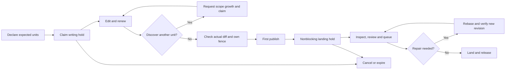
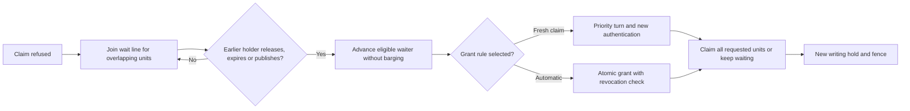

# Claims and leases: a reader’s edition for Seb

## Summary

Agents need a way to show where they are working without forcing unrelated work to wait. The research finds that exclusive claims protect edits but can create needless delays, while visible, non-locking claims might help agents coordinate but have not been tested with current agents. It proposes checking the old lease record, testing how well small code units and issue predictions work, then running a controlled trial with current agents. Seb needs to choose which tests to authorize and what improvement would justify changing the existing exclusive policy.

## Glossary

**Claim.** An agent records that it is working on a named piece of work. This may grant exclusive permission or only visibility.

**Lease.** A claim that lasts for a bounded time and has a holder. Concord can renew, release or expire it.

**Presence lease.** A visible, expiring “I am working here” signal. Other agents can hold one for the same place, so it gives no permission to exclude them.

**Exclusive lease.** One holder gets the right to publish changes to a protected place while the writing hold applies. A competing claim is refused, and Concord must check the holder’s authority at publication and landing.

**Unit.** The piece covered by a lease: perhaps a file, table row or function. Smaller units require reliable boundaries.

**Symbol.** A named code item such as a function, method or class. A symbol lease aims to protect that item instead of its whole file.

**Git funcname.** A Git rule that puts a nearby function name in a diff heading. It is a cheap hint about code location, not automatically a trustworthy lease boundary.

**Tree-sitter.** A parser that can identify code structure using language grammars and queries. It can suggest symbol boundaries, but parse failures and ambiguous edits still need a broader unit.

**LSP/SCIP.** Language Server Protocol reports code positions and hierarchy; SCIP indexes qualified code identities. Neither grants leases, and indexes can be stale.

**Footprint.** The units a change actually touches, derived from its diff. A declared footprint is a prediction; the final footprint must be checked against the change being published.

**Declare-grow-verify.** Claim predicted units at start, add discoveries during work, then check claims against the actual diff before publication.

**Wait line.** An ordered list of agents whose claims were refused. A fair line prevents a new request from cutting ahead of an older request for an overlapping unit.

**Landing.** Concord checks and adds an accepted change to the main code line. A change can be published for review before it lands.

**“Queued for landing.”** The change has passed into landing coordination, with its expected footprint and predecessor visible. The signal can help another agent plan a wait or a later rebase; it is not a fresh editing lock.

**Fence.** A value attached to a lease that lets Concord reject a former holder after ownership changes. Routine renewal should keep the same fence.

**Expiry/renewal.** Expiry ends a lease at its deadline; renewal extends that deadline while the same holder is still authorized. A disconnected agent and an abandoned renewal process need different recovery rules.

## The problem: two agents and one login function

Imagine two agents assigned different requests. Both discover they must edit the same login function in one file. With no claims, both can work immediately. They may make compatible edits, but they may also change the same lines or make changes that look textually compatible yet behave badly together. Git and the landing checks then have to merge or reject the result. The agents may need to repair work after the fact.

With a whole-file exclusive lease, the first agent claims the file before editing. The second waits even if it would have touched a different function. A verified symbol lease could let different functions proceed; here, both still contend for the login function. Concord ends the blocking writing hold at first publish. The second agent can then claim while the first change is reviewed. Landing orders overlapping changes, so the second may still need repair.

With presence leases, both agents see that the other is editing the login function. They might message, split the requests, or wait for the first change to be queued for landing. They can also ignore the signal and collide. Nothing in a presence lease prevents either publish. Whether agents actually use the signal well is a question for a current-agent trial, not a result established by old task-lock anecdotes.

Regardless of agent skill, visibility alone cannot enforce exclusive publication, and a broad lock blocks work inside its boundary. How well current agents coordinate and repair remains unmeasured in sources read by October 15, 2026.

## What others do

| System | What it locks | How | What happened in the supplied evidence |
|---|---|---|---|
| Database locking and optimistic transactions | Records or larger groups | Shared and exclusive locks, or validation at commit | Smaller locks allow more concurrency but require more bookkeeping; waiting trades against retries. Database timings do not transfer directly to long agent edits. |
| Gray–Cheriton leases and Chubby | Named cached data or named service nodes | Expiring rights; Chubby uses advisory locks and downstream fences | Expiry bounds failed-holder wait. Chubby’s advisory lock cannot stop an external write unless the recipient checks its fence. |
| Git LFS, Perforce and Unity Version Control | Files, selected assets or folders | Configured exclusive locks and server checks at push or submit | Useful for difficult-to-merge assets. Broad file or folder rules also block independent edits. Git LFS can make configured files read-only locally until locked. |
| Unreal’s actor files | One actor per file | Splits a shared scene into separate files, then uses provider checkout | File decomposition removes some shared-file contention; references still need validation. |
| Concord’s earlier version | Files, declared table rows and configured symbols | Exclusive writing holds, fenced verification and ordered landing | Published changes stopped blocking fresh claims, but the fair wait line and full declare-grow-verify workflow did not ship. |
| Cursor | Tasks, not source symbols | Agent-managed task locks, then more optimistic shared work | An older report described severe task-lock slowdown and later fewer conflicts. It does not measure Concord-style server-enforced code leases; publication date is unrecorded in the supplied notes. |
| Gas Town and Agent Company | Tasks or expected work areas | Task claims, advisory ownership and ordered integration | They coordinate work without reported code-unit locks. Duplicate work and repair remain possible; the supplied material gives no controlled lease comparison. |
| Agent Mail, Dancy Chat and SwarmLock | Paths, globs, folders or named resources | Advisory reservations or local registries, with expiry in some cases | They expose holders and conflicts, but direct edits can bypass their local coordination. Agent Mail can attach an issue as a reservation reason. |
| Figma, Yjs and Automerge | Objects, properties or ephemeral presence | Ordered updates or broadcast awareness, rather than code locks | Presence makes other participants visible. Same-property writes can still overwrite or conflict; this is not evidence that coding agents coordinate well. |
| Scion, Google’s Piper and SubmitQueue | Landing order, visible workspaces or build dependencies | Concurrent change creation with ordered integration and warnings | A global landing lock was costly at Scion’s scale; that says little about narrow edit leases. Dependency warnings identify likely conflicts without reserving code. |

These mechanisms protect different resources. The agent-behavior observations are capability-dependent; current agents may differ.

## What Concord’s earlier version tried

Seb approved a plan to **declare, grow and verify**. At start, an agent would claim its declared units as one set, using an issue’s expected units when available. During work, it would ask to add newly discovered units to the same intent; a conflict could enter a fair wait line. A separate planned step would extend the authorized editing scope before claiming newly discovered symbols. Before pushing, Concord would derive units from the actual diff, claim missing ones, release untouched ones and refuse a protected diff it could not cover. The plan also called for deadlock detection so a cycle of waiting agents could be broken.

What shipped was narrower. Concord has a lower-level all-or-nothing lease request, start-time file claims, policy-defined table-row and configured Git-funcname symbol units, single and batch renewal, fenced queue checks, owner force-release and release on close. Five minutes became the start default again after a longer default was rejected; longer holds are exceptions. Routine renewal now keeps a stable fence. An issue can be linked to a change, but that link is not an issue work lease.

The complete start declaration, dedicated mid-run claim command, server-approved symbol scope growth, fair wait line and exact pre-push reconciliation did not land. The wait-line effort failed after several repair rounds; related steps were held behind it. The start workflow faced repair and lease livelock. A later unshipped wait design proposed a priority turn followed by a fresh authenticated claim. So v2 **planned an API to add claims mid-run**, but not its complete workflow. A lower-level lease request does not enlarge authorized edit scope.

One important fix *did* ship. Before first publish, an exclusive claim blocks another writer. After publish, the first change retains a fenced landing hold that no longer blocks new claims. Concord orders overlapping published changes at landing, with a documented gap when whole-file and table-row units overlap. That is already part of the “queued for landing” idea. The remaining question is whether agents should receive and act on a clearer predecessor signal.

This shows the researched full lifecycle. Growth and pre-push reconciliation in the drawing are planned steps, not claims that they shipped.

## The options

**Kinds of lease.** Presence says “I am here”; example: both login agents see each other’s intent. Its trade-off is visibility without enforcement. Exclusive says “this holder may publish the protected edit”; example: one login writer holds the function until first publish. Its trade-off is protection at the cost of waiting. Reader-writer locks let many readers in but exclude writers; ordinary code reads already use immutable commits, so their extra upgrade and starvation rules need a concrete use case. A queued-for-landing signal describes a published predecessor; it helps planning but can become stale if that predecessor fails or changes order.

**How small a unit.** A repository or folder claim is simple but blocks broadly. A file claim is cheap and stable enough for many policies but may block two independent functions. A table-row or verified symbol claim can let those functions proceed separately, while increasing boundary and overlap work. A line-range claim is precise after editing but shifts under rebase, so the report treats it as a possible landing-hold unit, not a proven start-time unit. Git funcname, tree-sitter, LSP/SCIP and AI-assisted rule design are alternative ways to *find* a symbol; none substitutes for Concord verifying the same canonical unit at claim and publish. Ambiguous edits, renames and unsupported formats fall back to a broader unit.

**Issues that declare and grow leases.** An issue can predict that login work needs the login function; start could claim that set together. The trade-off is earlier coordination versus predictions that miss work found later. A growth request can add the missing unit without discarding the original claims, but it needs an authorized scope change, an atomic request and a wait or refusal path. At publish, diff reconciliation catches mismatches. An issue assignment, an expiring issue work lease and a source-unit lease are separate choices. If start acquires the issue but fails on a unit, it must roll back or use a bounded reservation rather than hold partial resources indefinitely.

**How agents coordinate.** Presence, messaging and events show who is working where. Example: the second login agent chooses another task. Signals may be ignored; the server still decides claims and landing. Build-dependency warnings flag likely problems without reserving code. Events prompt a state refresh, not a grant.

**Waiting rules.** A fair line would order overlapping requests while unrelated units proceed. Example: the second login agent joins behind the first. The original design would grant on release; the later design required a fresh authenticated claim after a priority turn. Convenience trades against reliable revocation. Automatic *entry* was approved; automatic *grant* was not. A waiting cycle calls for the youngest agent to yield, with stable age across retries.

**Hybrids.** Presence could cover most code while selected hard-to-merge assets keep pre-edit exclusive leases; the trade-off is a change to today’s exclusive default and a need for checked landing. Another option starts optimistic and locks only units with a measured history of costly conflicts; old replay results on one repository’s logs do not establish where that threshold belongs. An allowlisted append-only log might use a checked union merge, while an optional structured merge might resolve some conflicts at landing. Neither clean text nor a resolver’s success proves the composed code works; the merged tree needs the required checks.

## Seb’s ideas, one by one

**Non-locking leases.** They would make overlapping work visible, much as awareness systems and advisory reservations do. The evidence argues against treating visibility as protection: agents can still publish conflicting edits. Whether current agents notice and use it is unmeasured.

**“Queued for landing” signal.** Concord already stops a published lease from blocking a new writer and orders overlapping published changes. A clearer signal could tell the second agent to wait for a specific predecessor or plan a rebase. That plan may be invalidated if the predecessor fails, is ejected or changes order.

**Locking leases.** They give a server-enforced way to refuse a competing protected publication, especially useful for difficult-to-merge assets. Broad locks also impose false waits. Current policy keeps exclusive writing holds until first publish; shared or hybrid defaults were left for consideration after a checked landing merge exists.

**Symbol-level units.** They promise less waiting when edits touch different functions in one file. They do not make two edits to the login function independent, and a wrong narrow boundary can cause repair. The earlier key study compared names, not human-verified ownership or actual protected-pair outcomes.

**Git funcname or something designed with AI.** Git’s built-in rules do not include a TypeScript or JavaScript driver, and Concord’s sampled setup lacked a tracked rule file. The poor TypeScript agreement in the old study measured a narrow custom rule against tree-sitter, not every possible Git rule. The replay often had empty headings, so its apparent file-level behavior did not test funcname fairly. Compare a pinned improved Git rule and tree-sitter queries, including rules written and tested with AI help. A model choosing boundaries on every edit is a separate, more variable candidate. No supplied test proves which wins.

**Issues declaring leases and claiming them on start.** The earlier plan already specified this, but it did not ship. The issue’s expected-units field is a prediction, not ownership or permission. Old accepted diffs cannot prove prediction recall: the launcher restricted edits to declared files, and many runs lacked a usable diff. A blind study must hide generated work specs and future files, count refused-scope needs and include failed runs.

**Mid-run claim growth.** The earlier plan explicitly included it. About 13% of worker runs in one historical dataset were refused for leaving their allowed scope; that signals demand to grow scope but does not count all missing units. Growth can rescue a declaration miss, yet a new exclusive unit may be held by someone else. Test both success and wait cost; a lower-level lease call alone does not update authorization to edit a newly protected area.

## Candidate models and tests that would decide

Compare against the observed system: exclusive writing holds until first publish, nonblocking landing holds, and refusal followed by retry. It has no fair wait line. Compare the approved but unbuilt declare-grow-verify plan and a no-source-claim model with the same landing checks. Change presence, exclusion, declaration, growth and merge rules separately.

The durations below are planning allowances, not measured times; the data audit may change them.

| Plain model or test | What it does and what it needs | Rough duration and decision-changing result |
|---|---|---|
| **Current writing lock: record audit** | Inventory actual lease and queue events: request, refusal, grant, publish, renewal, expiry, review and land. Separate repositories and phases, and mark missing data. Old worker-run timestamps have no Concord leases or first-edit times. | Allow about a day for inventory, then re-estimate. If waiting mostly occurs after first publish, recheck the phase rule or measurement. |
| **Visible work: current-agent pilot** | Hold exclusion and landing rules fixed; switch presence on and off, then test the queued signal separately. Record whether agents saw it, changed plan, messaged, duplicated work or needed repair. | Allow one or two trial days for an early pilot around 12 issue families per arm across at least three repositories; it cannot choose policy. Useful coordination would justify a larger trial. |
| **Declared and growing work: blind study** | Freeze issue text and repository state before the work spec, hide leaked paths, then compare initial predictions and growth with all relevant outcomes, including refused and abandoned work. Test all-at-once start, growth and no growth under the same exclusion rule. | Allow several days after eligibility review; 200 historical and 50 current issues are candidates, not promises. Lower wait plus repair would favor growth. |
| **Small verified units: key study** | Compare existing keys, improved pinned Git rules, tree-sitter queries, fresh language indexes and AI-authored deterministic rules. Human reviewers label before-and-after boundaries and actual overlapping pairs; test rebases and broad fallback. | Allow several days of labeling and checks, then assess coverage; the earlier C++ sample had only 66 hunks. Less false waiting without excessive repair could justify narrower keys. |
| **Fair waiting: protocol test** | Compare automatic grant with a short priority turn, using revoked credentials, aliases, multi-unit requests, cancellation, expiry and published-hold transitions. | Allow about a day of deterministic checks after implementation. Automatic grant needs atomic revocation and grant; otherwise use a fresh claim. |
| **Checked merge: merged-tree study** | Replay conflicts on prospective merged trees, then run required checks. Keep append-only logs separate from code and report results by repository. | Allow one to several days if trees and checks can be reconstructed. A checked merge that saves repair time could support an opt-in landing rule. |
| **Controlled comparison: larger live trial** | Randomize comparable issue families after Seb chooses the smallest worthwhile gain and an acceptable check-failure margin. Track completed tasks per agent-hour from dispatch to accepted land, tail waits, repair, compute and failures. | Plan for longer than the pilot; its results determine sample size and calendar time. Change policy only if the prespecified gain and correctness rule hold across repositories. |

The older replay compared 1,304 pairs of pull requests. All 40 textual conflicts came from one repository, mostly append-only logs. Whole-file exclusion blocked 241 pairs, including 201 with clean textual merges. That is not measured waiting time. The replay did not build merged trees or measure repair. These limits hold regardless of agent skill; coordination and repair need current-agent measurement.

## Decisions needed from Seb

1. **What gain matters enough to change the default?** Recommendation: choose a minimum improvement in accepted tasks per agent-hour and an acceptable bound on failed checks or reverts before setting test thresholds. The old percentages were not tied to Seb’s costs.

2. **What does claiming an issue mean?** Recommendation: keep assignment separate from an expiring work lease, and test an issue-first start that either gets every required unit or rolls back. This avoids mistaking a link for ownership or hoarding an issue while units are blocked. Decide how expiry, reassignment, issue edits and close or reopen affect that lease.

3. **Should an agent add protected units during a run?** Recommendation: retain explicit, versioned, all-or-nothing growth as a candidate and compare it with advisory discovery and no growth. The old plan included growth, and work often discovers units after start; a refused growth request still needs a clear recovery path.

4. **How should a waiting agent receive its turn?** Recommendation: preserve fair automatic entry to the wait line, then choose automatic grant only if grant-time authentication and revocation are atomic; otherwise require a fresh authenticated claim during a priority turn. Shared user credentials should not stand in for separate agent sessions.

5. **Who keeps a lease alive through editing, review and queueing?** Recommendation: keep the decided five-minute start default and stable renewal fence, then test phase-specific renewal and bounded server holds. A dropped connection does not prove abandonment, and a detached renewer can keep an abandoned claim alive.

6. **Which units and files should be exclusive?** Recommendation: keep the existing exclusive policy while testing verified symbols and selected protected assets; consider a shared default only after a checked landing merge is available. Investigate line ranges for landing holds, and fix mixed file-and-row overlap before relying on finer queue ordering.

7. **Which research may run now?** Recommendation: approve a specific offline data audit, blind issue study, symbol-key study and merged-tree check first; approve the current-agent pilot, repositories and spend separately. The report itself ran none of these tests, and the existing research decision requires Seb to select the next tests.

Full report: `claims-options.md` in the research inputs supplied with this edition.
