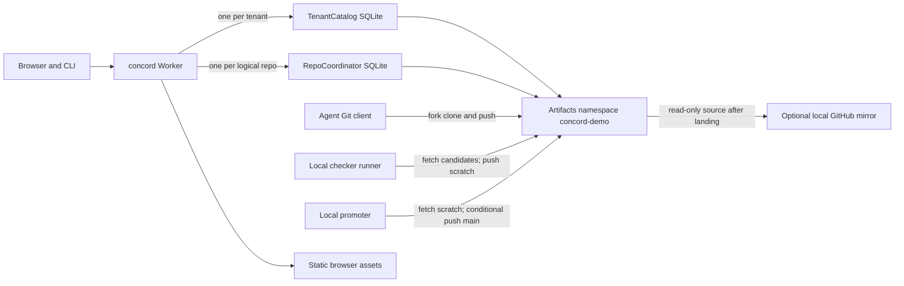

# How Concord v2 uses Cloudflare today

## Plain summary

Concord v2 already runs its public API and browser application on one Cloudflare Worker. A **Worker** is the request handler. A **Durable Object** is a named, stateful handler with its own SQLite database. Concord gives each tenant a catalog and each logical repository a separate coordinator. **Artifacts** is Cloudflare's Git repository service. It holds canonical Git history, a fork for each change, and scratch repositories for checked compositions. Agents, checkers, and the promoter use ordinary Git over HTTPS against Artifacts; the Worker does not process Git packs. This is a deployed architecture, but current use is a small pilot, not a capacity test for a large forge. See `src/worker.ts:135-215`, `wrangler.jsonc:3-18`, and `docs/deploy.md:166-172`.

The immediate scaling concern in our evidence is avoidable control-plane work: account counters show 1.176 million Durable Object requests and about 2.66 billion SQLite rows read over four measured days. An idle alarm defect also caused repeated Artifacts reads. The fix reduced the observed idle rate sharply. The Git side is less understood: 486 Artifacts repositories held 3.42 GB, but the usage extract has neither Artifacts operation counts nor a Git transfer bill. Each new change allocates a fork; the adapter has no deletion method, so retained forks and scratch repositories accumulate. Revisions of the same change reuse its fork. Neither the records nor the source show how a 542 MB local Git repository, a large initial push, or many concurrent writers perform in Artifacts.

**Decision support:** Cloudflare demonstrably works for Concord's bounded v2 pilot and ordinary control flow. It is not yet proven or disproven as v3's Git and coordination platform at the proposed scale. The owner needs measured Git operations, per-repository SQLite reads, fork retention, large pushes, and concurrent-agent latency. The earlier hosting report proposed moving live Git away from Cloudflare using a tariff model and an untraced Git path; the account below traces that path and separates observation from extrapolation. No web page or cloud API was fetched in this work.

## Architecture as built

`wrangler.jsonc:3-18` declares one Worker named `concord`, static assets, two SQLite-backed Durable Object classes, a 30,000 ms CPU setting, rate-limit bindings, and one Artifacts namespace. `src/worker.ts:197-207` routes tenant requests to `tenant:<tenantId>` and repository requests to `repo:<tenantId>:<repoId>`. A special public-directory catalog handles anonymous discovery (`src/worker.ts:53-70`). The normal object count is therefore one catalog per tenant, one coordinator per logical repository, plus the directory object when public discovery is used. There is no single global coordinator. Five logical repositories have five independent serial coordination lanes. `src/catalog.ts:10-42` owns names, quotas, delegated principals and tenant events. `src/coordinator.ts:59-126` owns per-repository changes, leases, queue, review, findings, jobs, issues, settings, events and alarms. Cross-feature transactions are local to one coordinator.

The coordinator's SQLite stores JSON state values in `concord_state`, individual events, event rollup shards, idempotency responses, and feature tables (`src/state.ts:13-42,67-89`). Lease claims and fences are rows in their own tables (`src/features/leases.ts:548-560`). Catalog listings and much queue/job history are JSON arrays in **single state rows**, not one SQLite row per item (`src/features/repos.ts:73-93`; `src/features/queue.ts:83-99`; `src/features/runners.ts:19-41`). Thus one billed row read may deserialize a growing array. Row counts alone conceal CPU, row size and memory pressure; a 2 MB row limit can bite before the 10 GB SQLite-object limit. The queue persists checked object IDs and evidence, while source files and Git objects live in Artifacts. Artifacts is selected only in production (`src/coordinator.ts:52-56`); local fake and bridge implementations are not production measurements.

A logical repository starts with one canonical Artifacts repository. `changeCreate` names a `concord-f-<change>` fork (`src/features/repos.ts:542-574`). A new revision of the same change uses the same fork. Bootstrap creates a scratch repository from its job ID; ordinary queue work uses a repository scratch name (`src/features/repos.ts:845-859,1034-1041`; `src/features/queue.ts:295-348`). No Artifacts delete operation appears in `src/storage/artifacts.ts:89-180`. The GitHub mirror is optional and one way. Workers Builds deploys Concord from its **Artifacts canonical main**, not from the GitHub mirror (`docs/ARCHITECTURE.md:3`; `docs/decisions.md:1485-1490`).

## Counting method and action paths

Counts below are **successful first-attempt code-path counts**, not a Cloudflare invoice. One `binding.get`, `binding.list`, `repo.info`, `repo.log`, `repo.readCommit`, `repo.readTree`, `repo.readFile`, `repo.createToken`, `repo.revokeToken`, `repo.listTokens`, `binding.create`, or `repo.fork` is one **binding method call**. Cloudflare's mapping from those calls and Git smart-HTTP exchanges to billable Artifacts operations is absent from our records. Treating each call as one billable operation is an explicit cost **estimate**. `info(name)` uses `get+info` when ready, or failed `get+list` when absent; list may page up to five times (`src/storage/artifacts.ts:44-69`). `resolveRef` uses `get+log`; `readCommit` uses `get+readCommit`; `listTree` uses `get`, optionally `readCommit`, then one `readTree` per path segment plus a final tree; `readFile` uses `get+readFile` (`src/storage/artifacts.ts:117-149`). Token mint and revoke each use `get` plus the operation (`src/storage/artifacts.ts:150-180`). Disposable handles add no separately visible binding call.

For SQLite, an indexed `sqlState.get` returns zero or one row and `put` writes one (`src/state.ts:67-77`). Every event writes **one event row and one rollup shard** through the trigger (`src/state.ts:24-32,80-85`); obtaining its sequence returns one result row. A recorded mutation reads at most one matching idempotency row, inserts one response row, and deletes **zero to 64** expired response rows (`src/coordinator.ts:295-321`); catalog create has its own response row (`src/catalog.ts:151-170`). Lease claiming can also expire due leases and delete up to **256** old terminal claim rows (`src/features/leases.ts:88-98`). The table's SQLite ranges count named-table rows touched on the simple path with no expired records, one per state-key get/put and one per returned SQL row. They are **code-path estimates**, not measured `rows_read`: module snapshots, migrations, alarms, indexes, cross-feature hooks and list length can add work. Authentication by delegated principal adds one tenant-catalog request and lookup rows (`src/auth.ts:90-99`). Normal secret-backed credentials avoid that request. Each range excludes that optional lookup and constructor migrations.

| User action, with source path | Durable Object requests | Artifacts binding calls on the simple path | SQLite rows read / written, code estimate |
| --- | --- | --- | --- |
| Create private repository: Worker forwards POST to catalog; catalog persists intent and reconciles provider (`src/worker.ts:197-200`; `src/catalog.ts:136-170`; `src/features/repos.ts:214-275`) | **1** catalog, zero coordinator. Publishing it adds **1** public-directory call (`src/features/repos.ts:202-212`). | **11** when absent and immediately ready: first `info` 2; `ensureRepo` repeats absent `info` 2, `create` 1, post-create ready `info` 2; initial-token revoke 2; orphan-token audit `get+listTokens` 2 (`src/features/repos.ts:127-179`; `src/storage/artifacts.ts:89-98,168-180`). An active orphan adds a revoke per token. | Approximately **15–35 / 10–25**. Catalog index and provisioning map are rewritten as whole JSON rows; each event adds two writes. Pending status adds `info` and state writes per poll. |
| Start a change, then claim **U** units: create checks base, reserves tenant fork quota and forks; claim checks overlaps and assigns fences (`src/features/repos.ts:499-575`; `src/features/leases.ts:117-207`) | Create: **1** coordinator + **1** catalog quota + normally **1** catalog list lookup. Claim: **1** coordinator. | Create: main `get+log` **2**, base `get+readCommit` **2**, immediate fork reconciliation **12**: two absent target `info` calls 4, source `get+fork` 2, new fork `get+info` 2, initial-token revoke 2, token audit 2. Claim: **0**. | Create roughly **20–45 / 10–25**. Claim reads at least the **active lease rows + 2U** (fence and version reads) plus fixed state/idempotency reads and issue lookups; it writes **5U** rows (fence, claim, version, event, rollup) plus response and any expiry/cleanup rows. Overlap scan grows with active leases (`src/features/leases.ts:76-98,148-205`). |
| Publish a revision after native push and branch registration (`src/features/repos.ts:621-652,718-797`) | **2** coordinator calls, plus normally **2** catalog list lookups for `catalogRepo`; its 60-second cache may avoid repeat lookups (`src/features/repos.ts:278-315`). | Branch registration: ready `info` 2, ref 2, commit 2 = **6**. Publish: ref 2, head 2, base 2, two ready `info` calls 4 = **10**. Git push is separate Artifacts Git traffic. | Branch roughly **10–25 / 5–12**; publish roughly **25–55 / 12–30**, including change, inspection intent, runner job/index, events and response. Later inspection is separate. |
| Queue and land: enqueue, checker poll/credentials/result, alarm, promoter poll/credentials/result and canonical readback (`src/features/queue.ts:410-457,1084-1178,943-969`; `src/features/runners.ts:273-316,330-517`) | At least **7** coordinator HTTP requests: enqueue, two polls, two credential requests, two results. Each credential request adds **1** catalog token-quota call **per Git remote minted**. Alarms, heartbeats and retries add requests. | Enqueue main ref **2**. Stack alarm reads main **2** and ready `info` for **N** distinct canonical/scratch/candidate repos (**2N**). Result identity checks add scratch ref/commit reads; promoter result adds canonical ref and perhaps ancestry reads. Each credential mint is **2** methods per remote. Native Git fetches and pushes are separate. | **Variable**: enqueue roughly **20–60 / 10–30**; each idle poll roughly **5–20 / 0**, claimed polls and results add writes. Landing rewrites queue and change arrays, releases leases and appends events. Stack width can be four; ancestry and queue history make a fixed total unjustified. |
| Read tree, file or README in UI (`src/features/repos.ts:391-441`) | **1** coordinator and up to **1** cached catalog lookup. Anonymous public reads additionally query directory and authoritative catalog, **2** requests (`src/worker.ts:53-70,162-209`). Static UI assets take `ASSETS`, no coordinator (`src/worker.ts:152-154`). | Warm content cache **0**. Cold root tree at recorded main: adapter `get+readCommit+readTree` **3**, plus one `readTree` per subdirectory. Cold file/README: `get+readFile` **2**. If main is not recorded, the route resolves ref and reads commit first, so root tree and file/README each take **6** calls. A supplied OID different from recorded main takes **4** calls for either root tree or file/README. | Warm content roughly **3–10 / 0**. A catalog lookup reads its index row. Cold content also uses Cache API, not SQLite. Snapshot cache misses build projections (`src/coordinator.ts:171-195`). |
| Agent clone/fetch, or checker fetching code (`cli/git.ts:86-104`; `runner/execute.ts:154-266`) | Agent gets read token: **1** coordinator + normally **1** catalog lookup + **1** token-quota request. Checker fetch credentials: **1** coordinator + **1** quota request per repository token (`src/features/runners.ts:330-383`). Git transfer makes **0** Concord Durable Object calls. | Agent token route: ready `info` **2** plus mint **2** = **4**. Checker mint **2** per remote. Native Git smart HTTP against Artifacts has no Concord binding calls; protocol exchange count depends on repository. | Token route roughly **10–25 / 2–8** including quota and response; checker count grows per remote. Git transfer touches zero Concord SQLite rows. |
| Optional GitHub mirror after landing (`deploy/mirror.ts:59-84,97-115`; `cli/land.ts:612-620`) | One canonical read-token coordinator call + catalog lookup/quota as above; preceding repo detail is separate. | Token **4**. Native fetch from Artifacts and source ref checks are not binding calls; destination push/readback are GitHub calls. | Same token-request estimate; Git operations write no Concord SQLite rows. |

The catalog lookups are **additional Durable Object requests**, not Artifacts operations. Pending provisioning can add up to five `list` pages after `get` on each retry. Visibility helpers can repeat a ref or commit read up to four times in total (initial plus three delayed retries, `src/features/runners.ts:57-70`). An ancestry check walks commits without a fixed upper bound (`src/features/runners.ts:118-132`). These branches, plus Git traffic, make a fixed “operations per change” tariff inadequate. Exact SQLite rows per action require a measured trace because successful paths depend on active leases, pending jobs, cache state, history and retries. The ranges above should be treated as hypotheses for that trace.

## Measured use and cost

The supplied account extract covers October 12–15 UTC, with three early October 16 Worker requests. It reports **997,407 Worker requests**, **1,175,856 Durable Object requests**, about **1.12 million Worker CPU milliseconds**, and approximately **2.656 billion SQLite rows read**. The four daily write figures total approximately **2.275 million rows written**. October 14 alone had **1,571,185,843 rows read** on **421,749 Durable Object requests**, about **3,725 rows per request** on average. These are account-wide counters, not per-feature traces or a v3 load test. `stored_MB=0.00` in that extract does **not** mean Git storage is zero: Artifacts billing is absent. A separate storage audit found **486 Artifacts repositories holding 3.42 GB** at 11:53 a.m. Chicago time on October 15. That averages about 7 MB per Artifacts repository; the extract cannot allocate bytes to canonical, fork or scratch repositories. Source: caller-supplied **Our measured usage**, collected October 15.

The idle-alarm leak is instructive. Before the fix, repeated wakeups read canonical Artifacts refs without useful work; the earlier **Where Concord should run** report quotes approximately **1,133 reads/hour** and a conditional $121/month at the Artifacts operation tariff. Current `queue.nextDeadline` returns no deadline while only waiting for a checker or promoter (`src/features/queue.ts:1196-1212`). `queueAlarmTick` skips canonical ref reads without queue work (`src/features/queue.ts:1084-1092`), and the coordinator deletes unused alarms and floors successful alarms by at least 1,000 ms (`src/coordinator.ts:128-138,341-358`). `docs/cost.md:15` records these controls. After the fix deployed at 17:55 UTC on October 15, the hourly series has 38 Durable Object requests and 38 Artifacts events at 18:00, then **8 and 8 in each of five following hours**. This proves a sharp idle reduction for that period, not zero background traffic or a future steady rate.

The price model uses the **October 15 rates captured in the supplied hosting comparison**, not a fresh vendor lookup: Workers Paid $5/month including 10 million requests and 30 million CPU-ms; excess requests $0.30/million as implied by that comparison's scenario arithmetic; Durable Objects include one million requests and 400,000 GB-seconds, then $0.15/million requests and $12.50/million GB-seconds; Artifacts include 10,000 operations and 1 GB-month, then $0.15/1,000 operations and $0.50/GB-month. One excess Artifacts operation thus costs **$0.00015**, compared with **$0.00000015** for an excess Durable Object request and **$0.00000030** for an excess Worker request. These are marginal component rates, not an invoice: duration, CPU, rows, Git transfers and billing rounding remain unmeasured or excluded. If every binding method billed as one operation, the table's uncomplicated create, start-change and branch-plus-publish paths imply about **$0.00165, $0.00240 and $0.00240** respectively in Artifacts calls; agent token issuance adds about **$0.00060**. This mapping is unverified. Holding 3.42 GB for a full 30 days would add about **$1.21** beyond the included GB. The earlier hosting report's four-Artifacts-operations-per-change assumption misses provisioning, status, token, inspection and Git activity.

For concrete marginal examples **after included monthly units are exhausted**, private repo creation is about **$0.00165045** (one Worker request, one catalog request, eleven assumed Artifacts operations). Starting an initialized change is about **$0.00240075** (one Worker request, three Durable Object requests including catalog lookup/quota, sixteen assumed Artifacts operations); claiming one unit adds at least **$0.00000045** before row charges. Branch registration plus first publish is about **$0.00240120** if two catalog lookups occur. A warm authenticated file read is about **$0.00000045–$0.00000060** depending on the catalog cache; a cold file read with known OID adds an estimated **$0.00030**. Issuing a canonical read token before a clone or mirror is about **$0.00060075** with catalog lookup/quota, before unpriced Git traffic. Landing has no honest single number: its lower HTTP floor is seven Worker and seven coordinator requests, **$0.00000315**, plus catalog token-quota requests, Artifacts calls, Git traffic, alarms, duration and rows. Within included units these incremental request charges are zero, while the $5 plan floor and storage still apply. These figures are arithmetic on the path counts above, not a claim of observed Artifacts billing.

## Scale and limits

Let **R** be logical repositories, **C** new changes per day, **A** simultaneously active agents, **S** retained Git bytes per repository, **F** fetches/clones, and **U** claimed units per change. Catalog index size and listing cost grow with R per tenant, up to the default 100-repository cap (`src/state.ts:143-159`; `src/features/repos.ts:233-239`). Coordinators grow roughly with R and isolate different repositories, but all A agents on the **same** repository serialize mutations through one coordinator (`src/coordinator.ts:324-335`). Fork count grows with cumulative C because every change gets one; revisions of a change do not. Git bytes grow with canonical history, retained forks, scratch data and S, not only R. Candidate pushes, checker/promoter transfers and clones grow with C, retries and F. Idle runner polls grow with A but back off toward 30 seconds (`docs/runner.md:29-31`); active runners add heartbeats and token mints. Leases cost O(U) writes and scan active overlap rows. Job and queue projections may deserialize growing JSON arrays even when SQLite reports one row. Snapshot caching lasts 15 seconds per version and visibility class (`src/coordinator.ts:171-195`); browser demand also matters.

Limits recorded in our own documents include a soft **1,000 requests/second per Durable Object**, **10 GB SQLite per object**, **2 MB per SQLite row**, a **100 MB request-body cap on Free/Pro zones**, **1 GB per Artifacts repository**, and **32 MB per Artifacts blob** (`docs/ARCHITECTURE.md:59,81-89`; supplied hosting comparison). The configured Worker uses 30,000 ms CPU and caps Concord JSON bodies at 256 KiB (`wrangler.jsonc:12`; `src/worker.ts:7,22-44`). The 100 MB edge limit concerns a Git push through a proxied zone, not the small API envelope. The 542 MB local `.git` directory for `gen-v-decomp` warns of risk against the 1 GB repository limit, but directory size is neither Artifacts remote size nor one push body. Other supplied local `.git` sizes are 11, 38, 55 and 172 MB. The 299–636 daily worker-run directories on October 10–14 are not concurrent agents, changes or clones. No large-repository import, high-concurrency writer test or big-push result is in the inputs. The captured Artifacts pricing page has no transfer tariff; free Git egress cannot be inferred.

`docs/cost.md:3-25` already guards Worker CPU, authentication failures, 256 KiB API bodies, tenant repositories (100), fork reservations (1,000 lifetime), and token mints (1,000/day), while warning that Workers Paid has no hard account spending cap. Source agrees on configured CPU (`wrangler.jsonc:12`), body bound (`src/worker.ts:7`), default caps (`src/state.ts:147-159`), and quota reservations (`src/catalog.ts:96-110`). Its claim that static assets bypass Worker invocation matches the assets route. The cost document's historical 100 ms local CPU experiment was superseded by its own 30-second production setting after snapshot/poll resets. The owner decided to deploy and track cost (**Cloudflare deployment and cost tracking**, `D-DEPLOY-COSTS`), connected Workers Builds to Artifacts canonical main (**Workers Builds deployment**, `D-DEPLOY-WORKERS-BUILDS`), and requested research into fewer forks and cleanup (**storage lifecycle scaling**, `D-STORAGE-SCALE`). The last decision is not implemented by this adapter, which has no delete method. The owner also prioritized stopping constant polling (**stop constant Durable Object polling**, `D-POLL-FIX-FIRST`); the observed idle fix and alarm code address part of that cost problem, while browser request patterns need separate measurement.

## Evidence and open measurements

Source files read for this trace: `src/storage/artifacts.ts`, `src/coordinator.ts`, `src/repos/model.ts`, `src/features/runners.ts`, `src/features/repos.ts`, `src/features/leases.ts`, `src/features/queue.ts`, `src/catalog.ts`, `src/worker.ts`, `src/state.ts`, `src/auth.ts`, `cli/git.ts`, `cli/git-token.ts`, `cli/land.ts`, `runner/git.ts`, `runner/execute.ts`, and `deploy/mirror.ts`; configuration `wrangler.jsonc`; repository documents `docs/cost.md`, `docs/ARCHITECTURE.md`, `docs/deploy.md`, `docs/api-repos.md`, `docs/runner.md`; relevant Artifacts, Durable Object and cost entries in `docs/decisions.md`; and the supplied **Our measured usage** and earlier **Where Concord should run** packets. Code citations are `origin/main` lines at the observed checkout head. The usage packet is a caller-supplied local record, not a live account query. No API call or cloud experiment was made for this report.

Measurements that would change the platform judgment are: (1) per-action traces joining Worker request, Durable Object rows read/write, alarm, Artifacts operation and Git transfer billing; (2) Artifacts bytes and clone/push durations for each real repository size, especially the 542 MB local case and a >100 MB initial push; (3) fork/scratch counts and bytes by age, then cleanup and recovery behavior; (4) same-repository concurrent claim/publish/landing throughput and latency as A rises, including queue contention and JSON-row growth; (5) CPU and rows for cold/warm snapshots, catalog listing near 100 repositories, and busy runner fleets; (6) GitHub mirror lag and failures after confirmed landing. The ordinary queue names a fallback scratch repository (`src/features/repos.ts:1041`), while the traced creation path is bootstrap provisioning (`src/features/repos.ts:845-859`); verify how a repository without bootstrap obtains scratch storage before projecting non-bootstrap landings. Record billable usage and failure modes, not only HTTP success. Until then, no defensible v3 per-repository monthly cost or maximum safe agent count follows from the current account totals.
