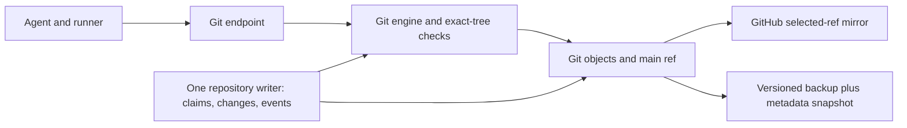

# Concord v3 on our current Cloudflare setup

## Plain summary

**Recommendation for our own first repositories:** prototype v3 with one rented server holding bare Git repositories and repository SQLite; keep Cloudflare for the existing site during migration. This is a study recommendation, not an approved hosting change. The server has the shortest known path to one ordered writer for claims, changes, checks and `main`. It needs paid hosting, patching, access control, backups and restore practice. A smaller server may fit the first two repositories; no quoted server has measured Concord capacity. Selling a hosted service is outside the MVP.

**Cloudflare remains a real contender.** An all-Cloudflare design can put metadata and authoritative refs in one Durable Object per repository, immutable Git data in R2, and Git merge/check computation in a Container. It needs a Git protocol gateway and proof that the exact checked commit survives crashes and becomes the advertised `main`. Artifacts could hold Git bytes, but its documented interfaces do not let a Durable Object atomically write an arbitrary Git ref. These are engineering questions, not evidence that Cloudflare cannot scale. Artifacts operation charges at 10–100 repositories are small under the estimates below. Size limits, safe landing, LFS, compute, duration and upkeep decide the choice.

| Decision at a glance | Current answer | Fact that could change it |
| --- | --- | --- |
| Git storage | Server disk for the MVP | Real repositories fit Artifacts limits, or an R2 Git gateway proves correct and fast |
| Metadata writer | Keep it beside server Git | Durable Object crash recovery passes |
| Git compute | Server Git is the tested local shape | Cloudflare Container or Git library passes the identical workload |
| Money | Small Git-operation fees do not justify migration | Measured duration, transfer, storage peaks or server capacity change total cost |
| Recovery | Independent Git and SQLite copy, quarterly drill | Each option meets the same loss and restore target |

The v3 draft's shared-by-default claims would reverse the recorded **exclusive unit claims decision (D-UNIT-1-EXCLUSIVE)**; this study assumes no policy change. The existing **Cloudflare deployment and cost tracking decision (D-DEPLOY-COSTS)** and **Workers Builds deployment decision (D-DEPLOY-WORKERS-BUILDS)** stay live until a separately approved migration. The draft proposes Concord, then gen-v-research-tools, as first repositories; their measured Git sizes are missing. A 542 MB local Git directory belongs to gen-v-decomp and is only a warning, not the size of either first repository or its Artifacts copy.

## Terms and evidence

**Git terms.** A *bare repository* stores Git history and refs without a checked-out working tree. A *ref* is a name such as `main` pointing to a commit. A *pack* is Git's compressed object-transfer format. *Smart HTTP* is Git clone/fetch/push over HTTP. *Compare-and-swap* moves a ref only if it still points to the expected old commit. A *revision* is one proposed change version; *land* merges its checked tree and moves `main`. *Git LFS* stores a small pointer in Git and large content in a separate service; a 32 MB Git-blob limit does not prove LFS support.

**Cloudflare terms.** A *Worker* handles an HTTP request in a 128 MB *isolate* (execution environment). A *Durable Object* is a named single writer with SQLite; a *catalog object* holds repository listing and identity. *Artifacts* is Cloudflare's Git repository service. *R2* stores keyed objects; Class A covers writes/listing and Class B covers reads. *Hibernation* suspends an idle Durable Object WebSocket without keeping compute active. *Server-Sent Events* (SSE) is a one-way HTTP stream. A *GB-month* is one GB retained for a month; a *GB-second* is one GB of allocated memory active for one second. A *zone* is a Cloudflare-managed domain; our `workers.dev` address is not a Free/Pro zone. *p95* is the latency below which 95% of observations fall. *Drain* is a runtime restart that closes old connections. Workers Builds deploys the current v2 Worker from Artifacts `main`.

| Proven in production here | Documented, untested for v3 | Needs measurement before host choice |
| --- | --- | --- |
| V2 serves a small pilot. Its Git client talks directly to Artifacts. After an idle-alarm fix deployed at 17:55 UTC, an hourly sequence shows 38 Artifacts events at 18:00, then eight in each of five following hours; both values are **post-deployment**. | Artifacts Git smart HTTP, synchronous multi-datacenter replication, 1 GB/repo, 32 MB/blob, 2,000 Git requests/10 seconds/repo; open beta since October 1, 2026, with no customer restore contract or SLA documented in supplied pages. | Real repository/LFS inventory; billed Artifacts units; stale-ref rejection; size/burst limits; checked-commit readback. |
| Read-only account API counted **487 Artifacts repositories** on October 15. Separate earlier storage audit counted 486 and 3.42 GB. Owner billing screenshot covers six cycle days and does not show Artifacts rows. | Workers have 128 MB isolate memory and up to five minutes Paid HTTP CPU (v2 configured for 30 seconds). Durable Objects have a soft 1,000 requests/second per object, 10 GB SQLite/object and 2 MB/row. Listed Container types reach 4 vCPU, 12 GiB and 20 GB disk; disk persistence is not established here. | Server pack CPU/egress/disk, Container startup and active time, R2 request pattern, Durable Object stream duration and restore. |
| A local v3 prototype landed 11 of 20 synthetic changes and found nine conflicts; this is **not** production capacity evidence. | Artifacts binding/REST inspect Git objects but do not document object/ref writes. Git pushes use protocol v1; isomorphic-git example demonstrates a small Worker-side push. | Same-repo contention, R2 Git gateway, LFS API/authentication, large pushes, post-crash reconciliation. |

The owner screenshot reports 1.07 million Durable Object requests, 2.21 billion rows read and 41,360 GB-seconds in the October 11–16 observed portion of the cycle. A different account-wide October 12–15 extract reports 997,407 Worker requests and about 1.12 million Worker CPU-ms. Do not combine those windows as one trace. Current Artifacts storage already exceeds the included 1 GB-month if retained all month. V2's periodic-read bug warns about design, not v3 rates.

## One workload, two independent choices

All numbers here are **estimates**, not forecasts. For each of 10, 100 and 1,000 logical repositories, assume current retained Git history of 0.2 GB per repo, one claimed unit and revision per task, 30 days, **30 tasks/month light** or **900 tasks/month busy** per repo. Every task starts one sandbox from a fresh canonical copy (clone or equivalent snapshot), submits once, gets one fast check on the exact merged commit and one land attempt. Runners fetch that checked commit once per task. There is one full-tier batch and GitHub mirror for each ten lands; the mirror fetches the batch tip. Also assume four human clones, sixty human incremental fetches, sixty browser file reads, thirty browser metadata reads and thirty browser event connections per repo monthly. Each task session has its own event connection and one scoped Git token, reused within that session. Retries, red batches, extra revisions and backup versions add work. A 0.05 GB/month growth rate and 0.8 GB at one year are **illustrative stress estimates**, not measured forecasts.

| Git placement, with **server metadata held constant** | Git bytes and checks | Advantage | New obligation |
| --- | --- | --- | --- |
| **Artifacts main store** | Artifacts canonical repo; rented Git engine builds/merges/checks, server SQLite has metadata | Managed replicated Git and native clone | Ref update contract, beta/size/LFS limits, split Git/database recovery |
| **Artifacts work copies** | Server owns canonical Git and SQLite; Artifacts task repos are temporary | Isolated agent Git work | Lifecycle and daily peak bytes; still needs server |
| **Own server** | Server has bare Git and SQLite; separate runners check | One repository writer, normal Git plumbing | One-machine failure, operator upkeep, pack CPU/egress |
| **Cloudflare throughout** | Durable Object has metadata and authoritative refs; R2 has immutable objects; Container computes, or bounded Git library runs in Durable Object | No rented server | Build Git gateway, atomic ref/object protocol, restore; prove limits |

For **Artifacts main store**, the server retains unpublished revision commits. On submission it merges against observed `main`, pushes a temporary candidate ref to Artifacts, and gives runners a read token for that exact commit. After a passing result it pushes `main` with an expected old commit and reads back the new ref. If it loses a race, it must rebuild and recheck; a retry cannot reuse the stale check. If the server crashes after the Git move but before SQLite records success, recovery compares its intent/outbox entry, Git ref and checked commit, then finishes or retries idempotently. Artifacts tokens are repository-scoped, **not documented as ref-scoped**; agents cannot receive canonical write tokens. Git-input submissions need an enforcing gateway or isolated task repo. If Artifacts cannot reject stale updates, this option cannot safely use it as canonical `main` without another authoritative ref service.

For **Artifacts work copies**, the server records the canonical base and makes a task repo. Full-history copies only work while each fits 1 GB/repo and 32 MB/blob. A fork may share provider storage, but that is undocumented and cannot be priced as deduplicated. Shallow import is documented for public HTTPS sources; private canonical sources need a push. A one-commit **tree-only snapshot** could omit old history: record its canonical base ID, let the agent edit, fetch the candidate, extract file edits, and apply them against the recorded canonical base on the server. Conflicts still resolve against current `main`; missing history may break tools that inspect ancestry. Large blobs and LFS still need a separate path. Authentication, changed transfer bytes and cleanup completion need measurement. The cost illustration below assumes 0.01 GB per snapshot; it is **not measured**. Full history remains the upper storage stress case.

For **own server**, the same task copies, runner fetches and mirror fetches hit its Git endpoint. At a 0.2 GB full-clone upper bound, 1,000 busy repositories make 900,000 task clones/month, about **180 TB** before runners and humans. Shallow or tree snapshots reduce bytes for every option; that benefit cannot be credited only to the server. Pack generation, outbound transfer, disk growth, TLS, access control, patching, monitoring, versioned backups and quarterly restore drills are real costs. GitHub's selected-ref mirror cannot restore issues, claims, events or unmirrored refs. R2 is an independent-provider backup for this server; for Artifacts/R2 primary designs, R2 alone shares Cloudflare's provider/account failure domain, so keep another copy elsewhere.

For **Cloudflare throughout**, a Durable Object serializes metadata and expected-old-ref moves. Store immutable blobs, trees and packs in R2 under content keys; keep `main` and candidate identities in its transactional SQLite. A Container reconstructs a disposable worktree, runs Git merge/check plumbing, uploads immutable objects, and discards local disk. Its listed 20 GB disk is a workspace limit, not proven durable storage. A Git library in a Worker or Durable Object is a smaller alternative, but the published simple-push example does not establish large-pack, receive-pack/upload-pack, merge or five-minute CPU behavior. A Git gateway must implement authenticated clone/fetch/push, ref advertisement, pack assembly, conditional update, retries and readback; R2 alone supplies none of those. The Durable Object records an intent, verifies uploaded immutable objects, swaps the ref and emits the landed event; recovery replays incomplete intents without claiming success for missing bytes. Runners fetch the exact candidate through this gateway. Artifacts can replace R2 as Git-byte storage only if temporary refs keep objects reachable and a gateway maps the Durable Object's authoritative ref into reads; its binding cannot write arbitrary refs. A plain push to Artifacts `main` instead needs stale-update proof. Both variants need LFS, backup and restore design.

A separate **metadata-location sensitivity** keeps Git placement fixed and moves claims/changes/events from server SQLite to one Durable Object per repo. This adds Worker/Object calls, possible GB-second duration and an outbox between metadata and Git. A successful Git move with failed metadata commit, or metadata success with missing Git objects, can misreport a landing. It needs idempotent intents, exact-commit checks, readback and crash replay. This is a different choice from where Git bytes live. The all-Cloudflare option uses it by necessity; the first three rows do not silently change it.

**LFS is a separate data path in all four options.** The v3 draft requires imported LFS objects and checksum verification. The supplied Artifacts docs describe Git pointers/objects but never establish an LFS batch API or content service; no Artifacts variant can assume one. For Artifacts main/work copies, a separately authenticated LFS endpoint could keep content in R2 or an independent store while Git holds pointers; the gateway must issue scoped upload/download credentials and carry LFS bytes into backup. Own-server Git can serve an authenticated LFS endpoint backed by server disk or R2; its restore must include content and pointer checksums. All-Cloudflare needs a Worker/Container LFS endpoint backed by R2 with the same auth, size and restore checks. These are proposed implementations, not verified capabilities. An oversized ordinary Git blob is still subject to the Artifacts 32 MB blob ceiling even if other files use LFS.

## Common action ledger and tariff model

The **same logical actions** apply to all options. Counts are **monthly estimates per repo**; let `tasks` be 30 or 900 and `batches = tasks / 10`. "Control calls" means dynamic HTTP calls or WebSocket upgrades if the control plane runs on Cloudflare. On a server they are server requests, not Cloudflare billable calls. One incoming Durable Object WebSocket message may count at a 20:1 billing ratio; message counts remain unknown. The v3 draft's token check is in memory, so no v2 delegated-catalog lookup is added. Each event append is a metadata write; replay reads at most 200 events per page. Indexed row counts, CPU and active duration are unknown until traced.

| Action | Count per repo per month | Git or storage activity; Cloudflare sensitivity |
| --- | ---: | --- |
| Create/import repository | 0 steady-state; one in first month | Canonical create, initial push/import, LFS import/checksum; setup separate from monthly table |
| Dispatch, claim, put revision, submit, fast-check result, review result, land request | **7 × tasks** | Seven control mutations and at least seven events; change bytes and merge/check CPU unknown |
| Agent session connection and scoped token | **tasks each** | One WebSocket upgrade and one token request per task; token calls may incur Artifacts activity, metering unknown |
| Agent tree copy, runner exact-commit copy | **tasks each** | Clone/snapshot plus candidate fetch for **every** option; bytes and pack CPU depend on copy method |
| Full-tier result and mirror result | **batches each** | Two control mutations/events per batch; one mirror fetch and external push per batch; retries extra |
| Human clone and fetch | **4 and 60** | Git traffic for every option; token reuse assumed, extra issuance if not reusable |
| Browser file and metadata reads | **60 and 30** | Ninety dynamic reads if proxied; cold Artifacts file read uses two binding methods in v2, but billing per method is unknown. Let cold share be `1 − cache_hit` |
| Browser event connection and catch-up | **30 upgrades** | WebSocket replay of at most 200 events/page. SSE fallback and MCP `event_wait` progress streams can keep a Durable Object response active; server streams consume server connections. Reconnects/messages extra |
| Post-land mirror, backup, LFS | Mirror above; backups by policy | GitHub push, Git bytes, SQLite snapshot, LFS objects/checksums; backup versions and network unpriced |

Each task also creates **one candidate object transfer** before its runner fetch: an Artifacts temporary-ref push for Artifacts main, an agent push and server fetch for Artifacts work copies, server-local commit creation for own-server HTTP edits (or a Git submission push), and immutable R2 writes for all-Cloudflare edits. A runner must fetch or read the exact resulting commit in every case, even when `change.put` rather than a Git push submits the edit. R2's minimum one write and one candidate read per task are only a request floor; object fan-out, pack assembly and cache misses can make actual Class A/B counts much higher. Full-suite checks, mirror fetches and LFS transfers add their own bytes. No table assumes v3 code already exists.

Thus Cloudflare control-plane entry count in the all-Cloudflare case, or a full Worker proxy of the server, is an **estimate** of `120 + 9 × tasks + 2 × batches`: **396 light** and **8,400 busy** per repo per month. This includes 90 browser reads, 30 browser upgrades, seven mutations, one task upgrade, one token request and two batch results. Direct-server options have zero such Cloudflare calls in the base case; their static app can stay on Cloudflare. Add one Worker call per proxied action if a gateway is chosen. Durable Object requests are at least similar for a one-object route but differ for catalog, messages, alarms and streams. Normal active GB-seconds need measurement: hibernating sockets may avoid idle duration, while SSE/pending responses do not. A 1,000-object, eight-hours/day, 128 MB active scenario is **110.6 million GB-seconds/month**; after the shared 400,000 inclusion, **about $1,377 estimated duration overage** at $12.50/million. This is a sensitivity, not base cost.

For the all-Cloudflare event route, assume the Worker forwards SSE fallback and long-lived MCP `event_wait` progress to the repository Durable Object, which terminates those streams. They can hold that object active for the response lifetime even if WebSockets hibernate. Moving SSE termination to a separate gateway changes where duration is paid and needs its own trace. A direct server terminates both streams on the server. The monthly table assumes only the listed WebSocket upgrades; SSE usage, reconnects and stream duration are explicit unmeasured additions.

**Artifacts activity proxy, not invoice units.** For Artifacts main store, four human clones + sixty human fetches + per task agent clone, candidate push, runner fetch and canonical push + one mirror fetch per batch gives `64 + 4 × tasks + batches`: **187 light** or **3,754 busy** activities/repo/month. For Artifacts work copies, illustrative create, baseline push/fork, agent clone, agent push, server fetch and delete give `6 × tasks`: **180 light** or **5,400 busy**. If fork replaces baseline push, activity count changes. Tokens, cold binding file reads and retry/visibility calls are known activities but their billed mapping is undocumented; add `token_units × tasks + file_units × 60 × (1 − cache_hit) + retry_units` to an invoice model only after billing evidence. Own-server and R2-based Cloudflare Git have no Artifacts activities. This proxy uses the same clone/check/mirror workload for all options.

Workers Paid has a shared $5/month floor, 10 million dynamic requests and 30 million CPU-ms. Durable Objects include one million requests, 400,000 GB-seconds, 25 billion rows read, 50 million written and 5 GB-month SQLite storage; overages are $0.15/million requests, $12.50/million GB-seconds, $0.001/million read rows, $1/million write rows and $0.20/GB-month. Artifacts includes 10,000 operations and 1 GB-month, then $0.15/1,000 operations and $0.50/GB-month. R2 has its **own** 10 GB-month, one million Class A and ten million Class B free allowances, then $0.015/GB-month, $4.50/million writes and $0.36/million reads; direct R2 egress is free. Container included active CPU/memory/disk quotas and regional egress vary; without runtime and transfer measurements these cannot yield a total. All inclusions are account-wide and already partly used by v2. [Workers pricing](https://developers.cloudflare.com/workers/platform/pricing/), [Artifacts pricing](https://developers.cloudflare.com/artifacts/platform/pricing/), [R2 pricing](https://developers.cloudflare.com/r2/pricing/).

### Comparable monthly components

These are **fresh-allowance component estimates**, not total bills or capacity quotes. They assume steady-state repos, a $81.99 server comparison point, the existing $5 Workers Paid floor, no Worker/SQLite/Container overage, no transfer or backup charge, no retries, and **one proxy Artifacts activity equals one billed operation** only for sensitivity. A small-server alternative is Hetzner EU CX23 **€5.49**, kept in euros and not added to dollar columns; CPX22 is **€19.49**. Neither is capacity-proven. For Artifacts work copies the illustrative billed daily peak is **0.01 GB per active snapshot**: one peak copy light, thirty busy, held one day and deleted successfully. Canonical server storage is additional. Own-server storage is 0.2 GB × repo count before workspaces/SQLite.

The $5 Paid floor remains while v2 or a dynamic Worker gateway uses this account. If v2 is retired and the own-server option serves its API directly, static Cloudflare assets can use the Free plan within its limits; then remove $5 from the own-server dollar column. It is not a fresh $5 charge for every option on the already-paid account.

| Repos / workload | Cloudflare control calls if hosted there | Artifacts main: proxy operations; GB; **$ server + Paid + Artifacts** | Artifacts work copies: proxy operations; daily-peak GB; **$ server + Paid + Artifacts** | Own server: **$ server + Paid**; canonical Git GB | All Cloudflare R2: **known floor**, other components unknown |
| --- | ---: | --- | --- | --- | --- |
| 10 light | 3,960 | 1,870; 2; **$87.49** | 1,800; 0.1; **$86.99** | **$86.99**; 2 | **$5**; R2 2 GB in free tier |
| 10 busy | 84,000 | 37,540; 2; **$91.62** | 54,000; 3; **$94.59** | **$86.99**; 2 | **$5**; other components unknown |
| 100 light | 39,600 | 18,700; 20; **$97.80** | 18,000; 1; **$88.19** | **$86.99**; 20 | **$5.15** R2 storage proxy |
| 100 busy | 840,000 | 375,400; 20; **$151.30** | 540,000; 30; **$180.99** | **$86.99**; 20 | **$5.15** R2 storage proxy |
| 1,000 light stress | 396,000 | 187,000; 200; **$213.04**, server capacity unproved | 180,000; 10; **$116.99**, server capacity unproved | **$86.99**, capacity unproved; 200 | **$7.85** R2 storage proxy |
| 1,000 busy stress | 8.4 million | 3,754,000; 200; **$748.09**, server capacity unproved | 5.4 million; 300; **$1,044.99**, server capacity unproved | **$86.99**, capacity unproved; 200 | **$7.85** R2 storage proxy |

Dollar cells use `server 81.99 + Paid 5 + max(0, operations − 10,000) × 0.00015 + max(0, billed daily-peak GB − 1) × 0.50`. R2 cells use `$5 + max(0, 0.2 × repositories − 10) × $0.015`, before R2 request units. R2 cells are deliberately **incomplete lower bounds**, not evidence it wins on total cost. Artifacts main cells also omit required server Git CPU, backup, SQL rows and transfer. At 10–100 repositories, operation-only surcharge is roughly **$0–$55 for Artifacts main**, or up to **$80 for work copies**; these proxy fees do not decide the architecture. Reusing v2's consumed allowances raises incremental charges; the screenshot filter omitted Artifacts, so measured billed units must replace this proxy. A fresh first-month repo creation/import adds one-time costs.

For an **all-Cloudflare Artifacts-byte variant**, use the same 187/3,754 estimated activity proxy per repository as Artifacts main **only if** its gateway needs the same candidate and final pushes. Removing the $81.99 server from that column gives a conditional **$5.50/$9.63 at ten** and **$15.81/$69.31 at one hundred** light/busy repositories, before Durable Object, Container, token/read metering, LFS and independent backup. Its 1 GB/repo and 32 MB/blob limits remain. A Durable Object as authoritative ref changes how clients discover `main`; the cost and correctness of that gateway cannot be inferred from these figures.

For the R2-based all-Cloudflare option, an additional **illustrative Container-compute estimate** assumes a Basic instance with provisioned ¼ vCPU, 1 GiB memory and 4 GB disk, active ten seconds of Git merge work per task, with the same external runner checks as other options. After shared included Container quotas, estimated incremental Container charges at 10 light/busy, 100 light/busy and 1,000 light/busy repositories are **$0/$0, $0/$6.28 and $1.61/$69.29 per month**, respectively. This uses the supplied 375 vCPU-minutes, 25 GiB-hours and 200 GB-hours included, then $0.000020/vCPU-second, $0.0000025/GiB-second and $0.00000007/GB-second. A quarter vCPU and 4 GB workspace may be inadequate for real Git packs; choosing a larger instance raises cost. This excludes cold starts, gateway compute, object requests, check runners and egress; ten seconds is an **estimate**, not a benchmark. A Container sending more than regional included egress (1 TB in North America/Europe, 500 GB elsewhere) adds transfer charges. If all 900,000 busy tasks at 1,000 repos each transfer a 0.2 GB full copy through the Container, estimated 180 TB is far beyond that inclusion. R2 direct egress is free, but this does not make Container egress free.

For work copies, storage billing uses the **average of daily peaks**, and capacity uses **maximum simultaneous bytes**, not time-average occupancy. With 0.01 GB snapshots held one day, busy daily peak is about 0.3 GB/repo even with smooth starts. With one-hour retention and smooth starts, peak might be one or two copies (0.01–0.02 GB); a daily burst of thirty tasks still peaks at 0.3 GB. Delayed deletion can hold peaks longer; REST deletion returning `202 Accepted` does not prove bytes disappeared. Full 0.2 GB history makes a busy daily peak **6 GB/repo** and could exceed the 1 TB Artifacts account cap well before 1,000 repos. A year-one 0.8 GB canonical history approaches the 1 GB per-repo Artifacts limit, and 1,000 such repos exceed the quoted server's 320 GB disk. Neither current nor future bytes are measured forecasts.

## What would flip the recommendation

| Evidence | Decision effect |
| --- | --- |
| First/busy repos stay safely below 1 GB and 32 MB Git blobs; LFS works with verified separate content; Artifacts stale updates reject correctly | Artifacts main becomes viable; managed replication and less operator storage work may justify added protocol/recovery cost. |
| R2/DO Git gateway serves clones and exact checked commits within resource targets, survives interruption, and restores; Container/Git-library cost stays below an adequate server plus upkeep | Prefer all Cloudflare for the MVP; no rented-server patching or disk administration is a concrete benefit. |
| Any real repo exceeds Artifacts limits, stale `main` races succeed, or required LFS has no workable service | Reject Artifacts as canonical; use server Git or prove R2/DO path. |
| Small server saturates on pack CPU/transfer or fails restore; larger server plus upkeep exceeds measured Cloudflare total | Reconsider all Cloudflare, sharded servers or prepared clone packs. Do not infer capacity from list price. |
| Split Git/metadata repeatedly needs reconciliation after failure while colocated Git/SQLite recovers cleanly | Keep one server writer for MVP even if raw Artifacts operation fees are low. |

Artifacts' synchronous multi-datacenter replication is a real availability benefit, but supplied open-beta docs give no customer restore procedure. One server is an obvious failure domain; its versioned independent backup and practiced restore are mandatory. R2 backup of server Git is cross-provider; R2 backup of Artifacts alone is not. LFS storage, auth, transfer, checksums and restoration belong in every option. Production v2 still depends on Artifacts and Workers Builds during migration; no recommendation here changes that.

## Smallest measurements before a hosting decision

These are **proposed read-only checks and later bounded tests**, not experiments performed for this study. Set pass/fail gates before spending on infrastructure. Use the same 30/900-task workload, full-clone and tree-snapshot variants, exact-commit checks and one-hour idle interval across options. Record p50/p95 latency, errors, CPU, bytes, daily storage peak, duration, billed units and recovery.

1. **Read-only inventory first.** For Concord, gen-v-research-tools and busiest/large repos, record reachable Git bytes, largest Git blob, total LFS bytes/object count and weekly Git/LFS growth from two snapshots. Record Artifacts operation meter through a billing view with that product selected, or GraphQL event counts clearly marked as events, not invoice units. Stop Artifacts-main consideration for any repo beyond a published limit. This needs no v3 code.
2. **Exercise real Git routes, after inventory.** In a disposable Artifacts repo use the direct `https://<account>.artifacts.cloudflare.net/git/...` remote for private push, clone and representative largest-repo transfer; public import is no substitute for private push. Start with **two** writers: both read the same old ref, one moves it, the other must be rejected; read back the winner and test interruption/retry. Only if safe, use ten and fifty submitting agents through a prototype enforcing gateway, with checks tied to the exact candidate. V2 `workers.dev` serves API/static assets and has **no Git push route**. Separately test a greater-than-100-MB push through any *planned* proxied server Git hostname; Free/Pro zone caps cannot be inferred for present `workers.dev`.
3. **Test each placement on the same fixture.** A bounded local or disposable small-server Git service should serve ten then fifty parallel task clones, submissions and runner fetches at inventory-derived sizes; count pack CPU, peak disk, outbound bytes and p95. Test Artifacts task repositories with full-history, fork and tree-only baselines: verify recorded base identity, extracted file edits, deletion completion and daily peaks. Prototype R2 immutable-object gateway plus Durable Object ref, Container or Git-library compute, and the same checked-commit path, including LFS where used. Provisional gates: every successful land's readback equals checked commit; stale moves never silently succeed; no data loss after one forced interruption; p95 claim under 250 ms and land under 30 seconds **as proposed targets** to adjust to actual repo needs; no platform hard-limit failures. No unbuilt v3 route is assumed.
4. **Recovery and idle-cost gate.** Restore Git refs, SQLite/DO state, LFS checksums, issue/claim/event state and selected GitHub mirror from independent versioned backup into an isolated fresh environment. Proposed target: no more than one hour accepted-work loss and restore within four hours; owner sets the real target. Trace an idle hour with WebSockets, SSE fallback and MCP `event_wait` separately, including reconnect after drain, and project GB-seconds at 10/100/1,000 repos. A later v3 delivery test can trace exact rows and invoices; host choice must not depend on unbuilt production v3 code.

## Sources and boundaries

Read in full: supplied **Concord v3 Architecture draft**, **Cloudflare Artifacts documentation study**, **How Concord v2 uses Cloudflare today**, **Our Cloudflare account**, both independent reviews, and **Cloudflare pricing and limits notes**. The supplied **Where Concord should run** study was used for server prices only. V2 `origin/main` source was spot-checked for direct Artifacts remote and Worker routing. No Cloudflare page was fetched anew for this repair; vendor links above identify pages timestamped in the supplied documentation study. No deployment, account change or experiment was performed. Every forward-looking count, dollar amount, storage size and acceptance target is an **estimate or proposal**, except quoted vendor limits/prices and labeled v2 observations.
