# Claims, handover, and work based on queued changes

Research design for Concord v3, 16 October 2026. This is a proposal for a **local prototype**, not a production policy change. The owner approved a small local prototype using real Git and past worker runs in the round-two research plan (D-RESEARCH-PLAN-2-GO). Product behavior and the owner-adjustable time limits below remain to be decided after its results.

## Plain answer

1. **Issue claims:** give each ordinary issue one visible work record from first claim through review, repair, and landing. The server holds the issue while nobody is actively writing; a named agent holds a short, renewable writing turn. When review fails, the server offers the same issue to a repair agent through an audited transfer. This prevents a second agent starting the same task just because the original agent sent a change. Code-unit leases protect **files or symbols** separately. Do not make acquisition of every predicted code unit a prerequisite for claiming the issue. A deliberately declared contest is the sole exception to one active worker per issue; this report specifies no contest mechanics.
2. **Handover:** use a durable, fair wait line that grants a fresh fenced code claim automatically **only if** the server can validate the waiting principal's current access, issue authority, change state, and all requested units in the same serialized transition. If that atomic check is unavailable, use a short priority turn followed by a fresh authenticated request. Handover is a new authorization event, not a promise made when the agent joined the line. The owner can cancel either a hold or a wait at any time.
3. **Queued changes:** after review, the code writing lock is gone. Keep revision-specific landing authority and an explicit dependency. The server can offer an immutable preview commit containing a queued predecessor; a new agent creates a separate child change against it. The child may edit a whole file or a verifiably separate symbol. If the predecessor fails, leaves, or changes revision, the child must reapply its own edits, recheck, and receive new review before landing. This can save later repair work, but predecessor success is uncertain.

The recommendations preserve the current exclusive writing rule for protected code units (D-UNIT-1-EXCLUSIVE), the five-minute default with reliable extension (D-LEASE-5MIN-EXTEND), the first-publication transition to nonblocking landing holds (D-LEASE-BOTTLENECK-ASAP), and human emergency controls (D-LEASE-WAIT-LINE). The owner asked to see gains beside every penalty, with no preset gain bar (D-GAIN-SEE-RESULTS). Thus the prototype reports a vector of throughput, waits, repair, validation, cost, and human actions; it does not declare a numeric winner.

## Terms, evidence, and limits

An **issue** is a task. A **change** is a proposed Git revision linked to that task. An **issue work record** is the server's exclusive ordinary-task slot; its current actor may change without creating a second task. A **code unit** is a policy-verified file or symbol. A **writing lease** temporarily excludes another writer of an overlapping unit. A **fence** is a rising server generation checked at every protected operation, so an old holder cannot publish after takeover. A **landing authorization** names one inspected revision and its checked footprint, and allows queue processing without excluding new writers. A **preview tree** is an immutable Git tree assembled from canonical main and a specified ordered queue prefix. A **stack edge** says a child change depends on a particular predecessor revision. None of these terms makes an issue assignee a code lock.

A **principal** is an authenticated account; a **stable intent** identifies one attempt across restarted runs. The **actor epoch** changes on writing-turn transfer, the **issue generation** on reopening, and the **queue epoch** on preview-invalidating queue changes. A **footprint** is the exact changed code-unit set. **Declare, grow, verify** mean request predicted units, add discovered units, then check the diff before sending. The **canonical ref** is the server-owned `main` pointer. A Git **tree** fixes file contents; a **commit** adds parentage. An **OID** is an object's Git identity; a **digest** binds review or checks to input. **CAS** means compare-and-swap: move a ref only if it still names the expected commit. An **ordered prefix** is consecutive queued revisions. **Rebase** or **cherry-pick** reapplies a change on a new parent; **restack** does this to descendants. A **disposable index** is a temporary Git staging area. **STRUCTURAL** labels a rule independent of agent skill; **CAPABILITY-DEPENDENT** labels behavior needing retest as agents change. Dates label evidence.

The published-lease change (181) already ends blocking code holds at first publication; nonblocking landing authorization remains. V2 links issues but does not enforce one active task per issue. Its fair wait line, complete declare/grow/verify workflow, and issue claim were specified but not all shipped. Automatic grant (72) and fresh-authentication turn (116) were different unshipped designs (`s6-v2-claim-history.md`, read 16 October). The owner's issue-claim redesign (D-ISSUE-CLAIM-REDESIGN) supersedes the earlier leading issue-plus-all-code proposal, while keeping exclusive code units. **STRUCTURAL (14–16 October 2026):** links and disjoint code leases cannot prevent duplicate task starts.

The synthetic issue simulation (`c2b-claim-sim.md`, 15 October) omitted growth and repair. Only four blind issue texts were usable, mostly with location clues (`final-c3-blind-footprints.md`). Wait and renewal prototypes (`final-c4-waitline.md`, `final-c5-renewal.md`) expose revocation and dead-holder costs. Narrow merge rules cleared 20 of 40 sampled textual conflicts, without a completed full suite (`final-c6a-merged-tree.md`). **CAPABILITY-DEPENDENT (15 October 2026; retest):** agent response and repair time may change. **STRUCTURAL (15 October):** clean text or narrow keys do not prove semantic correctness.

### Prior art and the transferable rule

The official pages below were fetched with `curl` and read in full as page text on **16 October 2026**; raw copies remain outside the repository. Local notes have 15 October read dates.

| System and source | What it does | Lesson for Concord |
| --- | --- | --- |
| [Zuul gating](https://zuul-ci.org/docs/zuul/latest/gating.html) and [dependent pipeline](https://zuul-ci.org/docs/zuul/latest/config/pipeline.html), fetched 16 October | Tests ordered queue prefixes speculatively in parallel; when an earlier change fails, downstream results are discarded and rerun. A window bounds wasted builds. | **STRUCTURAL (16 October):** a queued preview is conditional on every predecessor and its exact revision; failed prefixes invalidate descendants. It is a check scheduling model, not a source lock. |
| [GitHub merge queue](https://docs.github.com/en/repositories/configuring-branches-and-merges-in-your-repository/configuring-pull-request-merges/managing-a-merge-queue), fetched 16 October | Builds temporary merge groups from latest base plus preceding queued requests, runs required checks on those groups, removes failing entries, and rebuilds later groups. Jumping the queue rebuilds work. | **STRUCTURAL (16 October):** the server should expose prefix identity and invalidation cost; a prior isolated review does not validate a new combined tree. |
| [Gerrit changes](https://gerrit-review.googlesource.com/Documentation/concept-changes.html) and [review UI](https://gerrit-review.googlesource.com/Documentation/user-review-ui.html), fetched 16 October | Shows parent-child relation chains, outdated patch sets, and changes submitted together. Rebase can target another open change's current patch set. Submit strategy controls whether lineage is retained, rebased, cherry-picked, or merged; cherry-pick can ignore dependencies unless whole-topic submission is configured. | **STRUCTURAL (16 October):** display a child’s exact parent revision and make an outdated edge visible. A topic or issue link does not itself enforce landing order. |
| [Graphite create a stack](https://graphite.com/docs/create-stack) and [update a middle branch](https://graphite.com/docs/update-mid-stack-branches), fetched 16 October | Treats small branches as stacked changes; amending a middle branch restacks descendants and prompts for manual conflict resolution. Its [CI guidance](https://graphite.com/docs/stacking-and-ci) notes extra checks from restacking. | **STRUCTURAL (16 October):** automatic restacking moves conflict and CI cost downstream; it cannot be free or silently preserve previous review. |
| [GitHub assignees](https://docs.github.com/en/issues/tracking-your-work-with-issues/using-issues/assigning-issues-and-pull-requests-to-other-github-users), fetched 16 October | Shows who is working on issues and permits multiple assignees, including a Copilot assignment path. It specifies no expiring, fenced work ownership. | **STRUCTURAL (16 October):** preserve the familiar visible assignee, but make Concord's single-worker promise a separate server rule. |
| Scion (`r1-scion-queues-notes.md`, 15 October); Bors and Git plumbing (`r4-bors-git-notes.md`, 15 October); SubmitQueue (`r2-submitqueue-notes.md`, 15 October) | Scion makes immutable change publication cheap and accepts later conflict repair; Bors tests batches and diagnoses failed batches; SubmitQueue speculates builds using dependency/conflict information. | **STRUCTURAL (15 October):** publication, queue testing, and canonical ref movement are separate operations. **CAPABILITY-DEPENDENT (15 October; retest):** Scion's agent repair effectiveness does not predict Concord's. |
| Gray–Cheriton and Chubby (`s1-leases-lockservices-notes.md`), Gray lock granularity (`r11-lock-papers-notes.md`), sources 1989, 2006, 1976; read 15 October | Bounded leases cap failure waits; Chubby separates ephemeral presence from advisory locks. Its sequencers support downstream stale-holder checks; bounded lock-delay gives weaker protection where a recipient cannot check them. Hierarchical locks make coarse/fine overlap explicit. | **STRUCTURAL (source dates as shown):** Concord requires recipient-side fencing for its promised stale-write rejection. Expiry and file-versus-symbol overlap must also be checked. Short terms require reliable renewal. |
| Gas Town (`gastown-blog-notes.md`, 1 January 2026), Agent Mail (`s2b-agent-mail-notes-part1.md`, `s2c-agent-mail-impl-notes.md`) and presence (`s4-presence-notes.md`), read 15 October | Durable task claims, advisory path reservations and ephemeral awareness make activity visible. | **STRUCTURAL (15 October read):** visibility does not enforce a task slot or land gate. **CAPABILITY-DEPENDENT (1 January and 15 October; retest):** agents' response to signals is unmeasured. |
| Dancy Chat, Agent Company, SwarmLock (`s2-agent-coordination-notes.md`), read 15 October | Shared-file, Git or local registries coordinate cooperating clients; direct edits bypass them. | **STRUCTURAL (15 October):** the server publication gate remains necessary. |
| Git LFS, Perforce, Unity, Unreal (`claims-options.md`), read 15 October | File locks protect selected assets; splitting actors into files reduces contention. | **STRUCTURAL (15 October):** asset practice does not measure source-symbol throughput. |
| Jujutsu (`r5-jj-merge-piper-notes.md`) and local Git (`sp-b-landing.md`), read 15–16 October | Stacks can be rebased; the disposable prototype creates objects and conditionally moves a ref. | **STRUCTURAL (15–16 October):** neither supplies issue custody or reviewed prefix composition. |

Older Graphite and Gerrit paths returned 404; the linked official pages supplied the claims. The Piper page returned 403 and supplies no claim here (16 October).

## Question one: who owns work on an issue?

All four options assume the **server alone** writes canonical Git refs. All retain separate code-unit permission and current-fence checks. An issue record holds the task, not all predicted files or symbols. The comparison uses the shipped v2 behavior as baseline; option C is included because it was explored in earlier research, even though the owner rejected it as the leading answer.

| Option | Gain | Penalties and failure cases | Owner view and control |
| --- | --- | --- | --- |
| A. V2 link plus code leases | No new issue state; a change may be sent and later repaired using fresh code claims. | Disjoint agents can duplicate one issue. A dead/hung process is visible only through its change and code leases; review failure has no unique repair handoff. Cancelling one change may leave another linked attempt. | Linked changes and live code holders; owner closes changes and force-releases code, but no single issue-work cancel exists. |
| B. Server-custodied issue slot with timed actor turn **(recommended)** | One ordinary worker at a time, visible across send, review, repair and queue. A review failure transfers the same slot to an eligible repair actor without reopening duplicate work. Code-unit acquisition stays incremental. | New durable state, deadlines, fence checks, phase transitions, and possible idle time while the issue is reserved in review. A slow review may reach a phase cap. | Issue shows actor or “server awaiting review/landing,” last actor, exact revision, deadline, and reason. Owner may cancel work or close issue immediately, with audited revision and fence invalidation. |
| C. Atomic issue plus declared code set | A worker with a known scope either obtains all initial authority or none, avoiding an issue held while code is busy. | Scope is often incomplete; discovery still needs growth. Broad declarations block safe parallel work. Repair and review still need an issue custodian; coupling makes a busy symbol prevent task visibility. | Owner sees one combined refusal and can cancel; no issue holder appears until every requested unit is free. |
| D. Radical open collaboration with optimistic task attempts | Maximum simultaneous starts and no issue-claim waiting; competing ideas may be valuable in an intentional contest. | Ordinary issues can receive duplicate implementations, wasted checks and ambiguous repair ownership. A server landing gate prevents unreviewed ref moves but cannot recover spent agent time. | Owner sees many attempts and must choose or cancel them. This violates the ordinary one-worker rule, so it is only a comparison arm, not the default. |

**Recommendation.** Option B best expresses the owner's question: the work remains claimed while responsibility passes from implementer to server to repairer. Claiming does not imply that an agent has exclusive access to every path an issue might touch. The client may request code units as it discovers them; the server verifies the actual diff before publication, using the trusted file-or-symbol policy and a file fallback when symbol identity is uncertain. A code refusal does not release the issue automatically: the active actor can switch tasks or wait for a bounded no-progress window, then release or time out. If that produces material hoarding in the replay, compare a 60-second issue relinquishment policy as a sensitivity arm. **STRUCTURAL (owner decision date: 16 October 2026):** combining issue and code into one mandatory start is unnecessary for one-worker issue ownership. **CAPABILITY-DEPENDENT (source date: 15 October 2026; retest):** whether actors use the free interval productively while a code unit is busy needs live observation, not inference from this replay.

The server identifies an actor by authenticated principal, stable issue intent, and run/session ID, not by a shared principal token alone. A replacement run can resume only through an audited transfer that advances the actor epoch. The issue slot has its own fence and generation; a replacement change may link to the same issue record, but old revisions never inherit authority. A review failure moves the issue to **needs repair** under server custody. The original writer's turn ends. A repair agent explicitly claims the repair turn, sees the failing revision and findings, takes fresh file or symbol writing leases, and creates a new revision. If nobody claims before its deadline, the issue becomes visible as unstaffed needs-repair; no stale revision lands. Contest mode is only a typed exception allowing more than one slot and remains otherwise unspecified.

### Recommended issue lifecycle and provisional limits

These are **prototype settings, owner-adjustable**. During active writing, a five-minute code lease and five-minute issue actor turn renew in a batch every 100 seconds; renewal preserves fences. Ten minutes without a logged productive action (planning result, edit, check, review response, or repair step) ends the actor turn even if heartbeats continue. Server inspection lasts at most 45 minutes, review 60, queue 45, and a repair offer 30. Before a cap the owner may extend a named phase with a reason and finite deadline. At a cap, revoke that phase's late results and revision authorization, then enter **Intervention** for at most 15 minutes: the issue stays visibly reserved, nobody may write or land, and the owner may assign a fresh repair turn, cancel, or extend this named state with a reason and finite deadline. With no response, atomically cancel the attempt, release custody to Open, and alert the owner; a stale result cannot revive it. A later claimant starts with a new fence. No heartbeat extends server custody. Historical reviews reached 218 minutes (`final-c5-renewal.md`), so count legitimate extensions. These are proposed durations, **not** a settled maximum-age decision: the owner has left maximum age open and requires visibility and cancellation in every holding state (D-LEASE-MAX-AGE-OPEN).

```mermaid
stateDiagram-v2
  [*] --> Open
  Open --> Claimed: eligible agent takes issue actor fence
  Open --> Closed: owner close
  Claimed --> Sent: publish exact revision; writing holds end
  Claimed --> Claimed: issue edit pauses until acknowledgment
  Sent --> InReview: server inspection passes
  InReview --> NeedsRepair: review fails; server offers repair turn
  NeedsRepair --> Claimed: repair agent takes new actor fence
  NeedsRepair --> Intervention: offer deadline
  InReview --> WaitingToLand: review passes; queue accepts revision
  WaitingToLand --> NeedsRepair: queue check fails or predecessor removed
  WaitingToLand --> Landed: checked prefix lands by server CAS
  Landed --> Closed: post-land completion recorded
  Claimed --> Open: actor expiry or release
  Sent --> NeedsRepair: inspection fails
  Sent --> NeedsRepair: issue edit invalidates revision
  InReview --> NeedsRepair: issue edit invalidates review
  WaitingToLand --> NeedsRepair: issue edit invalidates queue
  Sent --> Intervention: phase deadline
  InReview --> Intervention: phase deadline
  WaitingToLand --> Intervention: phase deadline
  Intervention --> Claimed: owner assigns fresh repair turn
  Intervention --> Open: owner cancel or automatic deadline
  NeedsRepair --> Open: owner releases abandoned attempt
  Open --> Contest: owner declares contest exception
  Contest --> Open: owner ends contest
  Claimed --> Open: owner cancels work and revokes fences
  Claimed --> Closed: owner close and revoke
  Sent --> Open: owner cancels revision and issue custody
  Sent --> Closed: owner close and revoke
  InReview --> Open: owner cancels review and custody
  InReview --> Closed: owner close and revoke
  NeedsRepair --> Open: owner cancels repair and custody
  NeedsRepair --> Closed: owner close and revoke
  WaitingToLand --> Open: owner ejects revision and cancels custody
  WaitingToLand --> Closed: owner close and revoke
  Intervention --> Closed: owner close and revoke
  Closed --> Open: owner reopen, new generation
```

| State | Holder and limit | Visible owner action |
| --- | --- | --- |
| Open | No issue actor, no code hold; no timer. | Claim eligibility or close. |
| Claimed | One agent has issue actor turn plus separately acquired file/symbol leases; five-minute renewable terms, ten-minute no-progress cap. | View actor, last progress, units and expiries; cancel or transfer with a reason. |
| Sent | Server holds issue custody and one revision authorization; no exclusive code hold; inspection cap 45 minutes. | Inspect revision and deadline; cancel. |
| In review | Server custody; no agent writing turn; review cap 60 minutes. | See reviewer and deadline; cancel or reasoned extension. |
| Needs repair | Server custody, no active actor until one repairer claims; 30-minute offer window, then Intervention. The repairer uses Claimed limits. | Assign/claim repairer, extend with reason, or cancel. |
| Intervention | Server custody, no valid landing or writing authority; 15-minute deadline, then automatic attempt cancellation and Open. | See reason and deadline; assign a fresh repairer, finite reasoned extension, or cancel immediately. |
| Waiting to land | Server custody and exact revision authorization, no exclusive code hold; queue cap 45 minutes. | See prefix/dependencies, bump with invalidation warning, eject or cancel. |
| Landed, then Closed | Canonical Git commit is immutable; issue close is an idempotent recorded transition. No lease survives land. | Reopen creates a new issue generation; cancel cannot undo the landed commit. |
| Contest exception | One ordinary-slot rule is suspended only by explicit owner declaration; timer and authorization details require a later design. | See the exception and end it. |

An agent process that **dies** stops renewing; its turn expires and old fences fail. A process that **hangs** while a sidecar renews still loses its actor turn at the no-progress cap. Access **revoked while waiting** removes eligibility before any new turn. A **failed review** produces a repair offer, not a second independent issue. A **failed or removed queue predecessor** invalidates descendants' preview tickets, while this issue remains server-custodied for repair/rebase. **Owner cancel** atomically bumps the issue fence, invalidates change authorization and wait/stack tickets, releases live code holds, and returns a still-open issue to Open. **Owner close** performs the same revocation but enters Closed, even during writing, inspection, review, repair, intervention or queue. Reopen creates a new issue generation; old fences, checks and reviews never revive. An issue edit increments its version and pauses affected work: before send, actor acknowledgment is required and scope edits also need growth/reconciliation. Any edit after send invalidates inspection, review and queue results and requires a fresh acknowledged revision and review. Every publish, review completion and land checks the acknowledged current version. This is the common failure contract for the three questions below.

For example, an agent claims a task, obtains a file lease, sends a revision and releases the writing lease. The server keeps the visible issue slot through inspection and review. Review fails; the old revision loses landing authority. A repairer takes a new issue turn and fresh file lease, sends a replacement revision under the same task, and receives new checks and review. If that revision lands, the server closes the task. If the owner closes it during repair, the repairer's late send fails its issue fence.

## Question two: how should code claims pass to the next agent?

The handover unit is a **normalized set**: a policy-versioned canonical file path or symbol key, with aliases for renames and file/child overlap. A wait request contains principal, run, change, issue intent, exact unit set, request key, sequence, maximum wait deadline, and desired time-to-live (**TTL**); it stores no credential. **FIFO** means first eligible overlapping request in, first served. A wait never confers edit permission. An agent may have at most one live overlapping wait for the same change and key, and retry does not extend its deadline or move it in line. Earlier overlapping requests cannot be bypassed by a direct claim or alias.

| Option | Gain | Penalties, failures, and owner control |
| --- | --- | --- |
| A. V2 immediate refusal and client retry | Minimal queue state; today a client can retry after release, expiry, or publication. | Repeated races can barge and starve. A dead or hung holder is bounded only by its lease and renewal behavior. Owner can force-release a code lease, but has no durable wait to inspect/cancel. |
| B. Fresh-auth priority turn | Server opens a short turn when all units free; client must issue a new authenticated claim. Survives a separate authentication service that cannot be checked in the release transaction. | Extra round trip, missed turns when an agent dies or is slow, and a 45-second priority vacancy. Owner sees/cancels turns; revoked agents cannot complete a new claim. This is the later v2 design, not shipped baseline. |
| C. Atomic authenticated auto-handover **(recommended if feasible)** | One server transaction checks live access, issue/actor fence, open change, policy version, unit availability, FIFO priority, then grants the complete set and emits new fences. An alive waiter need not race for a turn. | Requires revocation and grant in one serializable order (as if requests ran one at a time); an offline client may hold until expiry. Owner sees/cancels wait or grant. If atomic access checking fails, use B. |
| D. Radical dispatcher with no code wait | Server directs agents to another issue or to a queued preview immediately, and code conflicts are resolved only at publish/land. | High utilization is possible, but overlapping unverified edits can waste work or fail checks; it changes the exclusive writing decision. Owner can cancel attempts but cannot assume ordinary issue ownership alone prevents code conflicts. |

**Recommendation.** C is a design for a single authoritative server, conditional on proving a transaction that orders access revocation with grants. A one-writer Git server does not by itself make a separate identity catalog atomic. The prototype must implement a local authoritative principal table in the same SQLite transaction as wait advancement, then inject a revocation race. If v3 deployment cannot supply that ordering, choose B. A request already authenticated before revocation is safe only if the transaction rechecks current authorization before grant. This follows the distinction found by the wait-line prototype (`final-c4-waitline.md`, 15 October) and Chubby's downstream fencing (`s1-leases-lockservices-notes.md`, paper 2006). **STRUCTURAL (source dates: 2006, 15–16 October 2026):** an enqueue-time permission check cannot authorize a later grant after revocation.

On release, expiry, first publication, or owner force-release, the server recomputes the eligible FIFO head for every affected unit. It grants all requested units together or none, advances a fresh fence, and records an event with a cursor (a monotonically increasing log position). A holder may renew a live claim without changing its fence. The server rechecks expiry on every request. Refused claims join the wait line automatically by default, with per-request opt-out (D-LEASE-QUEUE-AUTO). A refusal shows holder, stable intent, issue, units, position and **advisory** expiry, not a guaranteed grant time. The owner can pause a code wait line for a proposed maximum 15 minutes, move a named waiter to the front with a reason, force-release or cancel. Pausing prevents grants but leaves deadlines running; a separate reasoned extension names each affected request and never silently resets age. Moving changes queue order, not active holds or existing request deadlines; every overlapping waiter sees the new order. A pause expiry resumes automatically. These human-only controls are distinct from landing-queue priority (D-LEASE-WAIT-LINE).

For growth, build a **waits-for graph** with an edge from each request to every incompatible current holder **and** every earlier incompatible queued request. A cycle is a deadlock. Attempt age is first issue-claim time, retained across retries; ties use lexical stable intent. Atomically choose the youngest member, revoke its held code fences and withdraw **all** its outstanding waits, then append its still-needed request behind surviving waiters with a new sequence and its original deadline. If it has no holds, withdrawing the waits still breaks a queue-priority cycle. Example: A holds X; B waits for X and Y; A grows to Y. B waits for A's X, while A waits behind B's earlier Y request. If B is younger, remove B's wait, grant Y to A, then requeue B. The issue slot remains visible; a deadline or owner cancel eventually releases it. **STRUCTURAL (source dates: 1976, 15 October 2026):** all-or-nothing sets prevent partial grants but can delay a free subset behind a multi-unit request; count that delay.

## Question three: can an agent build on a queued version?

V2 already makes published code holds nonblocking, but its ordinary queue rejects a stale main base and serializes overlapping published changes. A later writer can obtain a unit and still need a rebase. The server offers a **conditional preview** after a predecessor passes review and enters the queue: starting with observed main, compose each queued candidate in order and create an immutable preview **commit** whose parent is the preceding preview commit. The ticket names `(repository, main commit OID, queue epoch, ordered revision OIDs, preview commit OID, tree OID, policy version)`. A Git tree contains content; only a commit can be a child's parent. The ticket gives read permission and dependency information, never a land guarantee or code lease.

| Option | Gain | Penalties, failures, and owner control |
| --- | --- | --- |
| A. V2 nonblocking landing hold | Later writers claim the same unit after predecessor publishes; no prefix service is needed. | Later changes may start from old main, rebase and hit a real conflict. Owner sees queue and can cancel or force-release; no child preview is promised. |
| B. Hold exclusive writing lease through queue | Later writers wait until predecessor lands, then start on canonical main. This avoids speculative child invalidation. | A slow check/review/queue recreates long file or symbol serialization and an accidental holder. Crash is irrelevant to server queue time, but a hung queue blocks work. Owner must release or eject; conflicts shift into idle time. |
| C. Conditional server preview plus explicit stack edge **(recommended)** | Child edits exact prospective tree before predecessor lands, often avoiding a later rebase; server can expose file and symbol differences in that tree. | Prefix construction, retention, invalidation, descendant repair and repeated checks cost work. Owner sees predecessor, descendants, tree identity, and “at risk” status; ejecting predecessor pauses every dependent. |
| D. Radical automatic moving stack | Server always rewrites descendants on every queue movement and auto-lands them after a passing prefix check. | High potential throughput but changed diffs can invalidate review, symbol identity, or task intent; automatic conflict resolution may silently lose edits. Owner needs full provenance and rollback; ordinary review cannot be assumed reusable. |

**Recommendation.** Offer C only for an exact reviewed queue prefix and pinned policy. The child receives an isolated change with the preview commit as its sole parent; it cannot alter the predecessor candidate. Its issue slot is distinct unless it is the authorized repair of that issue. At claim time compare requested **file or symbol** units with active unpublished writing holds; the predecessor's nonblocking landing authorization does not block. The server checks the child's issue and code fences before publication. Its dependency puts the predecessor first even when units differ. Explicit detachment onto main requires fresh checks and review. **STRUCTURAL (source dates: 14–16 October 2026):** reading a queued revision requires no old writing lease, but depending on it still risks invalidation.

At **file level**, the ticket identifies the whole tree. A child editing the same file gets a new writing lease after predecessor publication; its diff is against the preview base. At **symbol level**, resolve changed ranges against both parent and child under pinned policy. Distinct verified symbols in one file may have separate leases; file claims overlap every symbol. Renames, signature/boundary changes, parser uncertainty, generated files and unsupported languages widen to file. A symbol key does not prove semantic compatibility; composed-tree checks remain. The old Git **funcname** (function-name hunk header) replay frequently fell back to file, so report actual symbol coverage (D-TEST-SYMBOLS). **STRUCTURAL (15 October 2026):** narrow scope helps only where identity and overlap are proved.

When a predecessor fails review, leaves the queue, is cancelled or gets a replacement revision, increment the queue epoch and invalidate every descendant. For a **Claimed** child, atomically stop its actor turn, revoke all code fences and waits, and preserve its draft as data only; a late send fails. For **Sent**, **InReview**, or **WaitingToLand**, revoke that revision's landing authorization and pending inspection, review and queue results. In every case the issue remains visibly server-custodied while a new actor turn is offered; only that actor may repair, with **fresh leases for every unit in the replacement footprint, even unchanged units**. First send ends only that revision's exclusive writing turn, not the need for authority on a later writing turn. A server-generated transform is an untrusted draft, never an authorized publication.

To move only the child's work, record original preview parent commit P and child commit C. Transplant `P..C` with `git merge-tree --write-tree --merge-base=P N C` against valid new prefix commit N, then create replacement C′ with sole parent N. The three-way operation compares old base, child and new base. If the predecessor lands unchanged, map its preview commit to its landed commit and still transplant when ancestry differs; equal tree OIDs do not imply equal parents. Replacement/removal always creates a new N and child revision. A conflict or failed check creates a repair task; clean text still needs unit derivation, fresh issue/code fences, exact-tree checks and independent review. No old digest authorizes changed content. The owner sees invalidated descendants and recomputation cost before queue priority change.

## Prototype test plan

The owner authorized a **small local v3 prototype on real Git**, with scripted agents replaying actual prior changes and worker-run durations, instead of models (round-two plan decision D-RESEARCH-PLAN-2-GO, 16 October). This section is the exact build and measurement contract for a later run. No worker history was analyzed and no prototype was built in this design run. The prototype has one process acting as the only writer of a disposable bare repository; it does not run on the owner's machines as a promoter. Scripted agents call that process and receive immutable Git object IDs, claim results and events. It must never move a source clone's ref. All experiments use disposable scratch clones and a fixed event-time clock, while Git computes real trees and merges. Network, paid models, and live agent calls are unnecessary.

### Behaviors to implement, rule by rule

1. **Git substrate and cancellation race.** Clone each fixed source commit into a disposable bare repo; import candidates without moving source refs. Compose trees with `git merge-tree --write-tree`, create commits with `git commit-tree`, and move only scratch `refs/heads/main` via `git update-ref refs/heads/main NEW OLD`. Preserve clean/conflict/error separately. One server process owns both SQLite and the scratch ref; no other process writes that ref. Before CAS, durably store landing intent `(old OID, new OID, revision, ticket, check digest, authorization versions)` and take the same process lock used by cancellation. Recheck all authority **inside that lock** immediately before CAS. A cancellation acknowledged before this decision wins and forbids CAS; a successful CAS wins over a later cancel, which becomes a post-land revert/repair request. Cancel arriving while CAS is in flight waits for this short lock, so “immediate” means next serialized decision, never undo of a completed land. After CAS record completion durably. On restart, reconcile each intent against the actual ref: `new` means landed, `old` means not landed and safe to abort or retry after revalidation, any other OID stops that sequence for investigation. Test crash before CAS, after successful CAS, and before completion recording. Bound CAS retries to three, then report contention. Checks bind the proposed tree and current main; a changed tree gets new checks and review.
2. **Issue custody.** One ordinary slot per issue generation. Claim checks open status, issue version and access; idempotent retry returns the same result. Actor renewal matches principal, stable intent, run and fence. First send ends this writing turn, while server custody retains the exact revision. Review failure, issue edit, close, reopen, repair takeover and every phase deadline follow the lifecycle above. A replacement revision always needs a new actor epoch and code leases. Reject late publish, inspection, review and land by version/fence. Contest remains only a declared exception flag, without scheduling mechanics.
3. **Code-unit handover.** Use policy-versioned file/symbol keys and file/child aliases. Claim/grow is all-or-nothing and exclusive for each writing turn; exact-diff reconciliation releases unused units and refuses missing authority before send. Implement default automatic enqueue with opt-out, refusal diagnostics, bounded FIFO, pause, owner priority, no barging, cycle remedy and fresh-auth comparison as specified above. Revocation and grants share one serial transaction with the authoritative principal table. Every grant checks current access, issue authority and policy. A queued credential is never inherited.
4. **Queue and previews.** Each entry names revision, footprint, review digest and dependency edges. Build the preview commit chain and ticket defined above. Queue advance requires matching ticket, authorization, exact prospective tree check and current review. Predecessor failure, replacement, eject or priority move invalidates descendants in all four phases; transform only their delta against a valid prefix. A transformed draft requires a fresh writing turn, unit verification and new review/checks even if the unit names stayed the same.
5. **Failure and owner control.** Inject deterministic death, hang with continuing heartbeat, access revocation while waiting, review failure, queue failure/ejection, and owner cancel at every state in the diagram. A crash cannot leave a valid write after expiry; a hung actor cannot live past no-progress timeout; a revoked waiter never receives an effective grant; a cancelled revision never lands; a removed predecessor never silently remains in a child base. Owner cancel must be available immediately and include a reasoned event. A post-land cancellation request cannot erase the commit and is reported as a separate revert/repair decision.
6. **Observability and recovery.** Commit each mutation and its numbered event in one SQLite transaction. Its payload includes request key, principal/run/intent, issue ID/generation/version/acknowledgment, actor epoch/fence, **complete canonical unit and alias sets**, code fences/expiry, wait sequence/deadline/priority/pause, policy version, revision/tree/preview OIDs, review/check digests, queue edges/epoch, phase deadline, old/new ref OIDs, cause, result and event time. A durable state snapshot names its last event cursor; replay later events, then reconcile Git landing intents with the actual ref before serving requests. Reconstruct issue, wait, queue, authorization and ref state from snapshot plus log; the test also starts from event zero and compares exact state. Aggregate counts and redaction belong only in exported reports. Store no credential or private source content in the public report.

Reuse the 15 October landing prototype's disposable bare-clone setup, `hash-object`, temporary `GIT_INDEX_FILE`, `read-tree`, `update-index`, `write-tree`, `commit-tree`, `merge-tree`, and `update-ref` compare-and-swap loop (`sp-b-landing.md`, `spikes_v3_sp-b_land-proto.sh`, `spikes_v3_sp-b_output.txt`). Its fixture produced eleven lands, nine textual conflicts, and 118 or 73 CAS retries in two repositories. Those counts establish local plumbing only. Replace fixtures with historical revisions and add issue/code authority, handover, prefix dependencies and exact checks. Do not copy its HTTP server or concurrent shell load merely to simulate agents.

**Symbol slice.** The first working finder is CPython's standard-library `ast` parser for `.py` files; pin and record the exact CPython interpreter version in the replay manifest. A canonical key is `(repository, normalized relative path, dotted enclosing class/function names, node kind)` for `FunctionDef`, `AsyncFunctionDef` or `ClassDef`. Parse both parent and child trees. Grant separate symbols only when each changed line belongs to one uniquely matched node of the same kind and name on both sides; imports, decorators, signatures, moved/renamed nodes, nested ambiguity, parse errors and generated or non-Python files widen to file. An alias maps the old and new path when a file rename is provable; otherwise use file scope. Fixtures: two function bodies in one file grant concurrently; two edits to one function conflict; a file claim blocks both; rename, moved boundary and parse failure fall back. Compare file-only and verified-symbol policies on the **same Python-eligible attempts** and report eligible attempts, verified symbol pairs and every fallback. Other languages remain unsupported in this first slice, not silently counted as symbol successes (D-TEST-SYMBOLS). **STRUCTURAL (16 October 2026):** a narrower key proves overlap separation, not semantic independence.

**Checks and review oracle.** For each selected attempt, freeze **all** literal `Validation:` commands in listed order from its linked work specification, executable versions, dependency/cache identity, environment variables excluding secrets and required inputs. If a toolchain or dependency cannot be reproduced from recorded inputs, mark checks unavailable. Give each command a 120-second wall timeout. Execute in an isolated checkout of the **proposed combined commit**, with source tree and dependencies read-only; also run `git diff --check OLD NEW` and `git fsck --connectivity-only` in the disposable repo. Missing commands, dependency or timeout are **unavailable**; nonzero exit is failed, never pass. The protocol-only cohort still exercises authorization, but accepted semantic-land counts require runnable checks on every selected repository; report each repository's command/coverage table before comparing outcomes. Scripted review is an independent deterministic oracle: approve only an exact revision/tree with required check PASS and no injected review-failure flag; its digest binds those fields. That tests protocol gating, **not** real reviewer judgment. Historical check labels cannot certify newly composed trees. Runner CPU time uses process CPU measurements; missing CPU is reported unavailable.

### Replay corpus and extraction

Use five histories: **Concord**, **agent-workflows**, **gen-v-research-tools**, **mwcc-rs**, and **gen-v-decomp**. Sources are local clones in `agent-runs/clones/`; worker runs in `agent-runs/`, with `status.json`, `usage.json`, `work-spec.md` or `prompt.md`, `allowed-files.txt`, and `run.log`; and the 15 October landing report/script/output. The cost model (`final-c1-cost-model.md`) describes timing coverage; the footprint study (`final-c3-blind-footprints.md`) explains why Allowed files are not true scope. A later builder sets `RUN_ARCHIVE` and `CLONE_ROOT` to those read-only directories; its inventory commands are `find "$RUN_ARCHIVE" -name status.json -print0`, `find "$RUN_ARCHIVE" -name usage.json -print0`, and, per clone, `git -C "$CLONE" log --first-parent --format='%H%x09%P%x09%cI' main` followed by `git -C "$CLONE" diff-tree --no-commit-id --name-status -r -z PARENT HEAD`. These are **plan commands**. The joined manifest stays in scratch.

Build a deterministic sequence per repository: sort linked attempts by recorded start UTC then run ID; join base/candidate/land by exact OID or explicit target-change link and audit every failed, cancelled or undiffable run. Group by explicit issue link first, then target-change/replacement link; when neither exists, give that change its own synthetic issue and flag it, never infer duplicates from similar text. Select the first 30 fully linked sequential landings plus first ten overlapping/replacement attempts if available. These are **sample targets**, not observed counts. Keep missing cases and denominators; report each repository and pooled totals. The prior forty textual conflicts came from one repository's selected pair stratum, not a workflow rate (`claims-options.md`, 15 October).

Manifest one row per attempt and action: repository, issue family and grouping evidence, run/request/revision/base/candidate OIDs, arrival, dispatch, service minutes, declared units, ordered discover/grow/first-edit/productive-action events, phase starts/ends, checks, review, fault key and land, each with `observed` or `scenario`, source file/field, UTC, missingness and censor flag. A final diff supplies changed units **only**, never discovery order or time. Extract first edit or progress solely from linked timestamped log/event entries; an Allowed list supplies a declaration only if it was actually submitted before editing. Commit time only bounds order. When such evidence is absent, use a separately labeled fixed scenario: declare no initial units, discover each actual changed unit at first-touch offsets evenly spaced across the observed or assumed active service duration, with lexical unit order; progress only at those offsets. Also run reverse order and all-up-front declaration bounds. Missing phase times use stated `final-c5-renewal.md` scenarios. Audit observed versus assumed coverage and exclusions **before** comparative claims; never label the scenario as history (`final-c3-blind-footprints.md`, 15 October).

Freeze only outside events: arrivals, service demand, initial deltas, and faults keyed to issue/action (for example, “first review of this issue fails”), not absolute queue timestamps. Each arm derives dispatch, send, review, queue and landing times from its own state. Use two worker slots, one checker slot, one server/ref writer; dispatch earliest eligible arrival, then issue key for ties. Service is nonpreemptive within an action; blocked agents occupy a slot until release. Stop at 48 simulated hours per repository, at most two writing turns per issue, three CAS retries per land and one repair transformation per invalidation; unfinished work is censored. A watchdog stops a repository-arm after 300 real seconds and records timeout, never success. These capacities and limits are prototype assumptions. Scripted agents cannot adapt or repair semantically; show zero/full-reuse bounds. **CAPABILITY-DEPENDENT (15–16 October 2026; retest with current agents):** signal response and repair reuse remain unmeasured.

### Measurements and comparisons

The manifest (frozen input table) and event ledger permit recalculation of every metric. A **comparison arm** is one policy run on the same finite demand. For each arm/repository report counts, median and nearest-rank 95th percentile (**p95**: sorted observation at position `ceil(0.95N)`), plus paired differences on identical issues. A **paired interval** is an uncertainty range formed from those issue-level differences, clustered by issue family. A **sensitivity bound** is an assumption range, not measured uncertainty. A **stress stratum** is a deliberately selected hard subset, reported separately. **Right-censored** means unfinished at cutoff; retain its effort without inventing completion. Zero denominator means unavailable. Time is elapsed wall minutes unless named CPU time.

| Measure | Exact formula and interpretation |
| --- | --- |
| Accepted task rate | Let N be distinct issue generations accepted, M occupied worker minutes, S worker slots and H replay hours. Report `60N/M` accepted tasks per occupied worker-hour and `N/(S×H)` per available slot-hour. Occupancy includes planning, edit, synchronous calls, blocked waits and repair; server-only review/queue time affects end-to-end time. |
| End-to-end time and tail | For each landed issue, accepted-land timestamp minus first dispatch timestamp; report median and nearest-rank p95. Unfinished issues are right-censored and shown separately; do not assign them a fabricated finish. |
| Duplicate effort | Minutes spent by a losing or discarded second attempt on the same ordinary issue divided by total occupied worker minutes; also count distinct duplicate starts. Contest cases are excluded and reported separately. |
| Code wait and issue idle | Code wait = sum of `(grant or terminal time − first refusal time)` per uninterrupted request, counted once per request. Issue idle = minutes a demanded ready issue has no actor or server inspection/review/queue progress because custody or code wait prevents work; count elapsed issue time once, not once per waiter. Report p95 request wait and issue idle separately. |
| Hoarding and recovery | For each issue generation, take the **union** of time intervals where an issue actor turn or any code hold extends more than ten minutes past its last productive action; overlapping issue/code holds count once. Report separately crash-to-successor-progress and detection-to-successor-progress (expiry or override detection); censor either if no successor. Renewal is not progress. |
| Rebase and stack cost | Count rebase attempts, conflicts, invalidated child revisions and regenerated merged trees. Rebase minutes = measured repair-session time when linked; otherwise give zero/full-session bounds. Avoided rebase count = v2 baseline rebases minus recommended-arm rebases on the same trace. |
| Checks and correctness | Count required check invocations and nonzero exits separately from unavailable checks. A revert counts only when an accepted undo commit explicitly names its target landing; otherwise revert count is unavailable, never inferred from a similar diff. Runner CPU-minutes = measured process CPU seconds/60 divided by accepted lands. An accepted unauthorized write, stale ticket land, lost accepted edit or unreviewed changed tree is a protocol failure by independent assertion; clean text is not semantic proof. |
| Control and service cost | Calls per accepted land; owner cancel/extend/bump actions and minutes if logged; event/ledger bytes; prefix trees built per accepted land; server compute time separately from worker time. Dollar cost is unavailable without measured provider tariffs and is not estimated from token counts. |

Run these arms on **the same replay manifest**: v2 links, code leases, refusal/retry and no preview (baseline); the full recommended design; issue-plus-declared-code atomic start; recommended issue lifecycle with fresh-auth wait turns; recommended issue lifecycle with an exclusive code hold through queue; and preview off with other recommended rules fixed. Add no-code-lock optimistic editing as a radical sensitivity arm, retaining the exact land checker. Report accepted rate, p95 elapsed, duplicate/idle/hoarded minutes, wait, rebases, invalidations, checks, failed checks, reverts, compute and owner actions for every arm. Keep history IDs in scratch; publish aggregates.

**Proposed pass/fail lines, all owner-adjustable before the later build run:** protocol safety passes only with zero accepted stale-fence writes, unauthorized handovers, ordinary duplicate issue actors, stale-prefix lands, and changed-tree lands without renewed review/checks in deterministic fault cases; any such event fails. Replay fidelity passes when every selected input OID, delta and event ordering reproduces identically from the saved manifest; otherwise fail the affected sequence and report coverage. A useful comparison requires at least one eligible sequence from each named repository and measured or explicitly bounded timing for every selected attempt; if coverage is lower, label the result exploratory. For product choice there is **no fixed gain threshold**: show each paired gain and every penalty together, including intervals or scenario bounds and missingness, then let the owner judge (D-GAIN-SEE-RESULTS). If a safety line fails, no throughput advantage rescues that arm. The exact fault matrix must include crash before/after grant, hang with heartbeat, revocation during wait and handover, review failure before/after send, predecessor failure/ejection/replacement, owner cancel in every state, mixed file/symbol overlap, parser fallback, queue reorder, and server restart between Git object creation and ref compare-and-swap.

**Build size estimate:** 18–22 small files and 3,400–4,600 lines including fixtures. Nine bounded runs, one behavior each: (1) bare-Git object/ref adapter; (2) durable land-intent recovery; (3) issue custody and version transitions; (4) Python symbol/file overlap; (5) code wait handover; (6) preview commit and child invalidation; (7) exact-tree checks and scripted review oracle; (8) history extractor with provenance audit; (9) finite replay and metrics. Each run delivers its named transition fixtures and focused checks before the next depends on it; fault cases live with the behavior they challenge. These are estimates. Missing historical events and check environments may reduce the comparable corpus.

### Assumptions and open decisions

Automatic handover assumes one transactional order for access revocation and claim grants; otherwise use a fresh-auth turn. Time caps, no-progress rules, blocked-issue relinquishment and owner extensions remain adjustable. Ambiguous symbols widen to file; generated output is rebuilt at land when possible (D-UNIT-6-REGEN). Scripted replay tests mechanical behavior, not current agents' response, hidden-file discovery or semantic repair. A production default needs that later evidence.
