# Claims, handover, and work based on queued changes

Research design for Concord v3, 16 October 2026. This is a proposal for a **local prototype**, not a production policy change. The owner approved a small local prototype using real Git and past worker runs in the round-two research plan (D-RESEARCH-PLAN-2-GO). Product behavior and the owner-adjustable time limits below remain to be decided after its results.

## Plain answer

1. **Issue claims:** give each ordinary issue one visible work record from first claim through review, repair, and landing. The server holds the issue while nobody is actively writing; a named agent holds a short, renewable writing turn. When review fails, the server offers the same issue to a repair agent through an audited transfer. This prevents a second agent starting the same task just because the original agent sent a change. Code-unit leases protect **files or symbols** separately. Do not make acquisition of every predicted code unit a prerequisite for claiming the issue. A deliberately declared contest is the sole exception to one active worker per issue; this report specifies no contest mechanics.
2. **Handover:** use a durable, fair wait line that grants a fresh fenced code claim automatically **only if** the server can validate the waiting principal's current access, issue authority, change state, and all requested units in the same serialized transition. If that atomic check is unavailable, use a short priority turn followed by a fresh authenticated request. Handover is a new authorization event, not a promise made when the agent joined the line. The owner can cancel either a hold or a wait at any time.
3. **Queued changes:** after review, the code writing lock is gone. Keep only revision-specific landing authority and an explicit dependency edge. The server can offer an immutable preview tree containing a queued predecessor to a new agent, who creates a separate child change against that exact Git object. The child may edit a whole file or a verifiably separate symbol. If the predecessor fails, is removed, or changes revision, the preview is invalidated and the child must rebase, recheck, and receive new review evidence before landing. This saves avoidable rebases when predecessors land, but does not make their success certain.

The recommendations preserve the current exclusive writing rule for protected code units (D-UNIT-1-EXCLUSIVE), the five-minute default with reliable extension (D-LEASE-5MIN-EXTEND), the first-publication transition to nonblocking landing holds (D-LEASE-BOTTLENECK-ASAP), and human emergency controls (D-LEASE-WAIT-LINE). The owner asked to see gains beside every penalty, with no preset gain bar (D-GAIN-SEE-RESULTS). Thus the prototype reports a vector of throughput, waits, repair, validation, cost, and human actions; it does not declare a numeric winner.

## Terms, evidence, and limits

An **issue** is a task. A **change** is a proposed Git revision linked to that task. An **issue work record** is the server's exclusive ordinary-task slot; its current actor may change without creating a second task. A **code unit** is a policy-verified file or symbol. A **writing lease** temporarily excludes another writer of an overlapping unit. A **fence** is a rising server generation checked at every protected operation, so an old holder cannot publish after takeover. A **landing authorization** names one inspected revision and its checked footprint, and allows queue processing without excluding new writers. A **preview tree** is an immutable Git tree assembled from canonical main and a specified ordered queue prefix. A **stack edge** says a child change depends on a particular predecessor revision. None of these terms makes an issue assignee a code lock.

Today's v2 baseline matters. The published-lease change (181) already stops code writing leases from blocking new claims at first publication; a nonblocking landing hold and queue ordering remain. V2 links issues to changes but does not enforce one active task per issue. Its fair wait line, complete declare/grow/verify workflow, and issue claim were approved or specified in parts but were not all shipped in the supplied source snapshot. In particular the older automatic grant design (72) and later fresh-authentication turn design (116) are distinct proposals. The v2 history synthesis (`s6-v2-claim-history.md`, read 16 October) and the original v2 specifications are the basis for this distinction. The owner's recent issue-claim redesign (D-ISSUE-CLAIM-REDESIGN) supersedes the earlier research note's leading atomic issue-plus-all-code proposal; it does not remove exclusive code units. **STRUCTURAL (source dates: 14–16 October 2026):** an issue link and disjoint file or symbol leases cannot prevent duplicate task starts.

The offline issue-claim simulation (`c2b-claim-sim.md`, 15 October) favored atomic issue-plus-code under a synthetic workload but omitted growth, repair and fault mechanics. The blind-footprint study (`final-c3-blind-footprints.md`, 15 October) found only four usable pre-specification issue texts, most with location clues. Neither establishes a production claim policy. The wait-line and renewal prototypes (`final-c4-waitline.md`, `final-c5-renewal.md`, 15 October) expose revocation and dead-holder costs. The merged-tree study (`final-c6a-merged-tree.md`, 15 October) cleared 20 of 40 sampled textual conflicts with narrow log union or index rebuilding, without a completed full suite. **CAPABILITY-DEPENDENT (15 October 2026; retest later):** signal response, repair duration and reuse may change. **STRUCTURAL (15 October 2026):** a clean textual merge or narrow symbol key does not prove semantic correctness.

### Prior art and the transferable rule

The official pages below were fetched with `curl` and read in full as page text on **16 October 2026**; raw copies remain outside the repository. Local notes have 15 October read dates.

| System and source | What it does | Lesson for Concord |
| --- | --- | --- |
| [Zuul gating](https://zuul-ci.org/docs/zuul/latest/gating.html) and [dependent pipeline](https://zuul-ci.org/docs/zuul/latest/config/pipeline.html), fetched 16 October | Tests ordered queue prefixes speculatively in parallel; when an earlier change fails, downstream results are discarded and rerun. A window bounds wasted builds. | **STRUCTURAL (16 October):** a queued preview is conditional on every predecessor and its exact revision; failed prefixes invalidate descendants. It is a check scheduling model, not a source lock. |
| [GitHub merge queue](https://docs.github.com/en/repositories/configuring-branches-and-merges-in-your-repository/configuring-pull-request-merges/managing-a-merge-queue), fetched 16 October | Builds temporary merge groups from latest base plus preceding queued requests, runs required checks on those groups, removes failing entries, and rebuilds later groups. Jumping the queue rebuilds work. | **STRUCTURAL (16 October):** the server should expose prefix identity and invalidation cost; a prior isolated review does not validate a new combined tree. |
| [Gerrit changes](https://gerrit-review.googlesource.com/Documentation/concept-changes.html) and [review UI](https://gerrit-review.googlesource.com/Documentation/user-review-ui.html), fetched 16 October | Shows parent-child relation chains, outdated patch sets, and changes submitted together. Rebase can target another open change's current patch set. Submit strategy controls whether lineage is retained, rebased, cherry-picked, or merged; cherry-pick can ignore dependencies unless whole-topic submission is configured. | **STRUCTURAL (16 October):** display a child’s exact parent revision and make an outdated edge visible. A topic or issue link does not itself enforce landing order. |
| [Graphite create a stack](https://graphite.com/docs/create-stack) and [update a middle branch](https://graphite.com/docs/update-mid-stack-branches), fetched 16 October | Treats small branches as stacked changes; amending a middle branch restacks descendants and prompts for manual conflict resolution. Its [CI guidance](https://graphite.com/docs/stacking-and-ci) notes extra checks from restacking. | **STRUCTURAL (16 October):** automatic restacking moves conflict and CI cost downstream; it cannot be free or silently preserve previous review. |
| [GitHub assignees](https://docs.github.com/en/issues/tracking-your-work-with-issues/using-issues/assigning-issues-and-pull-requests-to-other-github-users), fetched 16 October | Shows who is working on issues and permits multiple assignees, including a Copilot assignment path. It specifies no expiring, fenced work ownership. | **STRUCTURAL (16 October):** preserve the familiar visible assignee, but make Concord's single-worker promise a separate server rule. |
| Scion (`r1-scion-queues-notes.md`, 15 October); Bors and Git plumbing (`r4-bors-git-notes.md`, 15 October); SubmitQueue (`r2-submitqueue-notes.md`, 15 October) | Scion makes immutable change publication cheap and accepts later conflict repair; Bors tests batches and diagnoses failed batches; SubmitQueue speculates builds using dependency/conflict information. | **STRUCTURAL (15 October):** publication, queue testing, and canonical ref movement are separate operations. **CAPABILITY-DEPENDENT (15 October; retest):** Scion's agent repair effectiveness does not predict Concord's. |
| Gray–Cheriton and Chubby (`s1-leases-lockservices-notes.md`), Gray lock granularity (`r11-lock-papers-notes.md`), sources 1989, 2006, 1976; read 15 October | Bounded leases cap failure waits; Chubby separates ephemeral presence from advisory locks and requires downstream fencing; hierarchical locks make coarse/fine overlap explicit. | **STRUCTURAL (source dates as shown):** expiry, current fences, and file-versus-symbol overlap must be checked by the server that accepts writes. Short terms require reliable renewal. |
| Gas Town (`gastown-blog-notes.md`, article 1 January 2026), Agent Mail (`s2b-agent-mail-notes-part1.md`, `s2c-agent-mail-impl-notes.md`), and presence systems (`s4-presence-notes.md`); notes read 15 October | Gas Town tracks durable task claims and uses a serial agent integrator; Agent Mail advertises advisory expiring path reservations and optional bypassable hooks; Yjs awareness expires without locking edits, while Figma orders object-property writes. | **STRUCTURAL (15 October read):** visible activity is useful but cannot replace an enforced task slot or landing check. **CAPABILITY-DEPENDENT (1 January and 15 October; retest):** agents' willingness to notice and respect advisory signals is unmeasured here. |
| Dancy Chat, Agent Company, and SwarmLock (`s2-agent-coordination-notes.md`, read 15 October) | Dancy uses atomic shared-filesystem named-resource claims; Agent Company records task claims in Git; SwarmLock keeps local file/directory TTL locks. None intercepts arbitrary source edits. | **STRUCTURAL (15 October):** client cooperation and a shared registry are weaker than a server publication gate. Their timeouts and cleanup still suggest owner-visible recovery states. |
| Git LFS, Perforce, Unity and Unreal (`claims-options.md`, read 15 October) | Git LFS can verify selected file locks at push; Perforce and Unity apply configured exclusive file checkout; Unreal splits actors into files to reduce shared-asset contention. | **STRUCTURAL (15 October):** pre-edit exclusion fits hard-to-merge assets, while changing unit boundaries can reduce false contention. Binary-asset practice does not measure source-symbol throughput. |
| Jujutsu/merge notes (`r5-jj-merge-piper-notes.md`) and the local landing report (`sp-b-landing.md`), read 15–16 October | Jujutsu can represent and rebase change stacks; the local Git prototype created objects, used `merge-tree`, and moved a ref with compare-and-swap in a disposable bare repository. | **STRUCTURAL (15–16 October):** immutable candidate objects plus a final conditional ref move provide a small substrate for the prototype. They do not provide review, issue custody, or tested prefix composition. |

The attempted older Graphite `/docs/stacking` and Gerrit `/Documentation/user-submit.html` paths returned HTTP 404 on 16 October. The successful official pages in the table supply the stacking and submit behavior instead. The separate `r5-jj-merge-piper-notes.md` source records a 403 for its Piper page; no Piper claim here relies on that unread page.

## Question one: who owns work on an issue?

All four options assume the **server alone** writes canonical Git refs. All retain separate code-unit permission and current-fence checks. An issue record holds the task, not all predicted files or symbols. The comparison uses the shipped v2 behavior as baseline; option C is included because it was explored in earlier research, even though the owner rejected it as the leading answer.

| Option | Gain | Penalties and failure cases | Owner view and control |
| --- | --- | --- | --- |
| A. V2 link plus code leases | No new issue state; a change may be sent and later repaired using fresh code claims. | Disjoint agents can duplicate one issue. A dead/hung process is visible only through its change and code leases; review failure has no unique repair handoff. Cancelling one change may leave another linked attempt. | Linked changes and live code holders; owner closes changes and force-releases code, but no single issue-work cancel exists. |
| B. Server-custodied issue slot with timed actor turn **(recommended)** | One ordinary worker at a time, visible across send, review, repair and queue. A review failure transfers the same slot to an eligible repair actor without reopening duplicate work. Code-unit acquisition stays incremental. | New durable state, deadlines, fence checks, phase transitions, and possible idle time while the issue is reserved in review. A slow review may reach a phase cap. | Issue shows actor or “server awaiting review/landing,” last actor, exact revision, deadline, and reason. Owner may cancel work or close issue immediately, with audited revision and fence invalidation. |
| C. Atomic issue plus declared code set | A worker with a known scope either obtains all initial authority or none, avoiding an issue held while code is busy. | Scope is often incomplete; discovery still needs growth. Broad declarations block safe parallel work. Repair and review still need an issue custodian; coupling makes a busy symbol prevent task visibility. | Owner sees one combined refusal and can cancel; no issue holder appears until every requested unit is free. |
| D. Radical open collaboration with optimistic task attempts | Maximum simultaneous starts and no issue-claim waiting; competing ideas may be valuable in an intentional contest. | Ordinary issues can receive duplicate implementations, wasted checks and ambiguous repair ownership. A server landing gate prevents unreviewed ref moves but cannot recover spent agent time. | Owner sees many attempts and must choose or cancel them. This violates the ordinary one-worker rule, so it is only a comparison arm, not the default. |

**Recommendation.** Option B best expresses the owner's question: the work remains claimed while responsibility passes from implementer to server to repairer. Claiming does not imply that an agent has exclusive access to every path an issue might touch. The client may request code units as it discovers them; the server verifies the actual diff before publication, using the trusted file-or-symbol policy and a file fallback when symbol identity is uncertain. A code refusal does not release the issue automatically: the active actor can switch tasks or wait for a bounded no-progress window, then release or time out. If that produces material hoarding in the replay, compare a 60-second issue relinquishment policy as a sensitivity arm. **STRUCTURAL (owner decision date: 16 October 2026):** combining issue and code into one mandatory start is unnecessary for one-worker issue ownership. **CAPABILITY-DEPENDENT (source date: 15 October 2026; retest):** whether actors use the free interval productively while a code unit is busy needs live observation, not inference from this replay.

The server identifies an actor by authenticated principal, stable issue intent, and run/session ID, not by a shared principal token alone. A replacement run can resume only through an audited transfer that advances the actor epoch. The issue slot has its own fence and generation; a replacement change may link to the same issue record, but old revisions never inherit authority. A review failure moves the issue to **needs repair** under server custody. The original writer's turn ends. A repair agent explicitly claims the repair turn, sees the failing revision and findings, takes fresh file or symbol writing leases, and creates a new revision. If nobody claims before its deadline, the issue becomes visible as unstaffed needs-repair; no stale revision lands. Contest mode is only a typed exception allowing more than one slot and remains otherwise unspecified.

### Recommended issue lifecycle and provisional limits

These are **prototype settings, owner-adjustable**. During active writing, a five-minute code lease and five-minute issue actor turn renew in a batch every 100 seconds; renewal preserves fences. Ten minutes without a logged productive action (planning result, edit, check, review response, or repair step) ends the actor turn even if heartbeats continue. The server may hold the issue through inspection for at most 45 minutes, review for 60 minutes, and queue for 45 minutes before moving it to a visible intervention state; an owner may extend a named phase with a reason, deadline, and audit event. These caps are deliberately shorter than an accidental two-hour invisible hold, but historical reviews reached 218 minutes (`final-c5-renewal.md`), so the prototype must measure how often a legitimate phase would require extension. No automated heartbeat from a detached client may prolong a server phase. An owner can cancel immediately in every state. These are hypotheses, not settled durations (D-LEASE-MAX-AGE-OPEN).

```mermaid
stateDiagram-v2
  [*] --> Open
  Open --> Claimed: eligible agent takes issue actor fence
  Claimed --> Sent: publish exact revision; writing holds end
  Sent --> InReview: server inspection passes
  InReview --> NeedsRepair: review fails; server offers repair turn
  NeedsRepair --> Claimed: repair agent takes new actor fence
  InReview --> WaitingToLand: review passes; queue accepts revision
  WaitingToLand --> NeedsRepair: queue check fails or predecessor removed
  WaitingToLand --> Landed: checked prefix lands by server CAS
  Landed --> Closed: post-land completion recorded
  Claimed --> Open: actor expiry or release
  Sent --> NeedsRepair: inspection fails or phase deadline
  InReview --> NeedsRepair: phase deadline
  WaitingToLand --> NeedsRepair: phase deadline
  NeedsRepair --> Open: owner releases abandoned attempt
  Open --> Contest: owner declares contest exception
  Contest --> Open: owner ends contest
  Claimed --> Open: owner cancels work and revokes fences
  Sent --> Open: owner cancels revision and issue custody
  InReview --> Open: owner cancels review and custody
  NeedsRepair --> Open: owner cancels repair and custody
  WaitingToLand --> Open: owner ejects revision and cancels custody
  Landed --> Closed: owner records completion
```

| State | Holder and limit | Visible owner action |
| --- | --- | --- |
| Open | No issue actor, no code hold; no timer. | Claim eligibility or close. |
| Claimed | One agent has issue actor turn plus separately acquired file/symbol leases; five-minute renewable terms, ten-minute no-progress cap. | View actor, last progress, units and expiries; cancel or transfer with a reason. |
| Sent | Server holds issue custody and one revision authorization; no exclusive code hold; inspection cap 45 minutes. | Inspect revision and deadline; cancel. |
| In review | Server custody; no agent writing turn; review cap 60 minutes. | See reviewer and deadline; cancel or reasoned extension. |
| Needs repair | Server custody, no active actor until one repairer claims; 30-minute offer window, then unstaffed intervention. The repairer uses the Claimed limits. | Assign/claim repairer, cancel, or return to Open. |
| Waiting to land | Server custody and exact revision authorization, no exclusive code hold; queue cap 45 minutes. | See prefix/dependencies, bump with invalidation warning, eject or cancel. |
| Landed, then Closed | Canonical Git commit is immutable; issue close is an idempotent recorded transition. No lease survives land. | Reopen creates a new issue generation; cancel cannot undo the landed commit. |
| Contest exception | One ordinary-slot rule is suspended only by explicit owner declaration; timer and authorization details require a later design. | See the exception and end it. |

An agent process that **dies** stops renewing; its turn expires and old fences fail. A process that **hangs** while a sidecar renews still loses its actor turn at the no-progress cap. Access **revoked while waiting** removes eligibility before any new turn. A **failed review** produces a repair offer, not a second independent issue. A **failed or removed queue predecessor** invalidates descendants' preview tickets, while this issue remains server-custodied and returns to repair/rebase. **Owner cancel** atomically bumps the issue fence, invalidates any change authorization and wait/stack tickets, releases live code holds, and returns the still-open issue to Open; owner close is separate. This is the common failure contract for the three questions below.

## Question two: how should code claims pass to the next agent?

The handover unit is a normalized **set** of file or symbol keys, with file/child overlap determined by one trusted policy. A wait request contains principal, run, change, issue intent, exact unit set, request key, sequence, maximum wait deadline, and desired TTL; it stores no credential. A wait never confers edit permission. An agent may have at most one live overlapping wait for the same change and key, and repeating it does not extend deadlines or move it in line. Unrelated unit sets can proceed independently. Earlier overlapping requests cannot be bypassed by a new direct claim, a subset, or a file-versus-symbol alias.

| Option | Gain | Penalties, failures, and owner control |
| --- | --- | --- |
| A. V2 immediate refusal and client retry | Minimal queue state; today a client can retry after release, expiry, or publication. | Repeated races can barge and starve. A dead or hung holder is bounded only by its lease and renewal behavior. Owner can force-release a code lease, but has no durable wait to inspect/cancel. |
| B. Fresh-auth priority turn | Server opens a short turn when all units free; client must issue a new authenticated claim. Survives a separate authentication service that cannot be checked in the release transaction. | Extra round trip, missed turns when an agent dies or is slow, and a 45-second priority vacancy. Owner sees/cancels turns; revoked agents cannot complete a new claim. This is the later v2 design, not shipped baseline. |
| C. Atomic authenticated auto-handover **(recommended if feasible)** | One server transaction checks live access, issue/actor fence, open change, policy version, unit availability, FIFO priority, then grants the complete set and emits new fences. An alive waiter need not race for a turn. | Requires revocation and repository authorization in one serializable order; an offline client may receive a short hold until expiry. Owner sees/cancels wait or grant and can revoke it immediately. If atomic access checking fails, use B rather than a stale enqueue-time check. |
| D. Radical dispatcher with no code wait | Server directs agents to another issue or to a queued preview immediately, and code conflicts are resolved only at publish/land. | High utilization is possible, but overlapping unverified edits can waste work or fail checks; it changes the exclusive writing decision. Owner can cancel attempts but cannot assume ordinary issue ownership alone prevents code conflicts. |

**Recommendation.** C is a design for a single authoritative server, conditional on proving a transaction that orders access revocation with grants. A one-writer Git server does not by itself make a separate identity catalog atomic. The prototype must implement a local authoritative principal table in the same SQLite transaction as wait advancement, then inject a revocation race. If v3 deployment cannot supply that ordering, choose B. A request already authenticated before revocation is safe only if the transaction rechecks current authorization before grant. This follows the distinction found by the wait-line prototype (`final-c4-waitline.md`, 15 October) and Chubby's downstream fencing (`s1-leases-lockservices-notes.md`, paper 2006). **STRUCTURAL (source dates: 2006, 15–16 October 2026):** an enqueue-time permission check cannot authorize a later grant after revocation.

On release, expiry, first publication, or owner force-release, the server recomputes the eligible FIFO head for every affected unit. It grants all requested units together or none, advances a fresh fence, and records an event with a cursor. A holder may renew a live claim without changing its fence. The server rechecks expiry when handling every request, so a missed timer cannot enable stale writes. A process that dies after grant leaves a five-minute hold; the no-progress timer can shorten it, while a hang cannot renew forever. If an older request waits for another unit, later overlapping requests remain behind it; a configurable maximum wait (proposed five minutes) and explicit cancellation bound head-of-line cost. Growth that creates a waits-for cycle makes the younger attempt yield its code holds and replan; the issue slot stays visible while this occurs. Owner cancellation advances the queue and fences atomically. **STRUCTURAL (source dates: 1976, 2026-10-15):** all-or-nothing sets prevent partial ownership, but can delay an unrelated subset behind a multi-unit request; measure both effects.

## Question three: can an agent build on a queued version?

V2 already makes published code holds nonblocking, but its ordinary queue rejects a stale main base and serializes overlapping published changes. A later writer can therefore obtain a unit and still need a rebase. The proposed server offers a **conditional preview** after a predecessor has passed review and entered the queue: canonical main at an observed commit, plus an ordered prefix of immutable candidate revisions, yielding a Git tree and ticket `(repository, main OID, queue epoch, ordered revision OIDs, tree OID)`. The ticket is read permission and a dependency description; it is neither a guarantee of land nor a transferred code lease.

| Option | Gain | Penalties, failures, and owner control |
| --- | --- | --- |
| A. V2 nonblocking landing hold | Later writers claim the same unit after predecessor publishes; no prefix service is needed. | Later changes may start from old main, rebase and hit a real conflict. Owner sees queue and can cancel or force-release; no child preview is promised. |
| B. Hold exclusive writing lease through queue | Later writers wait until predecessor lands, then start on canonical main. This avoids speculative child invalidation. | A slow check/review/queue recreates long file or symbol serialization and an accidental holder. Crash is irrelevant to server queue time, but a hung queue blocks work. Owner must release or eject; conflicts shift into idle time. |
| C. Conditional server preview plus explicit stack edge **(recommended)** | Child edits exact prospective tree before predecessor lands, often avoiding a later rebase; server can expose file and symbol differences in that tree. | Prefix construction, retention, invalidation, descendant repair and repeated checks cost work. Owner sees predecessor, descendants, tree identity, and “at risk” status; ejecting predecessor pauses every dependent. |
| D. Radical automatic moving stack | Server always rewrites descendants on every queue movement and auto-lands them after a passing prefix check. | High potential throughput but changed diffs can invalidate review, symbol identity, or task intent; automatic conflict resolution may silently lose edits. Owner needs full provenance and rollback; ordinary review cannot be assumed reusable. |

**Recommendation.** Offer C only when the server has an exact queue prefix with passed predecessor review and a pinned policy version. The child receives an isolated Git change whose parent is the prefix commit/tree; it cannot modify the predecessor's candidate. Its issue slot is distinct unless the child is the authorized repair of the same issue. At claim time the server compares the child's requested **file or symbol** units with active unpublished writing holds; a queued predecessor's landing authorization does not block the claim. The server still checks the child’s issue actor fence and its own code fences before publish. The queue places the predecessor before the child even when their code units are disjoint, because the child chose that tree as its base. An author may explicitly detach and rebase onto main, with a new review/check cycle. **STRUCTURAL (source dates: 14–16 October 2026):** a queued revision can be read immutably without holding its old writing lease, but a dependency on that revision remains until it lands or is replaced.

At **file level**, the ticket identifies the whole tree, not a mutable overlay of one file. A child editing the same file can get a new writing lease after the predecessor's first publish; its three-way diff is measured against the preview base, so the predecessor's edits are already present. At **symbol level**, the server resolves changed ranges against both the preview parent and child head using the pinned trusted policy. Distinct verified symbol keys in one file may have separate writing leases; file-level edits overlap every symbol; renames, signature/boundary changes, parser uncertainty, generated files, and unsupported languages widen to file. A symbol key is an authorization boundary, not a promise that two API changes are semantically compatible. Cross-symbol dependencies still require composed-tree checks. The symbol study decision (D-TEST-SYMBOLS) calls for a working finder; the old funcname replay frequently fell back to file, so the prototype must report true symbol coverage rather than treating fallback as a symbol success. **STRUCTURAL (source date: 15 October 2026):** narrow scope increases parallelism only where identity and overlap can be proved.

When a predecessor **fails review**, is **ejected from the queue**, is **owner-cancelled**, or gets a **replacement revision**, the server increments its queue epoch and marks every descendant ticket stale. Unpublished child work remains in a private candidate for possible recovery but cannot publish or land on the stale ticket. The server reconstructs the best valid prefix without the failed item; it attempts a Git rebase/cherry-pick of the child's own delta in a disposable index. A clean textual result becomes a new proposed revision, never an automatic acceptance: recompute file/symbol units, reacquire writing authority if repair changes them, run exact merged-tree checks, and obtain independent review of the new revision. If Git reports conflict or semantic checks fail, give the child a repair task; if the child issue can no longer be satisfied, owner cancels it. If the predecessor lands unchanged, the child ticket can advance to the same content identity against new main, but its queue check still must correspond to the exact prospective landing tree. No old review digest authorizes a changed tree. The owner sees invalidated descendants and estimated recomputation cost before bumping or cancelling a queued item. GitHub's merge queue and Zuul both rebuild dependent prefixes; Gerrit visibly marks outdated patch-set relationships, and Graphite restacks descendants with possible conflict (official docs fetched 16 October).

## Prototype test plan

The owner authorized a **small local v3 prototype on real Git**, with scripted agents replaying actual prior changes and worker-run durations, instead of models (round-two plan decision D-RESEARCH-PLAN-2-GO, 16 October). This section is the exact build and measurement contract for a later run. No worker history was analyzed and no prototype was built in this design run. The prototype has one process acting as the only writer of a disposable bare repository; it does not run on the owner's machines as a promoter. Scripted agents call that process and receive immutable Git object IDs, claim results and events. It must never move a source clone's ref. All experiments use disposable scratch clones and a fixed event-time clock, while Git computes real trees and merges. Network, paid models, and live agent calls are unnecessary.

### Behaviors to implement, rule by rule

1. **Git substrate.** For every repository, clone a fixed source commit to a disposable bare repo. Import selected historical candidate commits as Git objects without moving canonical main. Construct a proposed tree through `git merge-tree --write-tree`, make its commit with `git commit-tree`, and move `refs/heads/main` only with `git update-ref NEW OLD`; retry a failed compare-and-swap from the new main. Preserve clean/conflicted/error as separate outcomes and record exact object IDs. Run checks against the proposed combined tree before the ref move; a reviewer verdict is tied to the exact revision and tree. Post-land checks may be recorded but cannot retroactively validate a pre-land failure.
2. **Issue custody.** One ordinary issue slot per issue generation. Claim tests open/version/current access; retry with the same request key returns the same result. Actor renewal uses principal plus issue intent plus run and current fence. First send ends the writing turn but keeps server custody of that issue and exact revision through inspection, review and queue. Failed review offers repair to one new actor, atomically revokes the old actor epoch, and requires new code leases and a new reviewed revision. Lapsed or cancelled issue authority rejects old publish, review completion and queue land. Contest is represented only as an explicitly declared exception flag; no contest scheduling is implemented.
3. **Code-unit handover.** Implement policy-normalized file and verified symbol units with file/child alias overlap. Claim/grow is all-or-nothing, exclusive until first send, fenced at protected publication, and nonblocking afterward. Exact-diff reconciliation releases unused units and refuses missing authority before publication. Durable waits are FIFO on every overlapping unit, bounded and idempotent; no direct-claim barging. Revocation, owner cancel, expiry and issue change occur in the same serialized ledger as automatic handover. A separately selected fresh-auth turn arm replaces only the handover step. Every grant checks current access, issue actor authority and policy version; do not inherit a queued credential.
4. **Queue and previews.** A queue entry names an immutable revision, verified footprint, review digest and dependency edges. Build an ordered prefix tree against observed main and expose a ticket with all predecessor revision IDs and queue epoch. A child can check out that tree and publish a separate change with a dependency on it. Queue advance requires matching ticket, current review and merged-tree check; a failed predecessor, revision replacement, owner eject or priority move invalidates descendants and all stale check results. Recompute a new tree, transform the child's delta with Git, and require review/checks again on changed content. Symbol eligibility is verified against both sides of the child diff; ambiguous cases widen to file, and fallback count is reported.
5. **Failure and owner control.** Inject deterministic death, hang with continuing heartbeat, access revocation while waiting, review failure, queue failure/ejection, and owner cancel at every state in the diagram. A crash cannot leave a valid write after expiry; a hung actor cannot live past no-progress timeout; a revoked waiter never receives an effective grant; a cancelled revision never lands; a removed predecessor never silently remains in a child base. Owner cancel must be available immediately and include a reasoned event. A post-land cancellation request cannot erase the commit and is reported as a separate revert/repair decision.
6. **Observability.** Emit one append-only event per request, grant/refusal, wait/turn, progress, send, inspection, review, queue, prefix build, invalidation, rebase, check, land, expiry and owner action. Each event has issue generation, run, change revision, actor epoch, unit set or aggregate count, queue epoch, time, result and reason. Save no credential and copy no private source content into the result report. A replay from event zero must reconstruct identical issue, wait, queue and ref state after a simulated server restart.

Reuse the 15 October landing prototype's disposable bare-clone setup, `hash-object`, temporary `GIT_INDEX_FILE`, `read-tree`, `update-index`, `write-tree`, `commit-tree`, `merge-tree`, and `update-ref` compare-and-swap loop (`sp-b-landing.md`, `spikes_v3_sp-b_land-proto.sh`, `spikes_v3_sp-b_output.txt`). Its fixture produced eleven lands, nine textual conflicts, and 118 or 73 CAS retries in two repositories. Those counts establish local plumbing only. Replace fixtures with historical revisions and add issue/code authority, handover, prefix dependencies and exact checks. Do not copy its HTTP server or concurrent shell load merely to simulate agents.

### Replay corpus and extraction

Use five histories: **Concord**, **agent-workflows**, **gen-v-research-tools**, **mwcc-rs**, and **gen-v-decomp**. Sources are local clones in `agent-runs/clones/`; worker runs in `agent-runs/`, with `status.json`, `usage.json`, `work-spec.md` or `prompt.md`, `allowed-files.txt`, and `run.log`; and the 15 October landing report/script/output. The cost model (`final-c1-cost-model.md`) describes timing coverage; the footprint study (`final-c3-blind-footprints.md`) explains why Allowed files are not true scope. A later builder sets `RUN_ARCHIVE` and `CLONE_ROOT` to those read-only directories; its inventory commands are `find "$RUN_ARCHIVE" -name status.json -print0`, `find "$RUN_ARCHIVE" -name usage.json -print0`, and, per clone, `git -C "$CLONE" log --first-parent --format='%H%x09%P%x09%cI' main` followed by `git -C "$CLONE" diff-tree --no-commit-id --name-status -r -z PARENT HEAD`. These are **plan commands**. The joined manifest stays in scratch.

Build a deterministic sequence separately for each repository: sort linked worker attempts by recorded start UTC then run ID; join an attempt to its candidate/base Git OIDs and later canonical land by exact OID or explicit target-change link; retain failed, cancelled, review-repair and undiffable attempts in an audit table. Select the first 30 fully linked sequential landings in each repository after the first eligible run, plus the first ten historically overlapping or replacement attempts by start time if available. This is a **proposed sample target**, not a claim that each clone contains 40 eligible cases. If fewer are linkable, take all and report the denominator and reason; do not silently replace missing cases with convenient clean pairs. Preserve original arrival and start order and the actual Git delta of each historical attempt. Replay each repository separately, then show per-repository and pooled totals; do not let one hot repository determine the headline alone. The earlier larger replay selected overlapping merged-request pairs and found all forty textual conflicts in one repository's sample (`claims-options.md`, 15 October); those pairs are a stress stratum, not observed whole workflow timelines.

For task time, prefer explicit worker start/end timestamps in `status.json`; use `usage.json` session timestamps to split active attempts when present, and `run.log` phase markers only when linked to the same run. Commit author/committer time is an ordering bound, **not** a worker duration. Convert elapsed values to minutes once at manifest creation, retain source field, clock zone, missingness and censor status, and do not substitute a mixed-session median for a missing individual task. For inspection, review, repair and queue spans use linked server/worker events where present; where absent, report a separately marked assumed scenario using the published inspection quantiles and review range from `final-c5-renewal.md`, never label it observed. Each arm gets exactly the same indexed arrival, task-duration, failure and queue-event stream. Scripted agents replay fixed historical deltas and cannot choose a new task or repair intelligently; model task switching and repair reuse only as sensitivity bounds (zero and full reuse), not measured agent behavior. **CAPABILITY-DEPENDENT (source dates: 15–16 October 2026; retest with current agents):** claimed productivity improvements that require seeing a signal, switching work, or repairing a changed tree cannot be validated by scripted replay alone.

### Measurements and comparisons

The manifest and event ledger must permit recalculation of every metric. For each arm/repository report counts, median and 95th-percentile where a duration exists, plus paired differences per identical history; retain right-censored attempts at replay cutoff. A denominator of zero is “unavailable,” never zero improvement. Formula terms use elapsed wall minutes unless specified.

| Measure | Exact formula and interpretation |
| --- | --- |
| Accepted task rate | Distinct issue generations with accepted land divided by total occupied scripted-worker minutes / 60. Occupied time includes planning, editing, synchronous calls, blocked waits and repair until release; server-only review/queue time is excluded from occupancy but included in end-to-end time. Also show accepted tasks divided by available worker slots × replay hours. |
| End-to-end time and tail | For each landed issue, accepted-land timestamp minus first dispatch timestamp; report median and nearest-rank p95. Unfinished issues are right-censored and shown separately; do not assign them a fabricated finish. |
| Duplicate effort | Minutes spent by a losing or discarded second attempt on the same ordinary issue divided by total occupied worker minutes; also count distinct duplicate starts. Contest cases are excluded and reported separately. |
| Code wait and issue idle | Code wait = sum of `(grant or terminal time − first refusal time)` per uninterrupted request, counted once per request. Issue idle = minutes a demanded ready issue has no actor or server inspection/review/queue progress because custody or code wait prevents work; count elapsed issue time once, not once per waiter. Report p95 request wait and issue idle separately. |
| Hoarding and recovery | Hoarded minutes = issue actor or code hold minutes after the last productive action beyond the proposed ten-minute cap; renewals alone are not progress. Recovery time = successor's first productive writing time minus crash/timeout/override time, censored if none. |
| Rebase and stack cost | Count rebase attempts, conflicts, invalidated child revisions and regenerated merged trees. Rebase minutes = measured repair-session time when linked; otherwise give zero/full-session bounds. Avoided rebase count = v2 baseline rebases minus recommended-arm rebases on the same trace. |
| Checks and correctness | Required checks executed, failed checks, reverts, and runner CPU-minutes per accepted land. An accepted unauthorized write, stale ticket land, lost accepted edit, or unreviewed changed tree is a protocol failure, counted by independent assertions; a textual clean merge is not counted as semantic correctness. |
| Control and service cost | Calls per accepted land; owner cancel/extend/bump actions and minutes if logged; event/ledger bytes; prefix trees built per accepted land; server compute time separately from worker time. Dollar cost is unavailable without measured provider tariffs and is not estimated from token counts. |

Run these arms on **the same replay manifest**: v2 links, code leases, refusal/retry and no preview (baseline); the full recommended design; issue-plus-declared-code atomic start; recommended issue lifecycle with fresh-auth wait turns; recommended issue lifecycle with an exclusive code hold through queue; and preview off with other recommended rules fixed. Add no-code-lock optimistic editing as a radical sensitivity arm, retaining the exact land checker. Report accepted rate, p95 elapsed, duplicate/idle/hoarded minutes, wait, rebases, invalidations, checks, failed checks, reverts, compute and owner actions for every arm. Keep history IDs in scratch; publish aggregates.

**Proposed pass/fail lines, all owner-adjustable before the later build run:** protocol safety passes only with zero accepted stale-fence writes, unauthorized handovers, ordinary duplicate issue actors, stale-prefix lands, and changed-tree lands without renewed review/checks in deterministic fault cases; any such event fails. Replay fidelity passes when every selected input OID, delta and event ordering reproduces identically from the saved manifest; otherwise fail the affected sequence and report coverage. A useful comparison requires at least one eligible sequence from each named repository and measured or explicitly bounded timing for every selected attempt; if coverage is lower, label the result exploratory. For product choice there is **no fixed gain threshold**: show each paired gain and every penalty together, including intervals or scenario bounds and missingness, then let the owner judge (D-GAIN-SEE-RESULTS). If a safety line fails, no throughput advantage rescues that arm. The exact fault matrix must include crash before/after grant, hang with heartbeat, revocation during wait and handover, review failure before/after send, predecessor failure/ejection/replacement, owner cancel in every state, mixed file/symbol overlap, parser fallback, queue reorder, and server restart between Git object creation and ref compare-and-swap.

**Build size estimate:** about **14 small files and 2,400–3,100 lines**, including focused fixtures. Bounded runs, one behavior each: (1) bare-Git object/CAS adapter and event clock, three files, 450–600 lines; (2) issue custody, actor fencing and cancel, two files, 350–450 lines; (3) file/symbol normalization and atomic handover, three files, 500–650 lines; (4) queue prefix/ticket/child invalidation, three files, 550–700 lines; (5) history manifest extractor, one or two files, 300–400 lines; (6) replay driver, metrics and faults, two files, 250–300 lines. Counts are estimated unique files; later runs may revise them. Each run gets independent review and targeted checks. Historical join coverage and symbol extraction are the largest uncertainties.

### Assumptions and open decisions

Automatic handover assumes one transactional order for access revocation and claim grants; otherwise use a fresh-auth turn. Time caps, no-progress rules, blocked-issue relinquishment and owner extensions remain adjustable. Ambiguous symbols widen to file; generated output is rebuilt at land when possible (D-UNIT-6-REGEN). Scripted replay tests mechanical behavior, not current agents' response, hidden-file discovery or semantic repair. A production default needs that later evidence.

